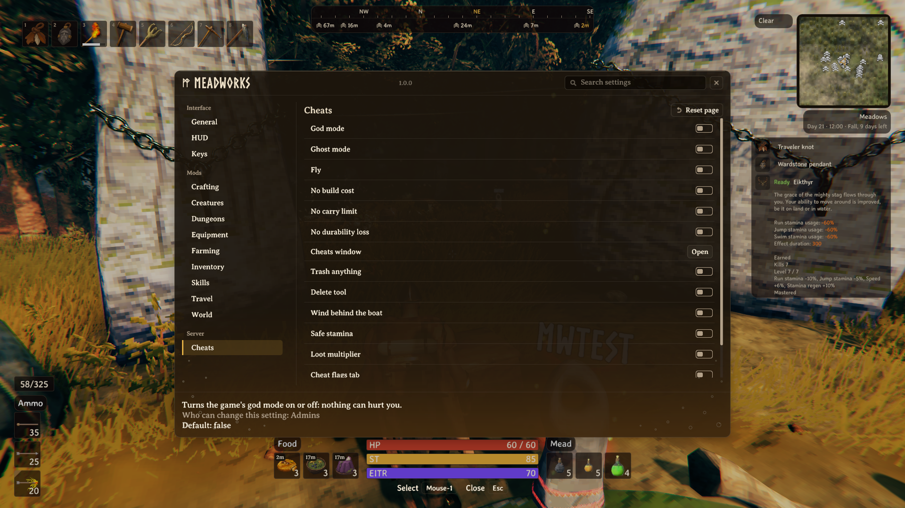
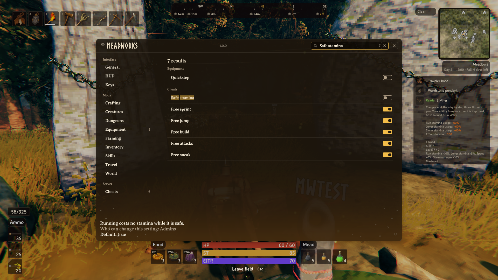
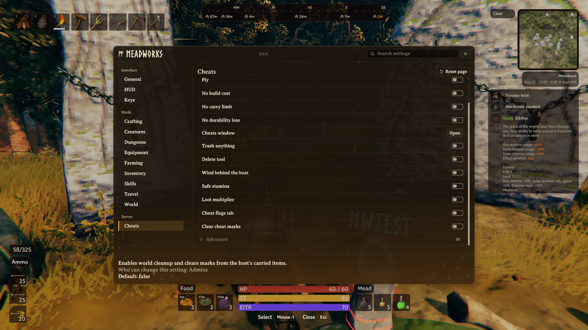

# MeadWorks Cheats

Cheats for solo play and for hosts and admins. Each cheat affects only the player who turns it on. Switch them on and off on the Cheats page of the MeadWorks menu (F8). Needs Meadworks: Core at exactly the same version.

## What it does

### Cheats window

Open the Cheats page and press **Open** beside Cheats window. The window follows the screen size and closes with Escape or its Close button. Only solo players, hosts and admins can open it or use its actions. Losing permission or leaving the character closes it.

- **Items.** Search items by their localized names and select a result with its icon. Enter an amount from 1 to 1000 and choose a quality up to that item's native maximum. Give adds items to your inventory and drops any overflow at your feet; Drop puts the full amount at your feet. Stacks stay within the item's native limit. Boss drops, boss trophies and quest/key items are hidden until Show boss and key items is on. Developer items stay hidden. Spawned drops do not multiply again through Loot multiplier.
- **Player.** Heal restores health, stamina and eitr to their current maximums. Repair restores all carried and worn gear, including gear in dedicated slots and backpack rows, without needing a station or materials. Clear ground items removes the loose dropped items within 30 meters of you and reports how many; graves, items in chests, placed pieces and fish still in the water stay. Return takes you to where you stood before your last accepted **Go here** trip from a Travel map pin. It holds one point for the current session; an accepted Return consumes it. A refused trip leaves the point intact.
- **Creatures.** Search the registered creature prefabs by localized name, select one, choose 0 to 2 native stars and a count from 1 to 10, then Spawn in front of your character. Players and untranslated names stay hidden. With Creatures elite creatures enabled and its difficulty above Off, the star choice extends to 8. Stars use the game's native level; they do not select elite mutations.

Spawned items receive the game's cheat mark. Clear cheat marks removes it when enabled; Report only preserves it. These actions use game APIs directly and require no developer commands.

### Player modes
God mode, Ghost mode, Fly and No build cost are switches at the top of the page. They set the game's own modes, so the game's own commands change the same state.

- **God mode.** Nothing hurts you: attacks, status effects, environmental damage and health costs take no health. Healing, loading saved health and a lower maximum health still work. The mode comes back after you respawn while you may change it, using the current solo or server setting.
- **Ghost mode.** Creatures do not notice you.
- **Fly.** Free flight.
- **No build cost.** Building takes no materials.

These four start at Admins: only a solo player, the host or a server admin can turn them on, and each one affects only the player who turned it on. An admin can switch a row to Everyone in game. Other players cannot change them through the menu while the row is at Admins.

**No carry limit** removes overweight movement penalties while keeping the weight display. **No durability loss** prevents wear on equipped gear, armor, shields, weapons and tools used for building and repairs. It preserves current durability rather than repairing gear. Both default to Off, start at Admins and affect only your own character. Unloading Cheats removes their effects without changing normal carry capacity or shared item definitions.

With Travel installed, an authorized player can choose **Go here** on a map pin card. The trip uses the game's teleport loading and floor checks, starting above the pin, terrain and water. Once the destination loads, its actual solid surface and water level set the landing height. Return restores the stored position and facing. Trips are unavailable during loading, the intro or an existing teleport; the game's cooldown can also refuse a trip. Leaving the world or unloading Cheats forgets the Return point.

### Destroy tools
**Trash anything** lets the inventory's trash slot destroy worn and quest items as well. Worn gear comes off first and the confirmation still opens. A worn pack whose rows hold items the bag has no room for is still refused: empty it first. Needs Meadworks: Inventory.

**Delete tool** arms the delete key (Delete by default). While it is on, the key removes what the crosshair points at within interact reach: dropped items, building pieces, plants and pickables, trees, rocks and creatures. Nothing is dropped, and a chest goes with what it holds. Players, graves, boss altars and boss stones, and the parts of locations and dungeons are kept. The key does nothing while a window, the map, chat or the console is open. A Delete chip shows while the tool is on.

Both switches default to Off and work only for a solo player, the host or a server admin; their permission is fixed to Admins. Other players see the removed objects gone too.

### Free stamina
With Safe stamina on, running, jumping, sneaking, attacking and building cost no stamina while no hostile creature is within the safe radius. Tamed creatures, passive animals such as deer, hares and fish, and creatures that are peaceful until provoked never count. Stamina keeps regenerating for covered actions. Swimming always keeps its native stamina cost and regeneration pause. Blocking, dodging and drawing a bow still cost stamina. Turning Safe stamina on covers every action except carrying too much; each action has its own switch, and Ignored creatures lists creatures that do not count as hostile. Old Free swim config entries are retired.

### More loot
Loot multiplier multiplies what you pick up. Boss drops, boss trophies, caught fish, gems and any item you list under Never multiply are never multiplied. Extras that do not fit in your inventory drop at your feet.

### Wind behind the boat
While you steer a boat, the wind blows from behind it.

### Cheat flags
Active cheats appear as chips centered under the compass, below its pin-distance line. They wrap into centered rows, clear of the weather card and minimap, and hide with the HUD and on the full map. Windows can move the chips down; when there is no clear space, they hide until space returns. Chips rebuild only when the active list, loot amount or theme changes.

The order is Wind (while steering), God, Ghost, Fly, No cost, No carry limit, No durability loss, Delete (while Delete tool is on), Safe stamina, enabled stamina options (Free sprint, Free jump, Free build, Free attacks, Free sneak and Encumbered), Loot xN with the current multiplier, then Dev for the game's developer commands. Stamina options show only while Safe stamina is on. Free build means no stamina cost while safe; No cost means no materials. Cleanup options do not add gameplay chips.

### Clear cheat marks
The game marks items and buildings made with cheats. Clear cheat marks removes the mark from carried items (bag, action bar, equipped gear, dedicated slots, backpack rows and keys) on load, inventory changes and save. This uses the server's setting on connected players too, even with Keep clearing while playing off. Report only counts carried marks without changing them, and Log each clean logs each carried item cleaned.

World cleanup runs when a world loads and keeps going while you play if Keep clearing while playing is on. On a server, world cleanup runs on the server. Clear object marks also clears building pieces, stations and chests. A chest owned by another connected player waits until that owner releases it.

Every few minutes the whole world is gone through again, a few objects at a time so the game does not stall. Options on the same page can only report what carries a mark, report impossible items, remove the game's developer items and any items you list, write a log line for every object cleaned and tell players when marks were cleared.

### Keys
Cheats binds one key: Delete aimed object, the Delete key by default. Change it on the Keys page. It acts only while Delete tool is on, and the game does not use that key in play. Open the Cheats window from the Cheats page; Escape uses Core's normal window closing behavior.

## Settings

Press F8 and open the Cheats page. Every setting row has a hover tip describing its effect. A setting marked Advanced is under the Advanced row of the page. The last column is the permission a setting starts with; the host or an admin can change it in game (see MeadWorks Core), except where it says fixed. A cheat's value is kept in each player's own config and affects only that player. Clear cheat marks and its options are the server's and apply to the whole world.

| Name | Default | Who can change | What it does |
| --- | --- | --- | --- |
| No carry limit | Off | Admins | Removes overweight movement penalties; carried weight still displays. |
| No durability loss | Off | Admins | Equipped and used gear keeps its current durability. |
| Cheats window | Open | Solo, host or admin | Opens Items, Creatures and Player actions for solo players, hosts and admins. |
| Trash anything | Off | Admins (fixed) | The inventory's trash slot also destroys worn and quest items. Works for solo players, hosts and admins. |
| Delete tool | Off | Admins (fixed) | While on, the delete key removes what the crosshair points at. Works for solo players, hosts and admins. |
| Delete aimed object | Delete | Everyone | Deletes the item, building piece, plant or creature under the crosshair, within reach, while Delete tool is on. |
| God mode | Off | Admins | Turns the game's god mode on or off: nothing can hurt you. |
| Ghost mode | Off | Admins | Turns the game's ghost mode on or off: creatures do not notice you. |
| Fly | Off | Admins | Turns the game's free flight on or off. |
| No build cost | Off | Admins | Building takes no materials. |
| Wind behind the boat | Off | Admins | While you steer a boat, the wind always blows from behind it. |
| Cheat flags tab | Off | Admins | Shows active cheat chips under the compass, below its pin-distance line. |
| Loot multiplier | Off | Admins | Multiplies pickups except boss drops, boss trophies, caught fish, gems and items in Never multiply. |
| Multiplier | 2 | Admins | How many times each pickup is multiplied (2 to 10). Advanced. |
| Never multiply | empty | Admins | Items that are never multiplied. Use the game's internal item names with commas between them, such as Wood, Stone. Advanced. |
| Safe stamina | Off | Admins | While no hostile creature is near, running, jumping, sneaking, attacking and building cost no stamina. Swimming keeps its native cost. |
| Safe radius | 25 | Admins | How far away the nearest hostile creature must be, in meters (5 to 60). Advanced. |
| Free sprint | On | Admins | Running costs no stamina while it is safe. Advanced. |
| Free jump | On | Admins | Jumping costs no stamina while it is safe. Advanced. |
| Free build | On | Admins | Building costs no stamina while it is safe. Advanced. |
| Free attacks | On | Admins | Attacks cost no stamina while it is safe. Advanced. |
| Free sneak | On | Admins | Sneaking costs no stamina while it is safe. Advanced. |
| Free while encumbered | Off | Admins | Carrying too much still leaves these actions free while it is safe. Advanced. |
| Ignored creatures | empty | Admins | Creatures that do not count as hostile. Use the game's internal creature names with commas between them, such as Boar, Greyling. Advanced. |
| Clear cheat marks | Off | Admins (fixed) | Clears carried items on load, inventory changes and save, and enables world cleanup. |
| Keep clearing while playing | Off | Admins (fixed) | Clears new world marks while playing; carried-item clearing remains active without it. Advanced. |
| Clear object marks | Off | Admins (fixed) | Also removes the mark from building pieces, stations and chests. Advanced. |
| World round minutes | 10 | Admins (fixed) | How often the whole world is gone through again, in minutes. 0 turns the rounds off (0 to 120). Advanced. |
| Report only | Off | Admins (fixed) | Only counts and reports what carries a mark. Nothing is changed. Advanced. |
| Report impossible items | Off | Admins (fixed) | Reports items that cannot be had in normal play, such as a stack or quality above the item's limit. Advanced. |
| Remove debug items | Off | Admins (fixed) | Removes the game's developer items wherever they are found. Advanced. |
| Extra items to remove | empty | Admins (fixed) | More items to remove along with the developer items. Use the game's internal item names, spelled exactly, with commas between them (64 at most). Advanced. |
| Log each clean | Off | Admins (fixed) | Logs every world object and carried item cleaned. Advanced. |
| Tell players | Off | Admins (fixed) | Tells players in a short notice when marks were cleared. Advanced. |

Cheat values stay with the player who set them; the cleanup settings use the server's values in multiplayer. Solo players, hosts and admins can change every setting. The Cheats window and its actions remain restricted to solo players, hosts and admins.

## Known limits

- God mode protects only your own character, and only while you have it on.
- Safe stamina does not cover swimming, blocking, dodging or drawing a bow.
- Loot multiplier multiplies pickups only. It leaves boss drops, boss trophies, caught fish and gems alone.
- A stored inventory above 256 KiB is not cleaned by the periodic rounds; it is cleaned when the world loads.
- A chest that cannot be changed safely at that moment is left as it is.
- Unloading Cheats leaves the game's own god mode as it was before; the extra protection ends.
- Blocked God mode hits can still show damage numbers and set off effects that react to being hit.

## Compatibility

Needs MeadWorks Core at the same suite version. MeadWorks clients can join servers without MeadWorks and can use other mods on MeadWorks servers. Joining is refused only for a missing, wrong-version or mismatched MeadWorks install on a MeadWorks server. Release builds ship no console commands.

## Install

Install with a mod manager, or put `meadworks.cheats.dll` in `BepInEx/plugins`. Install Core as well. Install on each player who wants it, and on the server for admin settings and permissions.

## License

MIT. Copyright (c) 2026 expDARE.
