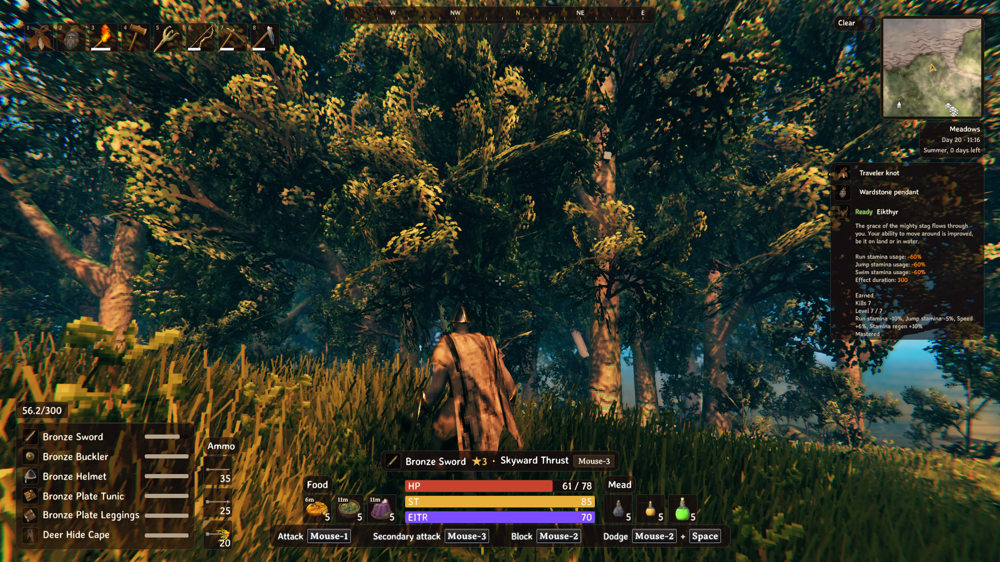
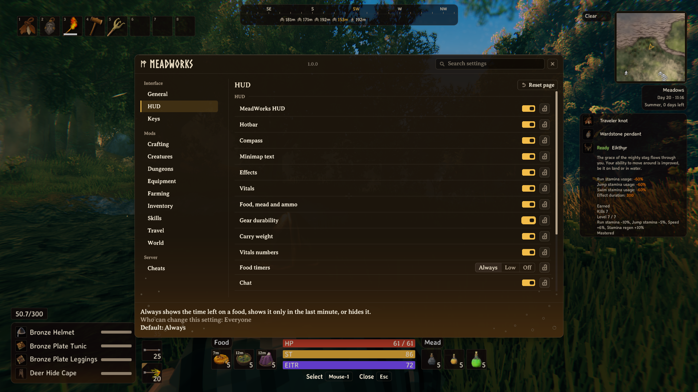
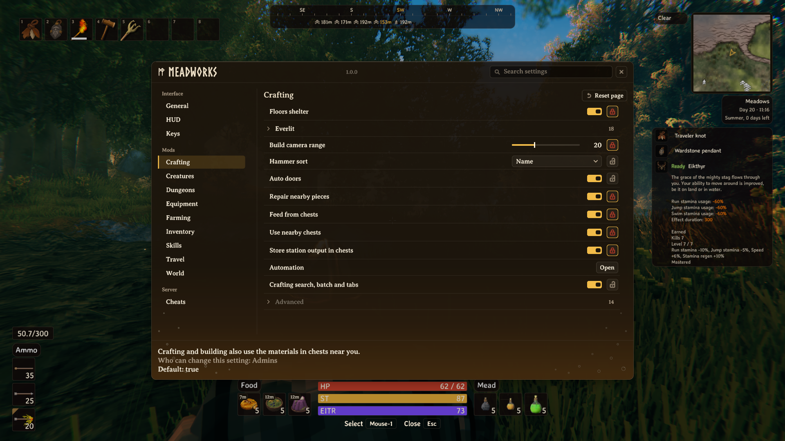

# MeadWorks Core

The shared base of the MeadWorks suite for Valheim: the settings window, the MeadWorks look for the game's windows and HUD, the title screen, server settings and the rules for joining a server. Every other MeadWorks mod needs it.

## What it does

### Settings

Changes you make to settings that are yours to change are saved as your own defaults. When you leave a server, your settings return to those defaults. Values supplied by the server stay in effect only while connected. On a server without MeadWorks, your local settings apply and personal cheats are unavailable. Settings sync is MeadWorks' own; no outside sync code is included. A slider follows the mouse during a drag and saves the new value on release. Left and right change a focused slider one step at a time.

Press F8 to open the settings window. It has a General page, a HUD page, a Keys page and one page for every MeadWorks mod and every other installed BepInEx mod, built from its config: switches, sliders, dropdowns, text fields and key binders. Search covers labels and hover tips on every page, including other mods, and groups matches by page. The search stays until the window closes or you clear it. Hover a setting, or move to it with the keyboard or a gamepad, to see what it does and its default value. Reset page puts every row of that page back to its default, follows the same server permissions as editing, and resets preserve character-owned progress switches. Gamepad focus stays on the selected setting or fold header when a page refreshes; left and right move between controls on one row. While you type in a field, gameplay hotkeys stay out of it. Settings that are advanced sit under an Advanced row of their page, and the pages scroll three rows for every notch of the wheel.

- **Who can change a setting.** In multiplayer every setting has a permission, Everyone or Admins, and the hover tip says which one applies. With Everyone each player keeps their own value unless the hover tip says the server value applies to everyone; some rows still use one world-wide value under either permission. With Admins only admins change it, and the server's value applies to every player and is never written into your own config. Leave the server and your own values are back. Interface settings start at Everyone. Gameplay settings, such as chest sizes, stack sizes, sleep rules and the Dungeons refill and respawn settings, mostly start at Admins. The settings tables of each mod list every setting's starting permission.
- **Choosing permissions in game.** On a hosted world or a server, the host or an admin gets a small lock button at the right edge of each setting row and switches it between Admins and Everyone. A few settings that change the world or other players' items are fixed to Admins and have no button; changing them needs the local host or an authenticated Steam admin. Solo players and the host are never held back by a permission. Choices are saved in `BepInEx/config/meadworks.permissions.txt` on the server. An older `meadworks.locks.txt` is read when the new file does not exist.
- **Admins.** While a world is open to other players, the host and admins see an Admins section at the top of the Server page, with one switch per player, online or offline. The host always stays an admin and nobody can remove their own admin access. Admins on a crossplay connection can see the list but cannot change it.
- **Cheats.** A solo player, the host or an admin can turn cheats on, and each cheat affects only the player who turned it on. Cheat values are kept in that player's own config.
- **Other mods on a server.** In `BepInEx/config/meadworks.foreign-sync.cfg`, set `[Server] Entries` to a comma-separated list such as `example.mod/Gameplay/Difficulty, example.mod/Gameplay/Spawn rate`. Match the plugin GUID, config section and key exactly. The server sends the selected entry names and values to connected clients and applies them to non-admins. Entries that look like credentials or paths are skipped even if listed. The list starts empty. An old `PluginGuids` list no longer shares any entries. Only list values you intend to share with every client. If you edit an unshared setting in the same config while an override is active, that edit saves once the overrides are cleared.
- **No key clashes.** A key already used by a MeadWorks mod, another mod or the game is refused. A key the game's own windows read straight from the keyboard cannot be bound to a MeadWorks action. F8 always opens the menu.

### Title screen and joining
- **Title menu.** The title screen's menu in the MeadWorks look, with up to five of your characters wearing their saved gear around the campfire, most recently played first, each with its name above it (Title campfire character). Click a character or its name to choose it and the camera glides to it. Point at a character and it waves.
- **Character list.** The MeadWorks character list in place of the game's own: a Characters panel with the number of characters, a search box, and one row per character with its name, where the save is kept as the game words it (local or cloud) and when it was last played, newest first. Click a row to choose it and double click it to enter the world. New character, Manage saves and Remove sit under the list. Worlds and servers are chosen in the same flow, on the left. A server password you type at the join prompt is kept.
- **Worlds and servers.** Search saved worlds, create a world with a name and optional seed, inspect its seed and modifiers, and remove a world through the game's confirmation. World modifiers include the game's presets, sliders and switches. Hosting exposes Host server, Crossplay, Community server and password controls. The server browser keeps the game's lists, search, platform filter, refresh, favorites, ordering and address joins. Queued Steam lobby and invite joins continue through character selection. Save-source notices, save errors, duplicate names and online-permission failures remain visible.
- **Character stats and backups.** The selected character shows the game's saved lifetime hours, deaths, boss kills and enemy kills. Hours come from the game's time-in-base and time-out-of-base counters; older saves may have incomplete counters. Before confirming Remove, Core copies the selected character file and verifies it. A failed copy cancels removal. The newest five backups per character and source are kept in `characters_local/MeadWorks-backups/local/<character>/` or `characters_local/MeadWorks-backups/cloud/<character>/` under the game's current save folder. Cloud backups are local copies. The backup guard also applies to the native character picker; Manage saves stays native.
- **Gamepad and keyboard.** Up and down walk the character rows and then the buttons under them, left and right walk the buttons, and Enter or the gamepad's A button on a row starts the world.
- **Mods in the title menu.** Mods opens the MeadWorks settings window before you enter a world.
- **Changelog.** The game's Changelog button opens one window with a MeadWorks tab and a Valheim tab. The MeadWorks tab shows 1.0.0 and later, with up to five bullets per mod and version. The mark beside the button lights up after an update until you open the notes.
- **Joining.** To join a MeadWorks server you need the same MeadWorks version as the server. A player with MeadWorks can always join a server without it. A player with MeadWorks plus other mods can join a MeadWorks server. Only a missing, wrong-version or mismatched MeadWorks install is refused on a MeadWorks server. On a server without MeadWorks, server settings, permissions and content stay off. Your local settings apply and personal cheats are unavailable.

### Look of the game's windows
- **Restyle game windows.** Crafting, inventory, container, trader, split stack, quit confirmation and text prompt windows, the game's own build menu (hammer, hoe, cultivator and the other build tools: smoked oak window, kit tabs, category rows and piece cells, with the game's own icons and bindings), the connection messages (disconnected, kicked, banned, server full) and the title screen's panels, take the MeadWorks look: smoked oak, a few faint bubbles in the lower corners of a window, the MW rune before each window title and a line of light along the top. Corners are 12 px for windows and panels, 8 px for tooltip cards and 6 px for controls and slots. The split-stack dialog opens over the inventory and keeps the native slider, buttons and bindings. The split and quit dialogs use the kit's text styles. Off restores the game's styling. Colors, strength and corner radii are in `BepInEx/config/meadworks.theme.json`, read when the game starts (`honey`, `foam`, `honeyStrength`, `radiusWindow`, `radiusTip`, `radius`, `radiusSmall`).

  The hammer menu shows piece details in a strip under the categories and piece grid, and the grid uses the full width of the window. Costs include eligible chest materials when Crafting's chest source is on. The per-character Can build switch dims pieces you cannot build with the available materials and stations.
- **Quality stars.** An item cell shows a gold star with a dark edge and the item's quality level (★1, ★2 and up, past ★4 for gear from the Forge of Potential) in its top-right corner, the same on the action bar, in the bag, chests, equipment and crafting windows. An item that cannot be upgraded shows none.
- **Worn items.** A bronze triangle marks the top-left corner of worn item slots in the bag, equipment panel, dedicated slots and hotbar, leaving the rarity color visible.
- **Mod name in tooltips.** An item tooltip ends with the name of the mod that added the item.
- **Pause screen.** The pause menu gets a MeadWorks button under Settings. Cards beside it list the players with distance, host and ping, and show the world's name, day and clock, how long ago it was saved, the MeadWorks version and the number of mods.
- **Text prompt and traders.** The text prompt for signs, portals, pet names and chest labels shows a character counter, and trader prices say what the coins cover. Hovering an item in the trader's list shows its item card.
- **Control names.** An icon-only control shows its name above it after half a second of hovering, or of gamepad focus on it. The name leaves the screen edges clear and never takes the click.
- **Death card.** While you wait to respawn, a card shows what the death cost, where your grave is, what you kept and where you wake.
- **MeadWorks cursor.** A pointer in the MeadWorks style, drawn at the size you set.
- **Loading screen.** Artwork from the installed game, with the world's or server's name, its day, the loading step and the game's tips standing on it. No loading pictures are included in the mod. If the artwork is unavailable, the game's own loading screen stays visible.

### HUD
The MeadWorks HUD replaces the game's health, stamina, eitr and adrenaline panels with one framed set, and each part has its own switch on the HUD page: vitals with the weapon in hand, its quality and its secondary attack above them, food, mead and ammo beside them, the hotbar, the active effects under the minimap text (Icon, Time, Effect Name), the compass along the top, and the text lines under the minimap. The HUD follows the game's native GUI scale in Accessibility. At larger GUI scales the compass drops below the hotbar and the map-side block stacks below the minimap, with captions and effects following it. The minimap is hidden while the inventory is open. The large map clears the HUD panels around it, including status effects and guardian power, until it closes. HUD captions use Averia Sans Libre, the font of the game's key hints, in regular weight. The resting icon shows the comfort level. The adrenaline bar flashes gold when the game applies a new adrenaline effect. Mead cooldowns and durations appear on their slot cells beside the remaining stack counts. Boss powers include their supplied description or power totals on a second line. Thin translucent panels back the compass, effects, weapon text, slot captions and native key hints.

- **Equipped gear.** What you have equipped at the bottom left, with a wear bar for each piece, while the MeadWorks HUD is on: weapon, off hand, helmet, chest and legs while worn, and a cape or utility item when it can wear out. The bar turns red when the piece is nearly worn.
- **Carry weight.** Current/maximum weight in a chip above the bottom-left gear panel. It highlights at 85% of the limit and turns red over it. Inventory changes update the weight; changes to the effective carry limit update the maximum.
- **Pickups and skill gains.** Short rows at the top left in place of the game's own messages. Unlocks use the same rows. Each pickup row shows one number at its right edge: the amount gained. A row for an item you just picked up shows a New tag, and several new build pieces in the same moment become one row.
- **Build card.** The selected piece's card sits just above the bars. It shows the piece's icon, name and description, then the requirement tiles: each item's icon, name and how many you have, counting nearby chests where Crafting uses them. A mode without materials, such as Repair, shows its name.
- **Chat.** The chat in the MeadWorks look. While chat is open, Page Up and Page Down move a page through the game's history, and the mouse wheel over chat moves three lines. Unfocused chat lets clicks pass through to the world. Native input and command history keep their bindings.
- **F5 console.** The console uses the MeadWorks HUD look in the main menu and in a world, with the game's controls and command suggestions. Switching off MeadWorks HUD restores the native console.
- **Key hints.** A bar of key hints at the bottom of the screen for what you can do right now.
- **Feedback.** Screen edge warnings pulses the edges of the screen while your health is low, and flashes them when you have too little eitr for what you tried.
- **Compass pins.** Nearby placed, location and player pins appear with their distances. A pin tracked in Travel stays on the compass at any distance and takes priority over ordinary nearby pins. Other players' shouts and pings appear for the game's chat-marker lifetime, at any distance. Pin names and a range for ordinary map pins are settings. Your last grave shows at any distance while its death pin remains; the linked pin clears when the game despawns or destroys that stone. Older graves and other players' graves are left alone. Death pins from before linking was added, and pins at an ambiguous position, can be removed manually on the map.

### Compendium
The Compendium is a tab beside the inventory and crafting tabs. It lists what you have discovered, on pages for Recipes, Pieces, Conversions and Items, with a header that shows how many of the entries you have seen, a search box that searches every page at once, and a chip for each page with its count.

- **Discovery.** A page lists only what your character knows. A recipe or piece appears when you learn it, a conversion when you know its station, input and output, and an item when you know its material or hold its trophy.
- **Favorites.** The star button on each row and card marks an entry, and the Marked chip shows only those. Favorites are saved with the character, up to 500.
- **New marks.** Entries you have not looked at yet carry a New mark, counted on the Compendium tab. Clicking an entry clears its mark, and Mark all seen clears them all. A character opened for the first time starts with nothing marked new.
- **Cards.** A card shows where an item or piece comes from, including the tool and station needed to build a piece, the parts it needs with what you carry, what it makes, the output item’s stats and where it is used. Food lists health, stamina, eitr and duration where applicable. An item's card lists every route that gives it. Recipe cards show ordinary crafting materials.
- **Conversions.** Smelters, cooking stations, fermenters, beehive honey, and planted seeds and saplings growing into pickables. Fuel-only routes such as the Frigid Kiln list the fuel as an ingredient. Source and stat durations use the same units, for example 45 s, 1 min 30 s and 4 h.
- **Pages from other mods.** Creatures adds a Creatures page (F7 opens it), and Equipment adds Presets and Spellbook pages. Presets gives more room to the detail pane.

### Chest access
- **Asking for a chest.** A chest belongs to one player's game at a time. When Restock, To chests, planting from a seed chest or a repair needs a chest that another player's game owns, MeadWorks asks that player for it and waits for the answer, so a chest is never left locked to someone else. A chest a player has open is not handed over. A refusal says why in a short message: in use, busy loading, busy taking items, ownership changed, chest data changed, unavailable, or not yours or access denied.
- **Stale open marks.** A chest left marked as open by a player who has left or crashed is not treated as open, and its owner clears the mark.

### Saves
- Items MeadWorks could not hand you right away are kept with your character for that world and given to you later, also after you leave and come back.
- With Equipment, solo players and hosts can hang MeadWorks items that have a vanilla fallback when stand saving is available. Guests and dedicated-server clients are refused on both stand types.
- **Shorter save pauses.** Map data is saved by copying the explored grids in bulk, and the bytes are checked against the game's own. If they differ, for example after a game update, the bulk copy is switched off for the rest of the session.

## Settings

Press F8 and open the General or HUD page. Every setting row has a hover tip describing its effect and who can change it. Every setting here starts at Everyone, so each player keeps their own value; an admin can switch a row to Admins on a server (see Who can change a setting). A setting marked Advanced is under the Advanced row of its page.

| Name | Default | Who can change | What it does |
| --- | --- | --- | --- |
| Restyle game windows | On | Everyone | Gives the game's own windows, including the build menu, the MeadWorks look. Off puts the game's look back exactly. |
| MeadWorks cursor | On | Everyone | Uses the MeadWorks pointer in place of the game's. |
| Cursor size | 32 | Everyone | How large the pointer is drawn, in pixels (16 to 96). Advanced. |
| Title menu | On | Everyone | Draws the title screen's menu in the MeadWorks look. Advanced. |
| Title campfire character | On | Everyone | Shows your recent characters around the campfire on the title screen. Advanced. |
| Character selection | On | Everyone | Shows the MeadWorks character list on the title screen in place of the game's own. Advanced. |
| Loading screen | On | Everyone | Shows the world's name, the loading step and the game's tips over a full picture while a world loads. Off leaves the game's own loading screen. Advanced. |
| Loading pictures | On | Everyone | Chooses from installed artwork and images in the loading folder each time a world loads. Off shows the game's own loading picture. Advanced. |
| Last changelog version | empty | Everyone | The last version whose release notes you opened. After an update the mark beside the Changelog button is lit until you open them. Advanced. |
| Death card | On | Everyone | Shows a card while you wait to respawn: what the death cost, where your grave is, what you kept and where you wake. Advanced. |
| MeadWorks HUD | On | Everyone | Replaces the game's health, stamina, eitr and adrenaline panels with one framed panel. Off puts the game's own back. |
| Hotbar | On | Everyone | Draws the hotbar in the MeadWorks look. |
| Compass | On | Everyone | Shows nearby map pins, temporary shouts and pings, and the last unrecovered grave with their distances. |
| Minimap text | On | Everyone | Shows the lines of text under the minimap. |
| Effects | On | Everyone | Draws your active effects in the MeadWorks look. |
| Vitals | On | Everyone | Shows the framed health, stamina, eitr and adrenaline bars. |
| Food, mead and ammo | On | Everyone | Shows your food, mead and ammo beside the health bars. |
| Gear durability | On | Everyone | Shows the durability of your equipped gear at the bottom left. |
| Carry weight | On | Everyone | Shows your carry weight and limit above the gear panel, or at the bottom left when gear is hidden. |
| Vitals numbers | On | Everyone | Shows the numbers on the health, stamina, eitr and adrenaline bars. |
| Food timers | Always | Everyone | Shows time left in the slot's upper-left badge. Choose Always, Low (last minute), or Off. |
| Pickups and skill gains | On | Everyone | Shows pickups and skill gains as short rows at the top left in place of the game's own messages. |
| Chat | On | Everyone | Draws the chat in the MeadWorks look. Off leaves the game's own chat. |
| Key hints | On | Everyone | Shows a bar of key hints at the bottom of the screen for what you can do right now. |
| Screen edge warnings | On | Everyone | Pulses the edges of the screen while your health is low, and flashes them when you have too little eitr for what you tried. |
| Pin names | Off | Everyone | Writes the name of each pin under the compass. |
| Pin range | 200 | Everyone | How near an ordinary pin must be to show on the compass, in meters (25 to 2000). Tracked pins, shouts, pings and the last grave have unlimited range. |

Keys on the Keys page:

| Name | Default | Who can change | What it does |
| --- | --- | --- | --- |
| MeadWorks settings | F8 | Everyone | Opens or closes the settings window. |
| Search in the open panel | None | Everyone | Puts the cursor in the search box of the open window. |

### Loading folder

Add PNG or JPEG pictures to `BepInEx/config/MeadWorks/loading/`, and optional UTF-8 tips to `tips.txt` in that folder, one tip per line. Blank lines and lines starting with `#` are ignored. Tips join the game's normal tip list and use its normal controls. Folder contents are read at loading events, with no file watcher. A missing or empty folder keeps the existing behavior; installed loading artwork and any existing artwork notice files are left intact.

Up to 64 image files are considered. Images larger than 16 MiB, 8192 pixels on either side or 32 megapixels are skipped before decoding, and broken images fall back to installed artwork. The tips file can be up to 64 KiB, with up to 256 distinct tips of 512 characters each.

### Translations

Core loads a JSON object of text keys and translations from `config/MeadWorks/lang/<game language>.json` in BepInEx at startup and when you change the game language. Missing keys use English. Core writes `English.json` as the key list.

## Compatibility

Use the same suite version and matching MeadWorks modules on a MeadWorks server. Other installed mods do not prevent joining. MeadWorks clients can join servers without MeadWorks; only a missing, wrong-version or mismatched MeadWorks install on a MeadWorks server is refused.

With EquipmentAndQuickSlots, Extra Slots or AzuExtendedPlayerInventory installed, Core saves items in the slot mod's own cells. Items from old MeadWorks backpack rows return to the bag when there is room. Picked-up gear that lands in a slot claimed by a worn item moves to the bag when space is available. See the limits below before changing your mod list.

## Known limits

- If you remove MeadWorks while keeping Extra Slots, Extra Slots can add a copy of an oversized slot stack from its backup.
- Loading without Extra Slots or EquipmentAndQuickSlots can drop slotted items on the ground. When you reinstall the slot mod, it can restore copies from its own backup. This can also happen on characters that have never used MeadWorks.
- A server without MeadWorks cannot send settings, permissions or content. Your local settings apply and personal cheats are unavailable.
- On a server without MeadWorks, chests, carts and ship holds take no item only MeadWorks adds and no stack above the game's own size, and you cannot drop or throw such an item. Players without MeadWorks would erase the item or the extra units. Split a larger stack before you store it.
- When you die on a server without MeadWorks, items only MeadWorks adds stay on your character.
- A MeadWorks server needs exactly the same MeadWorks version from every player.
- Items in dedicated slots, backpack rows, the coin purse and bag stacks above the game's normal sizes are saved in the character's own item list, below the game's bag rows and split to the game's normal stack size. With MeadWorks they go back to their slots, rows and purse when the character loads. Without MeadWorks they drop at your feet the first time the character loads, and you decide what to keep. An item only MeadWorks adds, such as a backpack, cannot exist in a game without it: it stays in the character file and returns when MeadWorks is installed again. A quest item the game will not drop is saved in a free bag cell instead; with a full bag it stays in the character file until MeadWorks is installed again.
- Chests and graves are saved in the game's own format: stacks are split to the game's normal size and wide chests use extra rows, so a game without MeadWorks loads them with nothing cut. Items that format cannot hold, such as items only MeadWorks adds, are kept with the world and come back into the chest, or into a wooden chest at its spot, when MeadWorks is installed again. Save the world with MeadWorks before removing it, and let shared-chest moves finish first.
- Release builds ship no console commands.

## Install

Install with a mod manager, or put `meadworks.core.dll` in `BepInEx/plugins`. On a server that runs MeadWorks, every player needs it, at exactly the same version as the server. Install on the server and every player.

## License

MIT. Copyright (c) 2026 expDARE.
