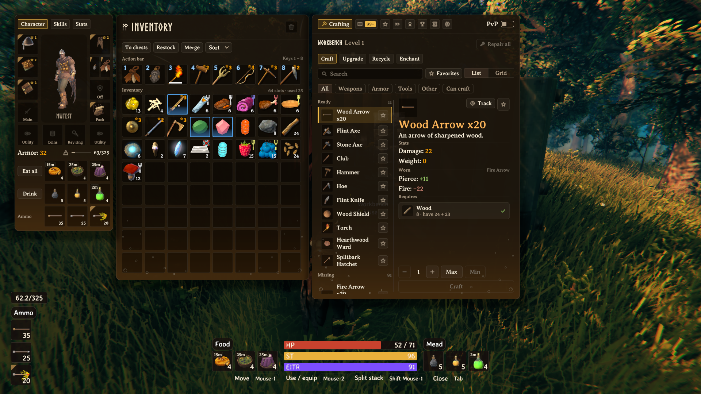
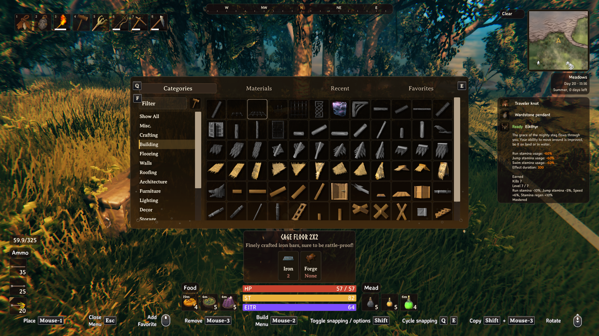
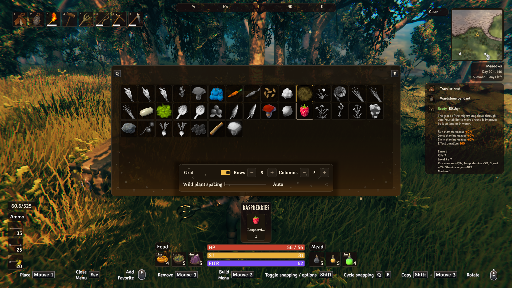
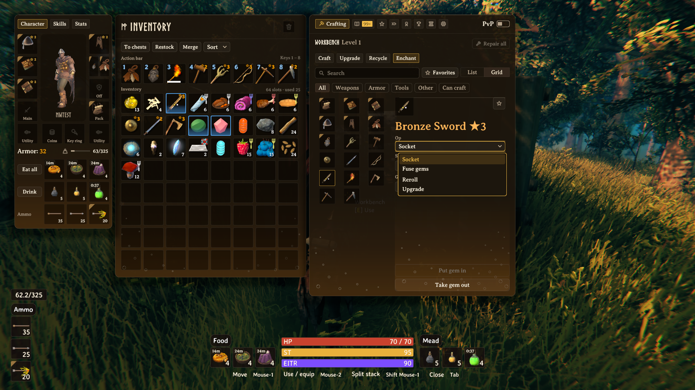
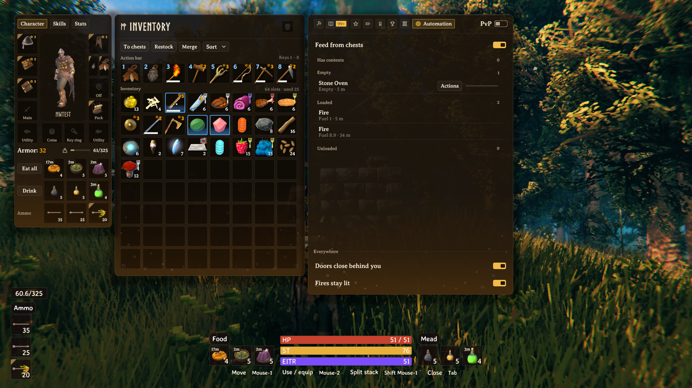
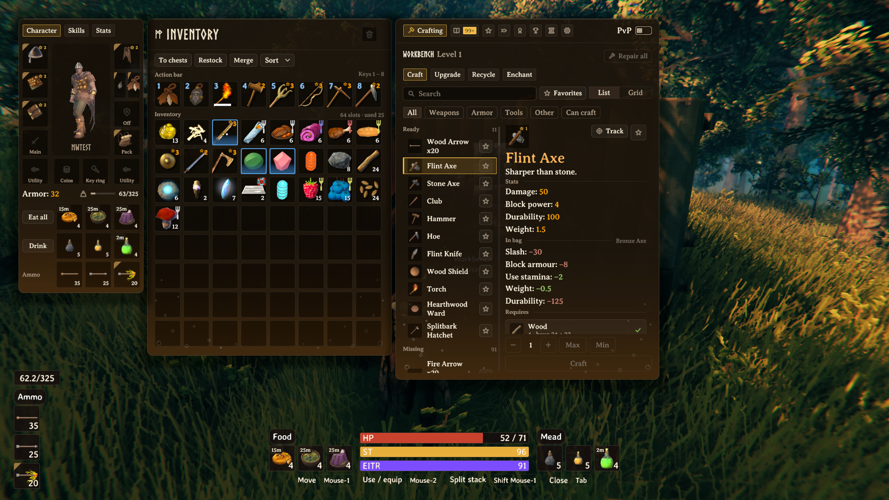
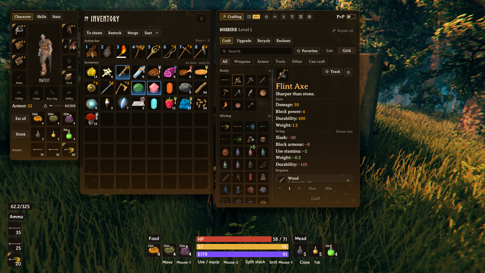
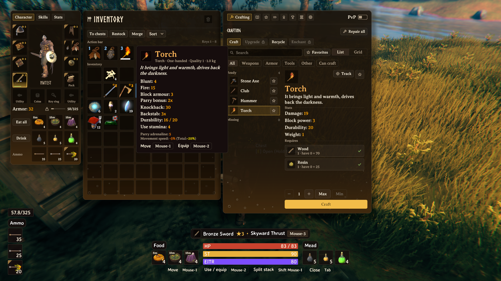

# MeadWorks Crafting

A crafting window, stations that work from nearby chests, and building conveniences. Switch each part on or off on the Crafting page of the MeadWorks menu (F8). Needs Meadworks: Core at exactly the same version.

## What it does

### Crafting
The crafting window opens from your inventory or at a station as the first tab of the window's tab row, with the tabs Craft, Upgrade, Recycle and Enchant. It opens on Craft every time. Stations that make only food or mead (the cauldron, the food preparation table, the mead ketill) show only the Craft tab. Turn it off with Crafting search, batch and tabs to get the game's window back.

- Search by recipe name or a localized ingredient name, with favorites, category filters, and Ready and Missing groups, in a list or a grid.
- Recipe rows show ingredients on one line and shorten longer lists with an ellipsis. The recipe name on hover appears beside the list.
- The detail shows the stats that apply to the output, including food health, stamina, eitr, duration and regen when present.
- Click an ingredient to see the recipes that use it, then select a recipe from that list.
- Use Track on a recipe to pin it under Tracked on the HUD. Your character keeps up to three pins, showing missing materials based on your bag and nearby chests. Recipe pins hide while enemies are targeting you.
- Craft and Upgrade retain recipe selection and scroll position when switching tabs. Gamepad navigation follows list rows and grid columns, including partial rows.
- A recipe shows its stats, the upgrade baselines, and each requirement with what you carry and what the chests near you hold, as one line.
- Hovering a recipe row, a grid tile, the detail icon or an item picked on the Upgrade, Recycle or Enchant tab shows the item card. With Equipment installed and its Compare tooltip on, the card and the recipe detail also show how the item it makes (at the quality it would have, shown with its quality star) differs from the item you wear in that slot, or the best item of its kind in your bag: green where the new item is better, red where it is worse.
- Set a quantity or press Max, press Craft to start, then press the same button, now labeled Queue, to queue more batches while crafting. Cancel clears the drawer immediately. A batch waiting for chest materials keeps its quantity and blocks the next batch until delivery settles. Canceling or closing the inventory stops a pending batch from resuming; materials already requested from shared chests still arrive in your inventory once.
- A PvP switch, the station level and Repair all sit at the top. Gamepad navigation follows the active crafting tab and returns to the item grid when the inventory opens.
- Crafting, building, upgrading and enchanting also use the materials in chests near you, within the chest range, and the chest you have open. A chest whose Used for crafting switch is off (set with Inventory) is left out. A chest another player's game owns is asked for and held only while a craft runs, you stay within reach of the station, and the chest is within range and holds something the craft needs. With Shared chests on (the default), a chest another player has open still supplies crafting: the server holds the chest and applies each take. On a server with Shared chests off, a chest another player has open is left out until they close it, so the counts show only what a craft can take; if a chest is opened just as you craft or build, nothing is taken and a message names the chest as in use. An idle chest that another player's game still holds is asked for first: a craft, Reroll, rarity Upgrade, Cut socket or Fuse gems waits up to three seconds after asking for it and then runs by itself, but only if you changed nothing in between (same recipe, item, amount, tab and station, window still open); a build names the chest instead and the next press places the piece where you then aim. While a craft is being paid from an idle chest, and for a second or two after, another player who tries to open that chest gets the game's "Someone else is using it"; the next press opens it with the cost already gone. Quality upgrades use the station's own upgrade craft. Reroll, rarity Upgrade and Fuse gems pull the same way before Equipment spends what is in the bag.
- Repair at crafting stations repairs everything you carry that the station can repair when you use it.
- Without a station, Repair all repairs damaged gear whose recipe needs no crafting station. Each repair costs one of every material used in its level-1 recipe. It uses your inventory first, then chests marked Used for crafting within Chest range. Hover over the button for each item's cost, the counts in your inventory and nearby chests, and any missing materials. The button names a missing material when nothing can be paid for. Repair all skips items you cannot afford, and if a chest refuses to pay for one repair, only that repair is skipped. Station-required gear keeps its usual repair rules.
- Station reach multiplies how far you can stand from a crafting station and still use it. It changes crafting stations only, not doors or chests.

### Recycle and Enchant
- **Recycle.** Quality 2 or higher items lose one quality level and return a share of that level's upgrade materials, keeping their augments, custom data and crafter. Quality 1 items are consumed, whatever rarity, bonuses or other data they carry, and any gems in their sockets go back to your bag with their rarity (the recycle is refused with Full when the bag cannot take the materials and the gems). Durability does not affect returns. Equipped and hotbar items appear in the list; equipped items require confirmation and are unequipped before recycling. While you work at any crafting station, an item recycles when a station of its recipe's kind and level stands in reach, so forge gear can be recycled at a workbench with a forge beside it; otherwise the line under the returns names the station it needs. Items whose recipes need no crafting station can also be recycled from your inventory. Recycle return share sets the percentage of materials returned.
- **Enchant tab.** Socket puts a gem in or returns it intact. Cut socket, within Socket, adds one socket to eligible rarity gear with none. Fuse gems combines three matching gems into the next rarity with 100% success; Reroll replaces one bonus; Upgrade raises rarity within the world boss cap. Costs and odds appear before confirmation. Reroll, Upgrade and Fuse gems take their materials from the same nearby chests as crafting, at the chest range. Runes and Rune Dust are retired. Needs Equipment and a usable station.

Both tabs use the same two-column layout as the recipes: the items on one side, the item and its action on the other.

### Build
- **Build costs.** Chests in reach count toward what a piece costs, as for crafting, and the game's build panel stops flashing a cost red when the chests cover what your bag lacks. The hammer and cultivator keep the game's own build menu, layout and behavior; its look follows Restyle game windows (Core), and the cost amounts in the build panel show a shortfall in the theme's warning color.
- **Hammer sort.** Orders the hammer's pieces by the game's own order, by name, by material or by crafting station.
- **Show piece stability.** With the hammer out, pointing at a building piece shows how well supported it is, in percent.
- **Repair nearby pieces.** With the hammer's Repair tool, alt-use (Shift + Interact with the default keys) repairs every damaged piece within the repair radius (10 m by default) and shows one count. A plain click still repairs one piece. The game still receives the Use press. Ward access and station rules match hammer repair. Stamina and hammer wear apply; no materials are used.
- **Floors.** A floor overhead (within 10 m) counts as a roof: the room under it is sheltered from rain, building pieces under it take no rain wear, and it counts as cover for resting, getting wet and fires. Fires, smelters, kilns, furnaces and refineries can be placed on floors, and floors do not wear down in the rain.
- **Auto doors.** Player-built doors open as you walk up and close once you have left. Range is measured from the doorway center. Matching wood doors, wood gates, darkwood gates, Dvergr doors, ashwood doors, iron gates and flametal gates with opposite outer hinges act as a double door when each has only the other as a matching neighbor: both open away from you and wait to close until you have left both and both doorways are clear. Closing either leaf by hand releases both until you walk away. A door you open by hand is left alone.

### Station inputs and chest feeding
Open Automation from the Automation button on the Crafting page, or from its tab in the crafting window. It lists the stations near you with contents, progress and Actions.

- At a smelter, kiln, furnace, refinery, windmill or spinning wheel input, hold the game's alternate-use binding and press Use to fill that input from your bag. Aim at the fuel input to fill it with fuel. Plain Use adds one.
- These stations' input and fuel capacity scale with Inventory's **Stack multiplier**, using the server's value in multiplayer. Without Inventory, the native limits apply. A station owned by an unrecognized or plain-game peer uses native limits. An explicit Everlit fuel capacity applies while a supported station is covered.
- Smelters, kilns and furnaces take ore and fuel from chests near them: up to five fuel and five ore every three seconds.
- Cooking stations, ovens and fermenters are filled from chests, and emptied into chests when they are done while Store station output in chests is on.
- What a smelter, kiln, furnace, refinery, windmill, spinning wheel, beehive or sap collector makes goes into a nearby chest, but only when one chest takes the whole batch. Otherwise the station does what the game does, so a batch is never split between a chest and the ground.
- Feed from chests is the main switch for feeding, cooking and storing.
- Stations are grouped by observed contents or whether they are loaded. Contents do not mean a station is producing: it may lack fuel, shelter or another requirement. Loaded production stations show their recorded timer against the recipe duration, rather than a promised completion time. Unloaded rows show distance and a fuel snapshot where applicable, and are read-only. The window searches the station range from you (40 m by default), and the list holds the nearest 40 stations and 20 fires. Fires and torches are listed only while loaded, and a station inside a ward that shuts you out is not listed.
- Feed and Everlit are global settings that start at Admins. Station Actions retain owner, ward and reach checks.
- Ingredients from a craft or build that could not be finished are kept for you and handed back, also after you leave and come back.

| Station | Takes from chests | Puts output in a chest | Everlit |
| --- | --- | --- | --- |
| Smelter, kiln, furnace | Ore and fuel | Yes | Smelters only, when switched on. Kilns never |
| Blast furnace | | | Only when switched on |
| Refinery, windmill, spinning wheel, beehive, sap collector | | Yes | Eitr refineries |
| Cooking station, fermenter | What they cook or ferment | Finished food and drink | |
| Torch, fire, hot tub, oven, frost foundry | | | Yes |
| Shield generator | | | Only when switched on |

Station range also sets how far station upgrades can connect to their matching crafting station, preserving any longer native range.

### Everlit
Everlit keeps torches, fires, hot tubs, ovens, eitr refineries and frost foundries lit without fuel. Smelters, blast furnaces and shield generators are covered only if you switch them on. A covered piece needs no fuel and burns none: it runs with an empty store, and Everlit never fills or changes what is stored, so destroying the piece returns exactly what players put in. Turning a switch off brings the game's own fuel use back with the stored amount unchanged. A charcoal kiln and a frigid kiln are never covered, because their wood and ice are what they work on.

Everlit scope picks all kinds, only torches or only fires. Everlit leaves alone lists pieces to skip. Everlit inside wards only covers only what stands inside a ward. Smoke chokes Everlit fires lets a covered fire go out when its smoke cannot escape. The fuel capacity of each kind only sets how much can be added by hand; Native keeps the game's amount.

### Keys
| Key | What it does |
| --- | --- |
| Ctrl+B | Toggles a free-flying camera while the hammer, hoe or cultivator is out. The movement keys fly the camera, the character stands still, and the camera stops at the Build camera range. |
| Alt-use (default Shift + Interact) | With the hammer's Repair tool, repairs every damaged piece in range. |

## Settings

Press F8 and open the Crafting page. Every setting row has a hover tip describing its effect. A setting marked Advanced is under the Advanced row of the page. The last column is the permission a setting starts with; the host or an admin can change it in game (see MeadWorks Core). Admins settings take the server's value for every player. Solo players, hosts and admins can edit every setting.

| Name | Default | Who can change | What it does |
| --- | --- | --- | --- |
| Crafting search, batch and tabs | On | Everyone | Adds search, batch amounts, chest counts and the Recycle and Enchant tabs to the crafting window. |
| Station reach | 2.5 | Admins | Multiplies how far you can stand from a crafting station and still use it. 1 is the game's own reach (1 to 10). Advanced. |
| Recycle return share % | 50 | Admins | The share of an item's materials that recycling gives back, in percent (0 to 100). Advanced. |
| Craft speed | 1 | Admins | Multiplies crafting and upgrade speed, with 1 keeping the current speed (0.1 to 10). Advanced. |
| Rested delay | Native (0) | Admins | Seconds of rest before Rested is granted; 0 preserves the native delay (0 to 60). Advanced. |
| Hammer sort | Vanilla | Everyone | The order of the pieces in the hammer's menu: the game's own, by name, by material or by crafting station. |
| Build camera key | Ctrl+B | Everyone | Toggles a free-flying camera while the hammer, hoe or cultivator is out. |
| Build camera range | 30 | Admins | How far the camera can fly from the player, in meters (5 to 50). It stops at the edge. |
| Repair nearby pieces | On | Admins | Alt-use with the hammer's Repair tool repairs every piece in range, not only the one you point at. |
| Repair radius | 10 | Admins | How far that repair reaches, in meters (1 to 50). Advanced. |
| Floors shelter | On | Admins | A floor above counts as a roof for beds, fires, stations and fermenters. Fires and smelters can stand on floors, and floors take no rain wear. |
| Auto doors | On | Everyone | Doors open as you walk up to them and close once you have left. |
| Auto door range | 1.5 | Everyone | How near you must be for a door to open, in meters (0.5 to 8). Advanced. |
| Use nearby chests | On | Admins | Crafting, upgrading and enchanting also use the materials in chests near you. |
| Chest range | 30 | Admins | How far from you a chest can be and still be used, in meters (5 to 64). Advanced. Shown only without Inventory, which has the same setting for both modules. |
| Feed from chests | On | Admins | Feeds smelters, furnaces, kilns, cooking stations, ovens and fermenters from chests, including fuel added to torches, hearths and campfires. Gates output storage too.|
| Smelter chest range | 10 | Admins | How far a smelter reaches for a chest, in meters (2 to 30). Advanced. |
| Store station output in chests | On | Admins | Everything a station makes goes into a chest near it, cooked food and drink included. Otherwise finished food and drink stay on the station. Feed from chests must be on. |
| Automation (Open button) |  | Everyone | Opens the automation window, which lists the stations near you with contents, progress and Actions. |
| Station range | 40 | Admins | Automation search distance and augment connection range to matching stations, in meters (10 to 100). Longer native augment ranges are preserved. Advanced. |
| Leave each item in chests | 0 | Admins | Leaves this many of each item in each direct chest when feeding stations or tames (0 to 100); shared remote chests are excluded while a reserve is set. Advanced. |
| Kitchen rate | 1 | Admins | Multiplies cooking, fermentation and sap collection speed together with seasonal rates (0.1 to 10). Advanced. |
| Food never burns | Off | Admins | Keeps cooked food from turning into coal while leaving already burned food unchanged. Advanced. |
| Tames eat from chests | Off | Admins | Hungry tames eat accepted food from accessible direct chests within their eating range. Advanced. |
| Honey rate | 1 | Admins | Multiplies honey production speed together with the season, with 1 keeping the current rate (0.1 to 10). Advanced. |
| Everlit | Off | Admins | Covered stations stay lit without fuel and burn none of the fuel that is in them. |
| Everlit scope | All | Admins | What Everlit keeps lit: torches, fires, hot tubs, ovens, refineries and frost foundries, or only torches, or only fires. Advanced. |
| Everlit leaves alone | empty | Admins | Torches and fires Everlit never keeps lit. Use the game's internal piece names with commas between them. Advanced. |
| Everlit inside wards only | Off | Admins | Everlit keeps only what stands inside a ward. Advanced. |
| Smoke chokes Everlit fires | On | Admins | A fire kept lit by Everlit still goes out when its smoke cannot escape. Advanced. |
| Everlit diagnostics | Off | Everyone | Writes what Everlit does with each torch and fire to the log. Advanced. |
| Night-only torches | Off | Admins | Keeps player-placed torches from burning during the day. Advanced. |
| Everlit smelters | Off | Admins | Everlit keeps this kind running without fuel. Advanced. |
| Everlit blast furnaces | Off | Admins | Everlit keeps this kind running without fuel. Advanced. |
| Everlit shield generators | Off | Admins | Everlit keeps this kind running without fuel. Advanced. |
| Torch fuel capacity | Native (0) | Admins | Fuel capacity, 0 to 1000; 0 preserves the native amount. Advanced. |
| Fire fuel capacity | Native (0) | Admins | Fuel capacity, 0 to 1000; 0 preserves the native amount. Advanced. |
| Hot tub fuel capacity | Native (0) | Admins | Fuel capacity, 0 to 1000; 0 preserves the native amount. Advanced. |
| Oven fuel capacity | Native (0) | Admins | Fuel capacity, 0 to 1000; 0 preserves the native amount. Advanced. |
| Refinery fuel capacity | Native (0) | Admins | Fuel capacity while covered, 0 to 1000. Native uses the game's capacity times Stack multiplier. Advanced. |
| Smelter fuel capacity | Native (0) | Admins | Fuel capacity while covered, 0 to 1000. Native uses the game's capacity times Stack multiplier. Advanced. |
| Blast furnace fuel capacity | Native (0) | Admins | Fuel capacity while covered, 0 to 1000. Native uses the game's capacity times Stack multiplier. Advanced. |
| Shield fuel capacity | Native (0) | Admins | Fuel capacity, 0 to 1000; 0 preserves the native amount. Advanced. |
| Frost foundry fuel capacity | Native (0) | Admins | Fuel capacity, 0 to 1000; 0 preserves the native amount. Advanced. |

Crafting search, batch and tabs, Hammer sort, Auto doors, Auto door range, Build camera key and Everlit diagnostics start at Everyone. On a server, the rest start at Admins and take the server's value.

## Known limits

- With Shared chests off, an idle chest held by another player's game, or by no one, is counted before it can be taken from: the first craft waits for it and the first build names it. On a dedicated server a chest that no player's game holds cannot be handed over until the server gives it to a nearby player, which takes a few seconds; until then a craft from it ends with the chest named as in use and nothing taken.
- Switching Shared chests on while players are in the world shares the chests that are already loaded once they are closed and every ready player can share. Until then each stays the game's own, and is left out while another player has it open. A chest with a take-all grant from the game stays native until the world session ends. A server that starts with Shared chests on shares each chest when it first loads.
- The wait for an idle chest ends after three seconds without an answer. If the game of the player who holds the chest freezes for longer than that, the craft ends with the chest named as in use and nothing taken; the next press works.
- A chest left marked open by a player who crashed or left is counted again once a player's game holds it and that player crafts, builds or opens the crafting window near it, or opens and closes the chest.
- A smelter on a raised wooden deck falls under the game's own building physics, since it needs stronger support than wood gives off the ground. Give it a stone or iron-reinforced base, or use a floor at ground level.
- The Enchant tab is locked unless Equipment is installed.
- Smelters, blast furnaces and shield generators are not covered by Everlit until you switch them on.
- A charcoal kiln and a frigid kiln always use up their wood and ice.
- Stations that are not loaded cannot be switched from the Automation list.
- A craft or build that would take materials from chests is refused, with nothing taken, while your character cannot keep a refund.
- A station puts its output into a chest only when one chest has room for the whole batch.
- Shared chests and chest preferences are set in Inventory. Without Inventory installed, saved exclusions still apply.

## Compatibility

Needs Core at exactly the same suite version. MeadWorks clients can join servers without MeadWorks and use other mods. A MeadWorks server refuses only a missing, wrong-version or mismatched MeadWorks install. Solo players, hosts and admins retain control of every setting; settings at Everyone stay each player's own.

## Install

Install with a mod manager, or put `meadworks.crafting.dll` in `BepInEx/plugins`. Install Core as well. Install on each player who wants it, and on the server for admin settings and permissions.

## License

MIT. Copyright (c) 2026 expDARE.

Existing worlds: old per-object Feed and Everlit flags remain in saves and are ignored. Previously disabled stations now follow global settings. Retired cooking, smelter-feed and per-fire-switch config entries are ignored.
