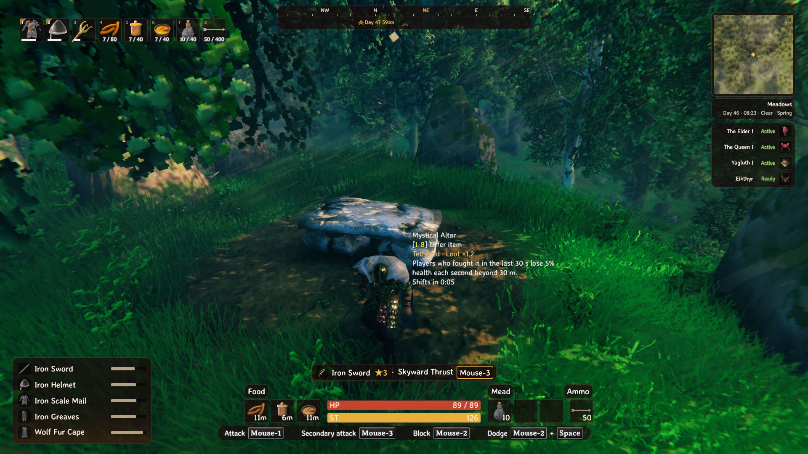
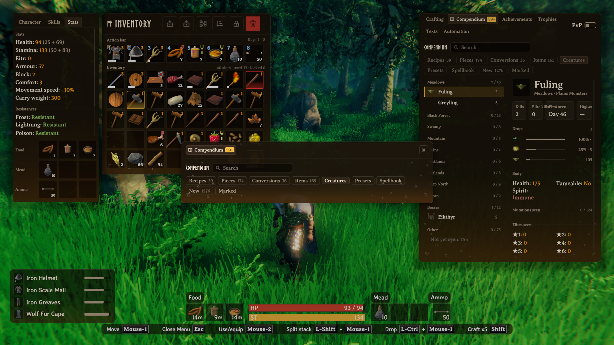
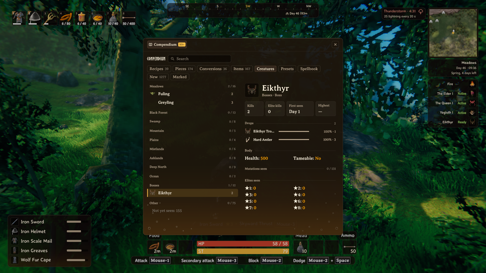

# MeadWorks Creatures

Elite creatures with mutations, boss aspects, new creatures for dungeons and biomes, hordes, and a creature compendium. Configure the module on the Creatures page of the MeadWorks menu (F8). Needs Meadworks: Core at exactly the same version.

## What it does

### Elite creatures
A creature that spawns can be an elite. An elite has a level from 1 up to its difficulty preset's cap (Mild 3, Normal 3, Hard 7, Brutal 8; Custom uses Max elite level) on top of the game's stars, and carries mutations. Each level adds health, damage and drops: by default half again as much health, a quarter more damage and one more set of drops per level. Nameplates have three centered rows: space-separated mutation names in their group colors; the level star before the localized creature name, followed by tame status and the game's alert indicator; then the thin health bar. Creatures without mutations have no mutation row, and plain creatures show their name over health. Boss repeat-defeat stars also appear before the boss name, with boss health and aspects keeping their own HUD rows. Elites also have a body tint and a slightly larger body by level, and effect tells for auras, trails and death bursts.

- **How often.** Elite difficulty is Off, Mild, Normal, Hard, Brutal or Custom. Mild is a 5% chance with half the mutations and levels up to 3. Normal is 15% with levels up to 3. Hard is 25% with 125% of the mutations and levels up to 7. Brutal is 40% with 150% of the mutations and levels up to 8. Custom uses Elite chance %, Max elite level, the level weights and the mutation count under Advanced. Only Custom shows those controls. With Elite levels follow boss kills on, the highest elite level starts low and rises as the world defeats its bosses, reaching the maximum after all seven Forsaken.
- **Levels and mutations.** An elite of level 1 to 8 carries 1, 2, 3, 4, 4, 5, 5 or 6 mutations. A mutation has a lowest level, and some only roll in certain biomes. Mutations never touch player items, containers or dropped items.
- **Tint.** The body tint comes from the group of the first mutation: red for Combat, teal for Movement, steel for Defensive, violet for Aura, orange for On death, blue for Elemental, pink for Tricks and green for Beneficial.
- **Raids.** No elites or mutations before the spawn biome's boss is defeated in the world. After that, at most one elite per raid, across waves and peers; saving and reloading does not replenish the allowance. Biomes without a native boss key stay plain.
- **Never elite.** Bosses, training dummies, the freed prisoners of the Deep North, the Shadows and the Fallen Warrior.
- **Tamed elites.** A tamed elite keeps its level and mutations but drops no elite loot. Only the mutations that suit a tame act, and they hit only its enemies. The young of a tamed elite are elite too, each mutation with half the chance (Offspring inherit elite).
- **Rewards.** Mutations that pay out when you kill (Eitr Font, Stamina Well, Swift Slayer, Reprieve) pay only the player who lands the kill, within 100 m.

### Mutations
The Compendium has a searchable Mutations page with every name, group color, effect, lowest elite level and allowed biomes. Hover or focus a Compendium mutation row for its full name and effect. Tough, Fast and Regen use neutral steel text; the other names use the group tints above. The nameplate toggle hides the mutation row without hiding stars or tame status.

There are 128 mutations in eight groups, and Tough (50% more health), Fast (30% faster) and Regen (heals 1% of its health a second) besides. Every mutation can roll, and none has its own switch.

**Combat**

| Mutation | What it does |
| --- | --- |
| Savage | 25% more damage, attacks 15% faster. |
| Rending | Hits cause a stacking bleed, up to 3 stacks. |
| Venomous | Hits add poison worth 20% of the hit over 6 s. |
| Frostbitten | Hits slow the target 20% for 4 s. |
| Cleaving | Swings pass 40% of their damage to one more target within 2.5 m. |
| Crushing | Blocked hits cost the blocker 15 extra stamina. |
| Hamstring | Hits slow the target 50% for 3 s. |
| Executioner | 50% more damage against targets below 30% health. |
| Opening Strike | Its first hit of a fight deals double damage. |
| Flurry | Every fourth attack hits for 1.2 times damage. |
| Sundering | Hits make the target take 20% more damage for 5 s. |
| Rampant | 8% more damage for every hit in a row, up to 5 times. |
| Spiteful | Gains 40% damage for 6 s after being shot. |
| Piercing | Ignores 30% of the target's armor. |
| Whiplash | Attacks reach 1.5 m further but deal 10% less damage. |
| Bloodscent | 30% more damage against bleeding targets. |
| Concussive | Every fifth hit staggers the target, at most once per 15 s. |
| Snagging | Hits slow 40% for 5 s and root the target for 1.5 s. |
| Frenzied | After dealing 100 damage in a fight, attacks 20% faster for 8 s. |
| Duelist | 35% more damage to its current target, 35% less to anyone else. |
| Hushing | 25% chance per hit to muffle the target's hearing for 6 s. |
| Silencing | 25% chance per hit to block magic and guardian power for 4 s. |
| Blinding | 25% chance per hit to darken the target's vision for 4 s. |
| Mad | 25% faster but 20% less health. |

**Movement**

| Mutation | What it does |
| --- | --- |
| Lunging | Leaps 8 m at its target every 8 s. |
| Blinker | Teleports 6 m behind its target every 10 s. |
| Stampede | Every 12 s charges for 2 s with 60% more speed and heavy knockback. |
| Strafing | 30% faster while circling within 4 m of its target. |
| Ambusher | Its first strike deals 50% more damage. |
| Burrower | Once, at 40% health, moves 5 m away. |
| Skybound | Jumps twice as high. |
| Wallrunner | Climbs slopes up to 70 degrees, 50% faster on steep ground. |
| Swimmer | Swims twice as fast. |
| Treadless | 15% faster. |
| Shadowstep | Dashes 5 m away after a hard hit, every 10 s. |
| Pursuer | Notices and tracks targets from 120 m. |
| Tumbler | After 3 hits in 4 s, rolls aside and is untouchable for 0.4 s. |
| Glider | 50% more movement speed while airborne, including flight. No bonus on the ground or while swimming. |
| Skirmisher | After each attack, backs off for 1 s at 40% more speed. |

**Defensive**

| Mutation | What it does |
| --- | --- |
| Bulwark | Takes 30% less damage from the front. |
| Thorned | Reflects 10% of melee damage taken and shoves the attacker. |
| Shielded | A shield worth 20% of its health, recharging 12 s after the last hit. |
| Stoneskin | Takes 20% less slash and pierce damage but 10% more blunt. |
| Gristle | Removes 5 damage from every hit it takes. |
| Deflecting | 25% of ranged hits do no damage. |
| Second Wind | Once, at 25% health, heals 30% of its health over 4 s. |
| Last Stand | Once, at 10% health, cannot drop below 1 health for 3 s. |
| Resolute | Never knocked back, and not staggered above 50% health. |
| Wary | Backstab bonus against it is cut by 60%. |
| Hardy | Burn, poison and frost on it last half as long. |
| Dug In | Takes 40% less damage after standing still for 3 s. |
| Adaptive | Gains 15% resistance per hit to the damage type that last hit it, up to 45%. |
| Unyielding | Slows, roots and stagger on it are 50% weaker. |
| Leeching | Heals 15% of the damage it deals, and 1% of its health a second when idle. |
| Grieving | Takes 25% less damage for 10 s when an ally within 15 m dies. |
| Reflex | Fully blocks its first melee hit, then again every 10 s. |
| Plated | Physical armor of 6 plus 2% of its health, doubled while unhurt. |

**Aura**

| Mutation | What it does |
| --- | --- |
| Rallying | Allies within 12 m deal 15% more damage. |
| Pestilent | Poisons players within 6 m and leaves poison clouds as it walks. |
| Dread | Players within 10 m regain stamina 25% slower. |
| Warding Hum | Allies within 10 m take 15% less damage. |
| Renewing | Allies within 8 m heal 1% of their health a second. |
| Quickening | Allies within 12 m move 15% faster. |
| Withering | Players within 5 m deal 15% less damage. |
| Vigil | Allies within 8 m cannot be staggered. |
| Grim Pall | Players within 8 m regain health 50% slower. |
| Numbing | Players within 8 m attack 15% slower. |
| Veiled Pack | Creatures hostile to the pack within 12 m see 40% less far. |
| Pack Instinct | 10% more damage per ally within 10 m, up to 40%. |
| Shared Pain | Takes a quarter of the damage dealt to allies within 6 m. |
| Sanguine | Allies within 10 m heal 10% of the damage they deal. |

**On death**

| Mutation | What it does |
| --- | --- |
| Volatile | Bursts after 1.2 s for 40 damage in a 4 m radius. |
| Brood | Splits into 2 weaker copies that split once more, and drop nothing. |
| Death Rattle | Allies within 15 m deal 20% more damage for 10 s. |
| Rotting Cloud | Leaves a poison cloud for 5 s. |
| Marked for Death | Its killer takes 20% more damage for 15 s. |
| Mending Passing | Allies within 12 m heal 15% of their health. |
| Frost Burst | Creatures within 5 m are slowed 30% for 3 s. |
| Shockwave | Staggers creatures and players within 5 m. |
| Mourning Howl | Creatures within 40 m turn on its killer. |
| Smokescreen | Leaves smoke for 6 s that cuts creatures' sight by 80%. |
| Rise Again | Once, deadly damage leaves it at 1 health, and it rises after 5 s with 20% health. |
| Winded End | Its killer loses 30% of their stamina. |
| Bloated | 40% more health, and a death blast of 30 damage in a 4 m radius. |

**Elemental**

| Mutation | What it does |
| --- | --- |
| Scorching | Melee hits ignite for 3 damage a second over 4 s. |
| Static | 20% of melee hits stagger and add 6 bleed damage. |
| Lightning Arc | Hits also send half their damage to another player within 5 m. |
| Scorched Trail | Leaves burning patches that ignite players. |
| Frost Trail | Leaves icy patches that slow and make the ground slippery, and it heals there. |
| Stormborn | In rain deals 20% more damage and moves 15% faster. |
| Sunbound | Heals in daylight when idle, deals 10% less damage at night. |
| Moonbound | 25% more damage at night, 15% less by day. |
| Firebrand | 20% more damage and immune to fire. |
| Icebound | Immune to frost and takes 25% more fire damage. |
| Sparkhide | Melee attackers take 3 lightning damage. |
| Poison Blood | 20% chance melee attackers are poisoned. |
| Cinder Breath | Every 10 s burns its target within 6 m for 15 fire damage. |
| Soaking | Hits make the target wet for 8 s, and wet targets take 20% more. |

**Tricks**

| Mutation | What it does |
| --- | --- |
| Sentry's Howl | When it raises the alarm, creatures of its side within 30 m are alerted. |
| Veiled | Unseen beyond 15 m until it strikes. |
| Keen Eye | Sees twice as far. |
| Cowing Roar | Every 15 s staggers players within 6 m who are not blocking. |
| Feinting | 20% chance after a hit to pause its next attack for half a second. |
| Cornered Fury | Below 30% health moves 40% faster but takes 25% more damage. |
| Territorial | 30% more damage within 25 m of where it spawned, 30% less beyond. |
| Echoing Swing | 15% of hits repeat 0.8 s later for half damage. |
| Gilded | Runs from its target below 50% health, and drops coins. |
| Mudbound | Leaves mud patches that slow players standing in them by 25%. |

**Beneficial**

| Mutation | What it does |
| --- | --- |
| Generous | Drops two extra rolls of its loot. |
| Docile | Tames 50% faster and never flees. |
| Trainer | Killing it gives 30% faster skill gain for 90 s. |
| Weary | Moves 25% slower and attacks 30% slower. |
| Frail | 30% less health and takes 20% more damage. |
| Healer's Gift | Killing it heals the killer 20% of their health over 8 s. |
| Harvest | Dying leaves a berry bush or mushroom pickable for 10 minutes. |
| Cartographer | Killing it reveals 60 m of map around it. |
| Hearth | Players within 12 m get +2 comfort and 15% longer Rested. |
| Eitr Font | Killing it gives 40% faster eitr regeneration for 60 s. |
| Stamina Well | Killing it gives 40% faster stamina regeneration for 60 s. |
| Vitality Aura | Heals players within 10 m by 4 health a second. |
| Pacifist | Never attacks, and if tamed flees from hostile creatures. |
| Beacon | Glows with warm light and reveals map within 40 m while you are near. |
| Lucky | Its Equipment loot drop is one rarity tier higher. |
| Warmth | Players within 12 m cannot be chilled or frozen. |
| Swift Slayer | Killing it gives 20% more movement speed for 30 s. |
| Sanctuary | Creatures within 15 m see and hear half as far. |
| Tamer's Friend | Tamed creatures of its kind within 12 m get 20% more health. |
| Reprieve | Killing it clears and blocks cold, wet and poison for 15 s. |

### Bosses
- **Boss order.** On by default. A boss's first summon requires the previous boss to have been defeated on that world: Eikthyr, The Elder, Bonemass, Moder, Yagluth, The Queen, then Fader. A boss already defeated on the world can always be summoned again.
- **Aspects.** A boss can fight with any of 31 aspects: extra abilities that change the fight. Aspects per boss, under Advanced, sets how many (1 by default, 0 to 2), and each aspect has a switch in the Advanced Boss aspects picker. With Rotating altar aspects on, hover over an altar to see the aspects its boss will have and the time until they shift. Every 15 seconds, the altar rolls from all enabled aspects. Everyone sees the same roll at the same altar. Summoning locks in the aspects shown when you press, including the element for Elementalist and any extra slot from repeat stars. Repeat stars do not rotate. Draining and Sundering, Unshakable and Brutal, Warcaller and Summoner, and Steadfast and Shielded never roll together. With rotation off, aspects roll at random when the boss appears.
- **Repeat boss stars.** A boss shows one star for every time it has been defeated before, up to five. Each star adds 20% health and 10% damage, and one more aspect slot, up to two aspects in all.
- **Boss damage board.** Tracks each player's boss damage and shows the results after the boss dies, with Player, Damage dealt and Damage taken columns. It stays for 30 seconds and closes with Escape or its Close button.
- **Boss hints.** Traders and the forge give a hint about the next boss the world has not defeated.
- **Boss loot for every player.** When a boss dies, every player within 50 m gets a full set of its drops.
- **Boss health line.** A wide health bar with the numbers, the stars and a chip for each aspect.

The altar hover describes each aspect and its loot multiplier, with their product applied once to each player's set of the boss's own drops, including coins but excluding trophies and gems. Two aspects multiply together (×1.3 and ×1.4 give ×1.82), a fraction of an item drops by chance, and a multiplied stack stops at 200.

| Aspect | Loot | What it does |
| --- | --- | --- |
| Colossal | ×1.2 | 50% more health, 30% larger, moves 25% slower. |
| Brutal | ×1.2 | 25% more damage, and its hits always stagger heavily. |
| Enraged | ×1.2 | Below 30% health, attacks 20% faster and deals 30% more damage. |
| Nightfall | ×1.3 | At night deals 20% more damage and takes 25% less. |
| Elementalist | ×1.2 | Adds 20% of each hit as fire, frost, lightning or poison. |
| Reflective | ×1.4 | Returns 15% of the melee damage it takes to the attacker. |
| Shielded | ×1.1 | A shield worth 25% of its health, refilling after 20 s without a hit. |
| Adaptive | ×1.3 | Takes 20% less from the damage type that hurt it most in the last 10 s. |
| Fixated | ×1.3 | Locks onto the player who hurt it hardest for 15 s and hits that player 25% harder. |
| Bountiful | ×2.0 | Doubles its own drops, including coins, except trophies and gems. |
| Portalbound | ×1.2 | Portals cannot be used within 50 m of the boss while it is engaged. |
| Phantom | ×1.3 | Every 20 s it vanishes for a second and blinks to a random spot within 10 m. |
| Mending | ×1.3 | Below 50% health it heals 1% of its health a second for 10 s, up to 3 times. |
| Tethered | ×1.2 | Players who fought it in the last 30 s and are over 30 m away lose 5% of their health each second. |
| Summoner | ×1.5 | Every 30 s calls 2 minions of the local biome, up to 6 alive. |
| Twin | ×1.3 | At 50% health it spawns a copy of itself with 30% of its health, once. |
| Stormbound | ×1.2 | Every 12 s marks up to 2 players within 25 m, and lightning strikes that spot 1.5 s later. |
| Gravitic | ×1.3 | Every 15 s a one-second pull drags players within 15 m toward it. |
| Echoing | ×1.3 | Its projectile and area attacks repeat 1.5 s later at half damage. |
| Earthshaker | ×1.3 | Every 18 s it stomps. Players on the ground within 8 m are knocked down for 1 s. A jump at the right moment avoids it. |
| Sundering | ×1.2 | Blocking its hits costs twice the stamina and wears shields three times as fast. |
| Draining | ×1.2 | Each hit it lands also drains stamina equal to half the damage dealt. |
| Death Throes | ×1.1 | When it dies it glows for 2 s, then bursts within 8 m for heavy damage, at most half your maximum health, hitting players only. |
| Bone-plated | ×1.2 | Takes 40% less from slash and pierce, and 40% more from blunt. |
| Steadfast | ×1.4 | No single hit can take more than 5% of its health. |
| Unshakable | ×1.2 | Cannot be staggered or knocked back. |
| Devourer | ×1.3 | Heals 10% of its health whenever a creature dies within 15 m: its minions, your tames or your summons. |
| Wintry | ×1.2 | Players within 30 m are Cold and Wet while it is engaged, unless they stand near a fire. |
| Hexing | ×1.2 | Every 20 s it curses one player for 8 s: stamina regen is halved. The curse shows in the effects list. |
| Warcaller | ×1.4 | Creatures within 30 m join the fight when they can see the target, deal 20% more damage and move 15% faster. |
| Ember Trail | ×1.3 | Where it walks, the ground burns for 4 s, in its biome's element: fire, frost or poison. |

### New creatures
Thirteen creatures join the world. Each has a spawn switch under Advanced, and all thirteen are on by default. In crypts they join the skeleton and draugr spawners at low weight. Most carry a look of their own: props from the game's meshes, a larger or different held weapon, and a glow color. Drops marked Equipment, and the trophies, need Equipment installed.

| Creature | Where | Drops |
| --- | --- | --- |
| Ossuary Knifer | Black Forest at night, and crypts | Bone Fragments, Ossuary Trophy 10% |
| Ossuary Blademan | Black Forest at night, and crypts | Bone Fragments, Ossuary Trophy 10% |
| Ossuary Hewer | Black Forest at night, and crypts | Bone Fragments, Ossuary Trophy 10% |
| Ossuary Crusher | Black Forest at night, and crypts | Bone Fragments, Ossuary Trophy 10% |
| Ossuary Lancer | Black Forest at night, and crypts | Bone Fragments, Ossuary Trophy 10% |
| Ossuary Reaper | Crypts only | Bone Fragments, Ossuary Trophy 10% |
| Ossuary Archer | Black Forest at night, and crypts | Bone Fragments, Feathers, Ossuary Trophy 10% |
| Ossuary Bolter | Crypts only | Bone Fragments, Iron Bolts, Ossuary Bolter Trophy 10% |
| Crypt Headsman | Crypts only, at most one in each, Burial Chambers and Sunken Crypts | Iron, Bone Fragments, Crypt Headsman Trophy 10%, and 5% of a weapon from Equipment's new weapons |
| Greydwarf Stonecaster | Black Forest forest groups of one or two, more at night | Greydwarf Eye, Resin, Fine Wood, Stonecaster Trophy 10% |
| Rimehide Jotun | Mountain in cold weather, rare and alone | Freeze Gland, Silver, Crystal, Rimehide Jotun Trophy (Equipment) 10% |
| Abyssal Tendriler | Deep open ocean, very rare | Raw Tendril, Serpent Scale, Abyssal Tendriler Trophy (Equipment) 10%, Abyssal Aegis (Equipment) 12%, always from three stars up |
| Coffer Lurker | Burial Chambers and swamp crypts, 5% of crypts | Coins, Amber, Coffer Lurker Trophy 10% |

- **The Ossuary fighters.** Knifer: a fast knife that circles its target. Blademan: a plain sword fighter. Hewer: slower axe swings with more health and damage. Crusher: a slow mace with strong stagger. Lancer: a spear with long reach. Reaper: an atgeir with a wide sweep. Archer: a skeleton bow. Bolter: iron bolts from an arbalest, slowly.
- **Crypt Headsman.** With Headsman moves on, he throws his axe at a target 4 to 10 m away after a one second amber warning ring, and swings behind him at flankers. With Headsman rise pair on (off by default), a landed axe raises up to two Ossuary Blademen beside it that last 35 seconds and drop nothing.
- **Greydwarf Stonecaster.** Throws stones while circling at 8 m, and fights in melee up close.
- **Rimehide Jotun.** With Frost shell on, a wild Jotun starts with three shell stages that cut physical damage by 60%, 40% and 20%. Fire or lightning of at least 5 damage after blocking strips a stage. The shell refills after 60 quiet seconds and taming removes it. With Jotun slam on, it winds up for 1.35 seconds and then slams the ground, followed by a frost wave.
- **Abyssal Tendriler.** A sea creature with a bite and a sweeping tendril attack. It moves only along water.
- **Coffer Lurker.** A chest that waits motionless until a visible player comes within 6 m or it is hurt. With Lurker moves on, it bites with its lid and rattles while it waits.
- **Attack warnings.** The Headsman, Jotun and Tendriler show a warning before their special attacks. Off hides only the warnings; the special attacks still happen.
- **Examples.** Eleven disabled example definitions (Boar, Greydwarf, Skeleton, Draugr, Wolf, Fenring, Goblin, Lox, Seeker, Troll and Ghost) are included as file examples. Their spawn switches are available only in Debug builds.

### Hordes
With Horde spawns on, hostile creatures spawn in larger groups and each one is weaker to match. Passive animals such as deer and hares never form hordes. Horde size is how many times larger a group is (2 by default). Off by default.

### See the creatures
- **Creature compendium.** F7 opens a window with the creatures of the world by biome, listing the ones you have seen. A creature's page shows its trophy, name and biome, kill and sighting figures, drops, body, the mutations you have seen and the elites you have seen.
- **Damage numbers.** Floating numbers for the damage you deal and the healing you get.
- **Mutations on nameplates.** Group-colored mutation names above the creature name. Full effects are listed in the Compendium.
- **Effect density.** How many of the mutations' particle effects and lights are drawn on your screen: Off, Low, Normal or High.

Creatures enter the Compendium when they are in camera view within 40 m with a clear line of sight. Unkilled entries are dimmed. First seen is saved from that sighting; First kill is a separate date. Old saved kill dates stay kill dates, and an unknown sighting date stays blank until you see the creature. Creatures and mutations both participate in the Compendium search.

Kill credit goes to every connected player who dealt damage, including damage over time. A tame's damage counts for its current follow target or its last commander, including while it stays. Command an existing tame once to establish that commander. Contributors travel with the creature through ownership changes and saves; its owner announces the death and the server awards each contributor once. The boss damage board is independent and stays Off by default.

### Your own drops and creatures
- **Loot rules.** `BepInEx/config/MeadWorks/creatures/loot.json` sets drops per creature name. Each rule has a `mode`: `Vanilla` (no change), `Add` (extra entries on top of the normal drops), `Replace` (the entries instead of the normal drops) or `Multiply` (normal amounts times `factor`, 0 to 10). Entries have `item`, `min`, `max`, `chance` (0 to 1) and `per_star` (the amount doubles per star). Gems and trophies are never multiplied, removed or added, and bosses take only `Add`. The file is written once as an example with every rule set to `Vanilla`. For example, `{"Boar":{"mode":"Add","drops":[{"item":"LeatherScraps","min":1,"max":2,"chance":0.5,"per_star":true}]}}` gives every boar a half chance of one or two more leather scraps, and more with each star. An invalid file or one over 256 KB logs a warning and the drops stay as they were. On a server, the server's file applies.
- **Creature rules.** A file you write, `BepInEx/config/MeadWorks/creatures/rules.json`, gives single creatures and whole biomes an elite chance of their own, 0 to 100 percent, and single creatures their own health and damage, 10 to 1000 percent of the game's, for example `[ { "biome": "Mistlands", "chance": 30 }, { "creature": "Deer", "chance": 0 }, { "creature": "Troll", "health": 150, "damage": 80 } ]`. A row names a creature by prefab name, a biome, or both; the closest row wins, and a chance of `0` means never elite. The Elite difficulty still sets the levels, the level cap and the mutation count, and Off stays off. Health and damage go on a row that names a creature and no biome; they apply to every creature of that kind, tamed ones and bosses too, with stars, elite levels and boss aspects on top. A bad row is skipped with one log line, a bad file keeps the last valid table, and `[]` turns the table off. The file is read at game start and at the start of a world you own; on a server, the server's table applies.
- **Custom creatures.** `BepInEx/config/MeadWorks/creatures/definitions.json` holds your own creatures as a JSON array, added to the built-in creatures. Eleven disabled example definitions remain available for file examples; their switches are Debug-only. Each needs a `Name`, a `BasePrefab` and a `SettingsKey`, and may set scale, tint, health and damage ratios, weapons, biome spawn rows and drops. A custom creature's `Enabled` controls its spawning. For example: `[{"Name":"MW_CustomBoar","BasePrefab":"Boar","SettingsKey":"custom_boar","Enabled":true,"HealthRatio":2,"Spawns":[{"Biome":"Meadows"}]}]`. The file is limited to 65,536 bytes, 40 custom creatures, 16 entries in each list and 128 characters per text. Unknown or repeated fields, wrong types, bad names and out-of-range values reject the whole file, and the last good set stays in use. Edit between sessions and restart the server, or leave and reopen the host world.

## Settings

Press F8 and open the Creatures page. Every setting row has a hover tip describing its effect. A setting marked Advanced is under the Advanced row of the page. Server controlled values come from the server for clients. Solo players, the host and admins can change them. Personal settings affect your own display or key binding.

| Name | Default | Policy | What it does |
| --- | --- | --- | --- |
| Elite creatures | On | Server controlled | Some creatures spawn as elites: stronger, with stars and mutations. |
| Elite chance % | 15 | Server controlled | The chance that a creature spawns as an elite, in percent. Only the Custom difficulty uses and shows it. Advanced. |
| Elite difficulty | Normal | Server controlled | How often elites appear and how high their levels go. Custom uses the weights and mutation count under Advanced. |
| Max elite level | 3 | Server controlled | The highest level an elite can spawn at on Custom difficulty (1 to 8). Only shown for Custom. Advanced. |
| Elite levels follow boss kills | On | Server controlled | The highest elite level starts low and rises as the world defeats its bosses. |
| Defer to another level mod | On | Server controlled | Stops elite levels from adding health, damage, drops and stars when another level mod is loaded, while mutations still roll. Advanced. |
| Custom level weights | `70,25,5,3,2,1,1,1` | Server controlled | For the Custom difficulty: how likely each elite level from 1 to 8 is, as up to eight whole numbers with commas between them. Advanced. |
| Custom mutation count % | 100 | Server controlled | For the Custom difficulty: how many mutations elites carry, in percent of the usual number. Advanced. |
| Health per level | 0.5 | Server controlled | How much health each elite level adds, as a part of the creature's own health. Advanced. |
| Damage per level | 0.25 | Server controlled | How much damage each elite level adds, as a part of the creature's own damage. Advanced. |
| Drops per level | 1 | Server controlled | How much each elite level adds to what the creature drops. Advanced. |
| Offspring inherit elite | On | Server controlled | The young of a tamed elite are elite too. Advanced. |
| Boss order | On | Server controlled | Bosses must be beaten in order the first time on a world. Previously defeated bosses can always be summoned again. |
| Boss aspects | On | Server controlled | Bosses fight with aspects: extra abilities that change the fight. |
| Aspects per boss | 1 | Server controlled | How many aspects each boss has (0 to 2). Advanced. |
| Rotating altar aspects | On | Server controlled | Shows the next boss aspects and a countdown on the altar. The roll shifts every 15 seconds; summoning locks in the current roll. Aspects per boss must be at least 1. |
| Boss aspects (Choose) | All On | Server controlled | Opens the aspect picker below. Advanced. |
| Repeat boss stars | On | Server controlled | A boss shows one star for every time it has been defeated before. |
| Boss damage board | Off | Server controlled | Tracks each player's boss damage and shows the results after the boss dies. |
| Boss hints | On | Personal | Traders and the forge give a hint about the next boss the world has not defeated. |
| Boss loot for every player | On | Server controlled | When a boss dies, every player near enough gets a full set of its drops. |
| Horde spawns | Off | Server controlled | Hostile creatures spawn in larger groups, and each one is weaker to match. |
| Horde size | 2 | Server controlled | How many times larger a horde is than a normal spawn (1 to 4). Advanced. |
| Ossuary Knifer | On | Server controlled | Allows this creature to spawn. Advanced. |
| Ossuary Blademan | On | Server controlled | Allows this creature to spawn. Advanced. |
| Ossuary Hewer | On | Server controlled | Allows this creature to spawn. Advanced. |
| Ossuary Crusher | On | Server controlled | Allows this creature to spawn. Advanced. |
| Ossuary Lancer | On | Server controlled | Allows this creature to spawn. Advanced. |
| Ossuary Reaper | On | Server controlled | Allows this creature to spawn. Advanced. |
| Ossuary Archer | On | Server controlled | Allows this creature to spawn. Advanced. |
| Ossuary Bolter | On | Server controlled | Allows this creature to spawn. Advanced. |
| Crypt Headsman | On | Server controlled | Allows this creature to spawn. Advanced. |
| Greydwarf Stonecaster | On | Server controlled | Allows this creature to spawn. Advanced. |
| Rimehide Jotun | On | Server controlled | Allows this creature to spawn. Advanced. |
| Coffer Lurker | On | Server controlled | Allows this creature to spawn. Advanced. |
| Abyssal Tendriler | On | Server controlled | Allows this creature to spawn. Advanced. |
| Attack warnings | On | Server controlled | The Headsman, Jotun and Tendriler show a warning before their special attacks. Off hides only the warnings; the special attacks still happen. Advanced. |
| Headsman moves | On | Server controlled | The Crypt Headsman uses his own moves, such as the axe throw. Advanced. |
| Headsman rise pair | Off | Server controlled | When the Crypt Headsman's axe lands, it can raise short-lived fighters near the spot. Headsman moves must be on. Advanced. |
| Frost shell | On | Server controlled | The Rimehide Jotun grows frost plates that cut physical damage. Fire and lightning break them. Advanced. |
| Jotun slam | On | Server controlled | The Rimehide Jotun uses its ground slam. Advanced. |
| Lurker moves | On | Server controlled | The Coffer Lurker bites with its lid and rattles while it waits. Advanced. |
| Creature compendium key | F7 | Personal | Opens and closes the creature compendium. |
| Damage numbers | On | Personal | Shows floating numbers for the damage you deal and the healing you get. |
| Show mutations on nameplates | On | Personal | Shows group-colored mutation names above an elite's name. Mutation effects are listed in the Compendium. |
| Effect density | Normal | Personal | How many of the mutations' particle effects are drawn on your screen. Advanced. |
| Loot rules data (synced) | empty | Server controlled | The loot rules the server sends to its players. The server fills it in; leave it as it is. Advanced. |

### Boss aspect picker settings

Each switch below is in the Advanced Boss aspects picker. Effects and loot multipliers are listed under Bosses.

| Name | Default | Policy |
| --- | --- | --- |
| Colossal | On | Server controlled |
| Brutal | On | Server controlled |
| Enraged | On | Server controlled |
| Nightfall | On | Server controlled |
| Elementalist | On | Server controlled |
| Reflective | On | Server controlled |
| Shielded | On | Server controlled |
| Adaptive | On | Server controlled |
| Fixated | On | Server controlled |
| Bountiful | On | Server controlled |
| Portalbound | On | Server controlled |
| Phantom | On | Server controlled |
| Mending | On | Server controlled |
| Tethered | On | Server controlled |
| Summoner | On | Server controlled |
| Twin | On | Server controlled |
| Stormbound | On | Server controlled |
| Gravitic | On | Server controlled |
| Echoing | On | Server controlled |
| Earthshaker | On | Server controlled |
| Sundering | On | Server controlled |
| Draining | On | Server controlled |
| Death Throes | On | Server controlled |
| Bone-plated | On | Server controlled |
| Steadfast | On | Server controlled |
| Unshakable | On | Server controlled |
| Devourer | On | Server controlled |
| Wintry | On | Server controlled |
| Hexing | On | Server controlled |
| Warcaller | On | Server controlled |
| Ember Trail | On | Server controlled |

## Known limits

- Glider increases airborne movement speed; it does not slow falling or grant flight.
- Creature definitions, custom spawns, elites, mutations, boss aspects and creature loot changes stay off while you are on a server without MeadWorks. They return when you leave it.
- Creatures that MeadWorks adds disappear from a server's saved world when Creatures is not installed on that server.
- Creature drops that are MeadWorks items need Equipment on the server and the players.
- Edits to the creature definition file apply only after you restart the server or reopen the host world.

## Compatibility

When using MeadWorks inventory changes, loading chests or graves without MeadWorks cuts oversized stacks to native sizes and discards the excess. Keep those containers in a matching installation.

MeadWorks clients can join servers without MeadWorks and can use other mods. On a MeadWorks server, only a missing, wrong-version or mismatched MeadWorks installation is refused. Keep Core and the installed MeadWorks modules at the same suite version on the server and its players.

## Install

Install with a mod manager, or put `meadworks.creatures.dll` in `BepInEx/plugins`. Install Core as well. Install on the server and every player.

## License

MIT. Copyright (c) 2026 expDARE.
