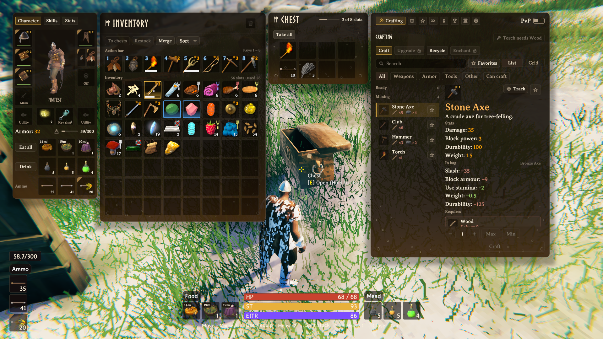
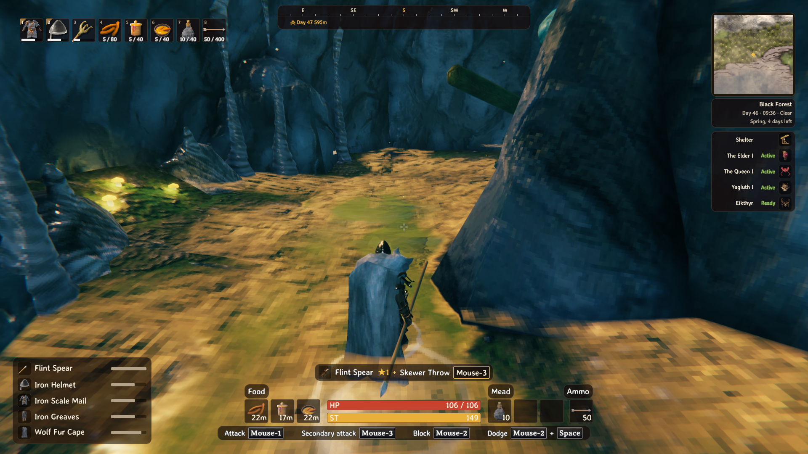
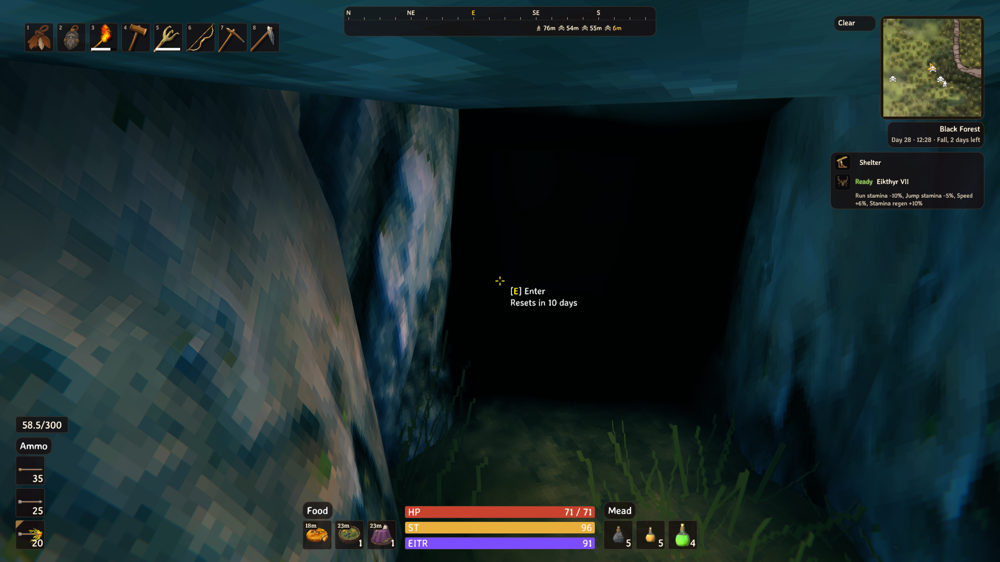

# MeadWorks Dungeons

Burial chambers, sunken crypts, infested mines, and Winding Tunnels reset to larger layouts. Loot chests refill and creatures return at other eligible locations after configurable delays. Configure the module on the Dungeons page of the MeadWorks menu (F8). Needs Meadworks: Core at exactly the same version.

## What it does

### Dungeon layouts reset

Black Forest burial chambers, Swamp sunken crypts, Mistlands infested mines, and the Deep North's Winding Tunnels keep their current layout until their first reset. Hover over the exterior entrance to see the remaining in-game days or hours. Resets replace the interior with a different, larger set of rooms drawn from the game's own room pool. The entrance, exit and any exterior gate stay in place.

When the countdown ends, the interior waits while a player is inside, has reserved an entry, or disconnected inside and has yet to be seen outside. If the server could not identify the disconnected character, that hold lasts one full reset interval from the disconnect. Player-built pieces, graves, tamed creatures and loose items the game cannot yet despawn also hold a reset. A player who returns to a stale spawn with no dungeon room nearby is teleported to the entrance or their spawn point.

Putting an item into a dungeon loot chest marks its contents even when layout resets are off. Equipment's first-open gear and gem bonuses count as generated loot. The next reset carries over all non-empty loot chests owned by the old layout if it predates enrollment, resets were turned off, or the server restarted since that layout was generated. Find carried inventories in ordinary wooden chests beside the new entrance. A reset waits if the source inventory cannot be verified or the replacement entrance room lacks space for the carry chests.

Reset layouts renew their loot and creatures together. The separate refill and respawn timers still apply at eligible camps, villages, and hand-built interiors such as troll caves, bear caves, and the Ashlands' Putrid Holes. Hildir's quest dungeons, boss lairs, and Mörkhalla keep their native layouts to preserve their special encounters. Turning layout resets off restores the ordinary timers in eligible generated dungeons.

### Reset all dungeons

With layout resets turned on, a solo player, host, or authorized server admin can choose **Reset all dungeons** and confirm the performance warning. The server marks every eligible generated dungeon in the current world due and rebuilds them one at a time. The usual safety holds still apply. Progress and the final reset and waiting counts are shown to the person who started it. Cancel lets the current reset finish and leaves the rest due for their ordinary checks.

### Chests refill
Loot chests the world placed in dungeons and camps fill again with their own loot after enough in-game day boundaries have passed since they were emptied. The count starts when the chest is emptied, also when the chest stays loaded and nobody opens it. Chests that players built, chests in use and chests that still hold items are never touched. Dungeon chests also wait while any player is inside that same dungeon, even in a distant room. Leaving does not restart the refill delay.
Hover over an emptied loot chest to see how many in-game days or hours are left, or that it is ready to refill, while chest refills are on.
Empty world loot chests remain in place while refills are on, including treasure chests that normally disappear when emptied. Turning refills off restores the game's normal empty-chest removal.
With Equipment installed, each refill also uses its MeadWorks item chest chance once, through the same native loot fill.

### Camps and dungeons repopulate
The creatures that the world placed at a location come back after the camp or room is next seen empty. The wait counts in-game day boundaries, and camps and dungeons have their own switch and their own number of days. Dungeon creatures also wait while any player is inside that same dungeon, even more than 20 m from the spawner. A creature comes back only when no player-built piece is nearby, no player is within 20 m, and the game's own spawn conditions pass. Outdoor camps keep the 20 m player guard.

Left alone:
- Bosses.
- Spawners that have their own respawn time.
- One-time encounters, such as the freed prisoners of the Deep North and the fallen warrior duel.

On a server, the server's values apply to every player. A game that owns a chest or a spawner at that moment does its refill or respawn. Client owners ask the server whether the dungeon is clear. The guard uses the game's owning Location and interior zone, and includes remote players with map sharing off. A player outside the interior or in a different dungeon does not count as occupying it. If the location or server answer is unavailable, the interior waits.

## Settings

Press F8 and open the Dungeons page. Every setting row has a hover tip describing its effect. A setting marked Advanced is under the Advanced row of the page.

| Name | Default | Default permission | What it does |
| --- | --- | --- | --- |
| Reset dungeon layouts | On | Admins | Eligible generated dungeons get a larger new layout after the wait once the interior is clear. |
| Reset all dungeons | — | Admins | Marks eligible generated dungeons due and rebuilds them in turn after confirmation. |
| Dungeon reset days | 10 | Admins | How many in-game days an eligible dungeon waits after enrollment or its last layout reset (1 to 30). |
| Refill loot chests | On | Admins only | World loot chests refill after the wait; dungeon chests also wait until nobody is inside that same dungeon. |
| Refill after days | 10 | Admins only | How many in-game day boundaries an emptied chest waits before it fills again (1 to 30). |
| Respawn camps | On | Admins only | Camp and village creatures come back after the camp is next seen empty, only with no player-built piece nearby, no player within 20 m, and the game's own spawn conditions. |
| Camp respawn days | 10 | Admins only | How many in-game day boundaries a camp waits after it is next seen empty (1 to 30). Existing configs keep their saved value. |
| Respawn dungeons | On | Admins only | Dungeon creatures return after the wait, only with nobody inside that dungeon, no player-built piece nearby, no player within 20 m, and the game's own spawn conditions. |
| Dungeon respawn days | 10 | Admins only | How many in-game day boundaries a dungeon waits after it is next seen empty (1 to 30). |
| Keep clear of bases (m) | 40 | Admins only | Advanced. Creatures do not come back this near a player-built piece or a player base, in meters (10 to 100). |

MeadWorks syncs these settings from the server. The host or an authorized admin can set the layout reset switch and interval to Admins or Everyone in game. Reset all dungeons is reserved for the host and authorized admins. Refill and respawn rows are reserved for the host and authorized admins. Solo players can change every row.

## Known limits

- If the game cannot generate a valid, larger replacement within its own bounds, the dungeon keeps its layout and tries again at the next day check.
- Frost caves keep their original layout: the game often leaves their required shrine rooms out, and the replacement rarely comes out larger.
- If the server cannot verify a layout switch, the entrance shows “Reset paused.” The hold applies to that dungeon.
- Old auto-destroy drops can retire with an unloaded layout if their saved age and loose-item state allow it. A loose drop holding an unloaded layout shows “Resets when empty.”
- Only creatures that a location placed once come back. Spawners that already respawn on their own are not changed.
- A dungeon room counts as a dungeon, and every other location spawner counts as a camp.
- A creature waits while a player stands within 20 m of its spot. Dungeon creatures and loot chests also wait while anyone occupies the same interior, using the game's location ownership rather than a distance limit.
- Native spawn triggers still apply. An empty dungeon does not force a respawn; a trigger that requires a player inside can keep its spawner waiting.
- A chest refills with the loot the game rolls for it, so the contents are not the same as before.
- The wait counts in-game day boundaries from when a player's game next sees the camp or room empty. A creature killed just before everyone leaves starts that count on the return, so the camp or room then waits a full period.

## Compatibility

Reset rooms, entrances and carry chests use native game objects and the native save format, so the generated layout can load with MeadWorks removed. Carry items keep their original prefab and still need the mod that supplies them. A MeadWorks client on a plain server sees the native entrance text.

When using MeadWorks inventory changes, loading chests or graves without MeadWorks cuts oversized stacks to native sizes and discards the excess. Keep those containers in a matching installation.

Player-built chests and graves are never refilled or emptied by this module. World loot chests retain native loot; any additional MeadWorks items supplied by Equipment need that module.

MeadWorks clients can join servers without MeadWorks and can use other mods. On a MeadWorks server, only a missing, wrong-version or mismatched MeadWorks installation is refused. Keep Core and the installed MeadWorks modules at the same suite version on the server and its players.

## Install

Install with a mod manager, or put `meadworks.dungeons.dll` in `BepInEx/plugins`. Install Core as well. Install on the dedicated server, or in the host's game. Players who install it as well see countdowns on dungeon entrances and emptied loot chests.

## License

MIT. Copyright (c) 2026 expDARE.
