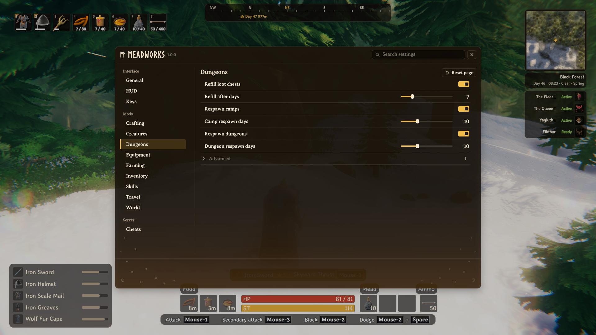
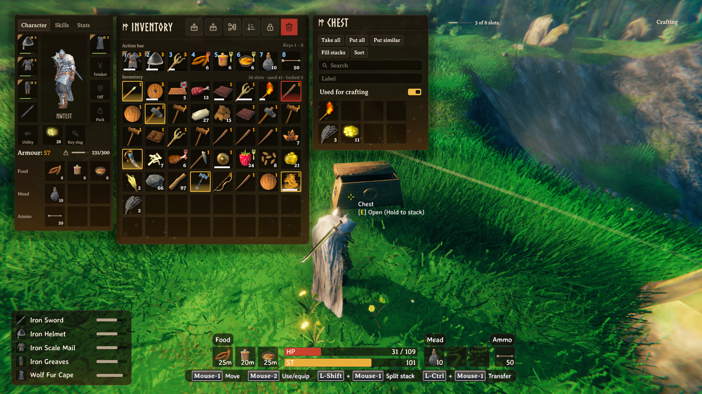

# MeadWorks Dungeons

Loot chests refill and creatures return to camps, villages and dungeons after configurable delays. Configure the module on the Dungeons page of the MeadWorks menu (F8). Needs Meadworks: Core at exactly the same version.

## What it does

### Chests refill
Loot chests the world placed in dungeons and camps fill again with their own loot after enough in-game day boundaries have passed since they were emptied. The count starts when the chest is emptied, also when the chest stays loaded and nobody opens it. Chests that players built, chests in use and chests that still hold items are never touched. Dungeon chests also wait while any player is inside that same dungeon, even in a distant room. Leaving does not restart the refill delay.
Hover over an emptied loot chest to see how many in-game days or hours are left, or that it is ready to refill, while chest refills are on.
Empty world loot chests remain in place while refills are on, including treasure chests that normally disappear when emptied. Turning refills off restores the game's normal empty-chest removal.
With Equipment installed, each refill also uses its MeadWorks item chest chance once, through the same native loot fill.

### Camps and dungeons repopulate
The creatures that the world placed at a location come back after the camp or room is next seen empty. The wait counts in-game day boundaries, and camps and dungeons have their own switch and their own number of days. Dungeon creatures also wait while any player is inside that same dungeon, even more than 20 m from the spawner. A creature comes back only when no player-built piece is nearby, no player is within 20 m, and the game's own spawn conditions pass. Outdoor camps keep the 20 m player guard.

Left alone:
- Bosses.
- Spawners that have their own respawn time.
- One-time encounters, such as the freed prisoners of the Deep North and the fallen warrior duel.

On a server, the server's values apply to every player. A game that owns a chest or a spawner at that moment does its refill or respawn. Client owners ask the server whether the dungeon is clear. The guard uses the game's owning Location and interior zone, and includes remote players with map sharing off. A player outside the interior or in a different dungeon does not count as occupying it. If the location or server answer is unavailable, the interior waits.

## Settings

Press F8 and open the Dungeons page. Every setting row has a hover tip describing its effect. A setting marked Advanced is under the Advanced row of the page.

| Name | Default | Policy | What it does |
| --- | --- | --- | --- |
| Refill loot chests | On | Server controlled | World loot chests refill after the wait; dungeon chests also wait until nobody is inside that same dungeon. |
| Refill after days | 10 | Server controlled | How many in-game day boundaries an emptied chest waits before it fills again (1 to 30). |
| Respawn camps | On | Server controlled | Camp and village creatures come back after the camp is next seen empty, only with no player-built piece nearby, no player within 20 m, and the game's own spawn conditions. |
| Camp respawn days | 10 | Server controlled | How many in-game day boundaries a camp waits after it is next seen empty (1 to 30). Existing configs keep their saved value. |
| Respawn dungeons | On | Server controlled | Dungeon creatures return after the wait, only with nobody inside that dungeon, no player-built piece nearby, no player within 20 m, and the game's own spawn conditions. |
| Dungeon respawn days | 10 | Server controlled | How many in-game day boundaries a dungeon waits after it is next seen empty (1 to 30). |
| Keep clear of bases (m) | 40 | Server controlled | Advanced. Creatures do not come back this near a player-built piece or a player base, in meters (10 to 100). |

All settings are Server controlled: clients use the server values. Solo players, the host and admins can change them.

## Known limits

- Only creatures that a location placed once come back. Spawners that already respawn on their own are not changed.
- A dungeon room counts as a dungeon, and every other location spawner counts as a camp.
- A creature waits while a player stands within 20 m of its spot. Dungeon creatures and loot chests also wait while anyone occupies the same interior, using the game's location ownership rather than a distance limit.
- Native spawn triggers still apply. An empty dungeon does not force a respawn; a trigger that requires a player inside can keep its spawner waiting.
- A chest refills with the loot the game rolls for it, so the contents are not the same as before.
- The wait counts in-game day boundaries from when a player's game next sees the camp or room empty. A creature killed just before everyone leaves starts that count on the return, so the camp or room then waits a full period.

## Compatibility

When using MeadWorks inventory changes, loading chests or graves without MeadWorks cuts oversized stacks to native sizes and discards the excess. Keep those containers in a matching installation.

Player-built chests and graves are never refilled or emptied by this module. World loot chests retain native loot; any additional MeadWorks items supplied by Equipment need that module.

MeadWorks clients can join servers without MeadWorks and can use other mods. On a MeadWorks server, only a missing, wrong-version or mismatched MeadWorks installation is refused. Keep Core and the installed MeadWorks modules at the same suite version on the server and its players.

## Install

Install with a mod manager, or put `meadworks.dungeons.dll` in `BepInEx/plugins`. Install Core as well. Install on the dedicated server, or in the host's game. Players who install it as well see the refill countdown on chests.

## License

MIT. Copyright (c) 2026 expDARE.
