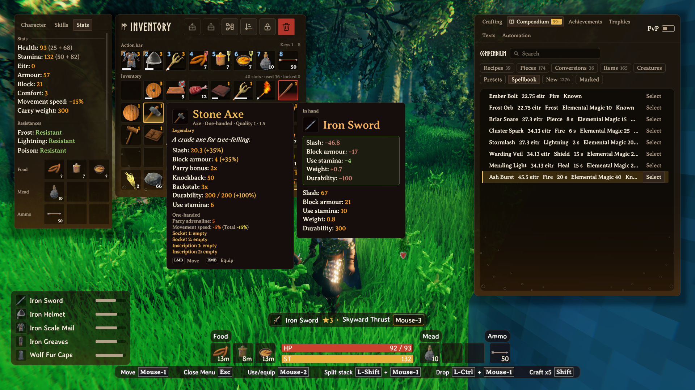
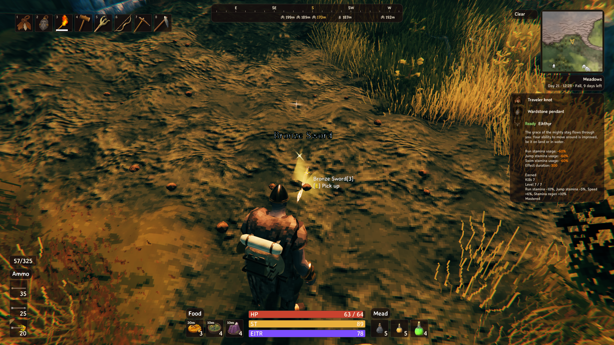
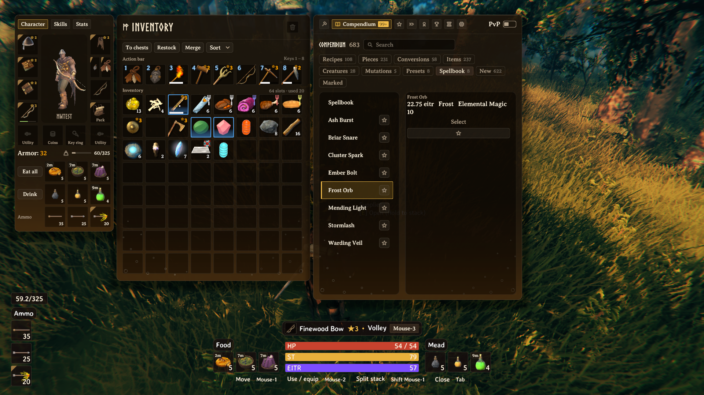
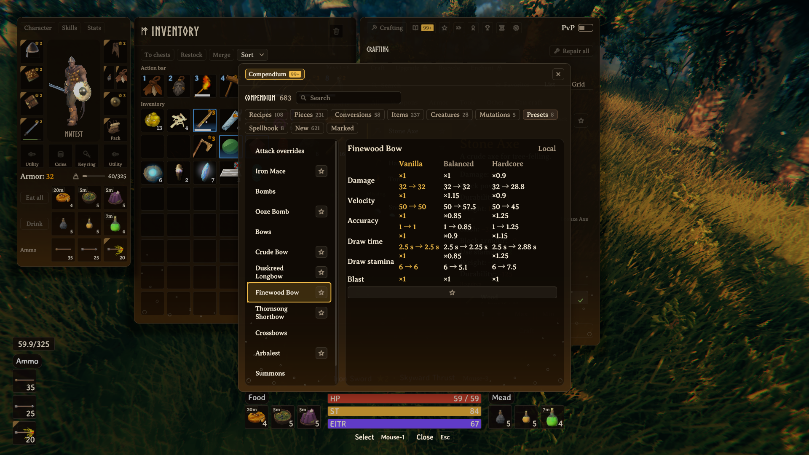

# MeadWorks Equipment

New weapons, shields, trinkets, robes, wands and packs, item rarity with gems and rolled bonuses, a secondary move for every weapon, spells and summons. Switch each part on or off on the Equipment page of the MeadWorks menu (F8). Needs Meadworks: Core at exactly the same version.

## What it does

### Fight
- **Dual wield.** Drop a one-handed sword, axe, mace, club or knife from the bag onto OFF HAND to pair it with a compatible main weapon. Drop onto MAIN HAND to choose the main weapon. This includes Splitbark Hatchet and other MeadWorks weapons in those families. Paired attacks alternate and block uses the main hand.
- **Hand choices.** Bag right-click, use and hotbar equip keep the native hand rules. A shield replaces the left-hand item and keeps a one-handed main weapon or torch. Bows and two-handed weapons clear both old hands; hammers and pickaxes keep their native hand restrictions. The fist-weapon shield setting keeps its existing exception.
- **Saved hands.** Dual-wield pairs retain their hand across reloads, sheathing and automatic grave recovery. Ordinary equip actions ignore old hand marks. Death still follows the world's and Inventory's item-retention rules. Manually unequipping an item clears its hand choice. Native controls are unchanged.
- **Shields with fist weapons.** A shield can be held together with a fist weapon.
- **Secondary attacks.** A weapon that has no secondary attack borrows one from a similar weapon, for example clubs from maces. Weapons that already have one keep it. Secondary attack stamina scales what the secondary costs, and Secondary cooldown scales the wait between secondary attacks.
- **Secondary moves.** Every weapon family has its own move on the secondary attack, with a cooldown. While the move cools down, its key chip beside the weapon name dims and shows the seconds left. No key changes: the move is on the secondary attack.

| Weapon | Move | Cooldown | What it does |
| --- | --- | --- | --- |
| Knife | Shadow Lunge | 3 s | A 6 m dash to the crosshair. The first enemy takes double damage. |
| Sword | Skyward Thrust | 5 s | A 3 m thrust. The first enemy takes 1.5 times damage and light enemies are lifted. |
| Axe | Cleaving Arc | 5 s | One wide horizontal swing hits every enemy once in a 180° arc within 3 m, for 85% primary damage and 2× stagger. |
| Mace | Launch Slam | 6 s | The first enemy within 2 m takes 1.5 times blunt damage, is staggered and pushed back. |
| Spear | Skewer Throw | 5 s | A thrown spear that pierces up to 3 enemies. |
| Atgeir | Whirling Sweep | 6 s | Three sweeps around you, each at 0.6 damage. |
| Greatsword | Sundering Cleave | 7 s | A 4 m half-circle at 1.5 times damage. A hit enemy takes 20% more damage for 5 s. |
| Battleaxe | Savage Rend | 7 s | The first enemy within 2 m takes normal damage, then bleeds for five seconds. |
| Sledge | Earth Tremor | 8 s | Three rings of shock out to 7 m. Hit enemies are staggered. |
| Bow | Volley | 6 s | Fires up to three equipped arrows at full draw in a tight horizontal fan. Uses one draw's stamina and one arrow per shot. |
| Crossbow | Bolt Breach | 6 s | The next bolt from a loaded crossbow pierces 2 enemies and staggers them. |
| Staff | Arcane Surge | 6 s | For 3 s attacks cost no eitr. It covers Dundr. Wands are excluded. |
| Unarmed and fist weapons | Iron Kick | 4 s | A kick with twice the push, staggering the enemy. |
| Pickaxe | Fault Strike | 6 s, shorter with Pickaxes skill | The pickaxe swing at twice the stamina and durability, then a 5 m crack in the ground that damages enemies, rocks, ore and trees along it for 1.5 s. It never hits players, tamed animals or anything you or anyone built. |

Moves hit enemies you can see, never through terrain or walls, and only hit another player when both are in PvP. Both players need Equipment for the moves to act. With Secondary moves off, secondaries keep the game's own behavior with the name Secondary Strike.

- **Quickstep.** The dodge becomes a quick step of 2.5 meters for 70% of the stamina, and you are safe only during the step. The dodge key stays the one the game uses. Off by default.
- **Bow, crossbow and bomb presets.** Balanced makes them cheaper, quicker and straighter. Hardcore does the opposite and lowers damage. Vanilla is the default. The tables below list every value. Per-weapon values can also be set in `BepInEx/config/MeadWorks/equipment/attacks.json`, and Attack overrides turns the presets and the file off together.
- **Special arrows.** Adds the ember, thunder, bramble and whistling arrows, described under Special arrows below.
- **Summons.** Blood Magic summons can have a preset (Balanced or Hardcore), extra levels, a different lifetime and limit, extra damage by Blood Magic skill and a shield. All are Advanced settings. Damage and shields are fixed when a creature is summoned, so a change affects new summons only.

### Gear
- **Item rarity.** Most fresh crafts have no rarity. The chance of a tier is 1%, plus 0.5 percentage points per native boss defeated in this world, up to 4.5%. Personal boss history and guardian powers do not count. A successful roll can be Common. Eikthyr and The Elder unlock Uncommon; Bonemass and Moder unlock Rare; Yagluth and The Queen unlock Legendary; Fader unlocks Mythic. Earlier pairs must also be defeated. Each higher tier is half as likely, starting with Common. Native quality upgrades keep the existing rarity. The Enchant tab's Upgrade raises rarity within the same world cap. Weapons, shields, armor, capes, packs, trinkets and tools use the same rules, including custom MeadWorks gear. Creature rarity drops remain Legendary from elites, Mythic from bosses and Ascendant from end-game bosses. Ascendant stays drop-only and owner-bound.

| Tier | World bosses required for crafting / Upgrade | Craft weight when unlocked | Damage, armor and block | Durability | Bonuses |
| --- | --- | --- | --- | --- | --- |
| Common | None | 1 | x1 | x1 | 0 |
| Uncommon | Eikthyr + The Elder | 0.5 | x1.05 | x1.1 | 1 |
| Rare | Also Bonemass + Moder | 0.25 | x1.1 | x1.25 | 2 |
| Legendary | Also Yagluth + The Queen | 0.125 | x1.35 | x2 | 2 |
| Mythic | Also Fader | 0.0625 | x1.5 | x2.5 | 3 |
| Ascendant | End-game boss drops only | 0 | x1.7 | x3 | 3 |

- **Rarity frames, loot glow, pillars and labels.** Bag, hotbar, equipment and dedicated item slots show a frame in the tier color, including after an item is equipped or moved. Dropped gear glows on the ground, at most 64 drops at once. At most four drops cast light, within 20 meters, and at most eight floating names show at once. Rare and better stand under a pillar of light, and Legendary and better show a floating name in the HUD font, in plain white.
- **Quality upgrades.** Native quality upgrades preserve rarity, bonuses, sockets and crafter data.
- **Bonuses.** Gear rolls bonuses automatically when it gains rarity from crafting, creature drops, chest loot or Upgrade. The 122-effect catalog is listed under Inscriptions below. Each class of gear rolls from its own pool: armor, shields, bows and general tools have pools of their own. Existing bonus rolls stay unchanged.
- **Gems and sockets.** Gear with rarity has sockets for twelve kinds of gem. Elite creatures and bosses still drop gems. Taking a gem out returns it with its rarity; the bag needs a free cell. Three matching gems fuse into one better gem.
- **Enchant.** The crafting window's Enchant tab has five actions: Socket, Cut socket, Fuse gems, Reroll and Upgrade. It needs Crafting and a usable crafting station.
- **Trinkets.** Eight crafted trinkets, worn in a slot of their own: Hearth ring, Ember ring, Seafarer band, Wolfsbane ring, Miner charm, Forager charm, Traveler knot and Wardstone pendant.
- **Packs.** Enable Backpacks on the Inventory page (Off by default). Hide, Troll-hide and Lox-hide packs add carry weight and, with Inventory, rows to the bag. They are worn on your back, flush against your body and armor, with a cape hanging clear of them, and other players see them.
- **Compare tooltip.** Tooltips of weapons, shields, armor, ammo and trinkets become a flat card. When you wear an item in the same slot, a second card beside it shows that item and the lines that differ, green where the hovered item is better and red where it is worse. On by default. Interactive item cards show mouse or controller action hints; food shows Eat, and unsupported actions are omitted.
- **Set line.** An item tooltip says how many pieces of its set you wear out of how many are needed, and whether the set effect is active.
- **New equipment.** 22 weapons, seven ward shields, four offhand foci, four Augur robe sets, five wands, a spellbook with eight scrolls, six eitr foods, three packs, eight trinkets, twelve gems, special arrows, the Abyssal Aegis and Tendril foods, and seven trophies from new creatures, all listed below. New equipment recipes controls whether they can be crafted; packs also require Inventory's Backpacks toggle (Off by default).

### Cast spells
Wands pair with a focus or shield. Reading a scroll teaches its spell and confirms learning without food effects. The Spellbook, or the Compendium Spellbook tab, lists every spell and selects the one a wand casts. Selecting the active spell again puts it away and the wand casts its own attack. The Next spell key, unbound by default, steps through the known spells. A spell cooling down shows its seconds on the hotbar. Spells, wands, foods and robes are listed below.

### Move and survive
- **Torches keep you warm.** A lit torch in your hand keeps you warm in cold weather. In freezing weather it lowers Freezing to Cold, or does nothing when In freezing weather is Off.
- **Equip while running.** You can equip and unequip while running without slowing down.
- **Gear in water.** Your weapons and tools stay in your hands while you swim.

### World chest loot
World loot chests in dungeons, camps and villages have a 10% chance per fill to add one MeadWorks item at quality 1. Player-built containers are excluded. The chest's biome selects the material tier: flint/wood/leather in Meadows, bronze/troll/copper in Black Forest, iron in Swamp, silver/wolf in Mountain, blackmetal/linen in Plains, carapace/eitr in Mistlands, flametal/asksvin in Ashlands, and the next tier in Deep North when available. Each item's live recipe materials determine its tier; station and level are the fallback when no material is recognized. Boss materials, trophies, uncraftable drops and items with rarity or owner binding are excluded.

Qualifying chest gear uses the same world-based rarity chance and tier weights as a fresh craft, and a tier grant rolls its bonuses. The chest owner rolls once through the game's default loot fill, including Dungeons refills. Chest identity and a saved fill counter determine the roll. No matching item or no room means no bonus; native loot takes priority. On a server, the server's percentage applies to every owner. Solo players, the host and admins can change it.

## Settings

Press F8 and open the Equipment page. Every setting row has a hover tip describing its effect. A setting marked Advanced is under the Advanced row of the page. Server controlled values come from the server in multiplayer; admin-lockable values stay personal unless locked. Solo players, hosts and admins can edit gameplay values.

| Name | Default | Policy | What it does |
| --- | --- | --- | --- |
| MeadWorks items in chests % | 10 | Server controlled | Chance per world loot chest fill for one custom item of the biome's material tier (0 to 100). 0 disables it. Includes Dungeons refills. |
| Dual wield | On | Server controlled | A second one-handed weapon can be held in the off hand. |
| Shields with fist weapons | On | Server controlled | A shield can be held together with a fist weapon. |
| Secondary attacks | On | Server controlled | A weapon without a secondary attack gets one borrowed from a similar weapon. |
| Secondary attack stamina | 1 | Server controlled | Multiplies the stamina a secondary attack costs. 1 is normal (0.25 to 2). Advanced. |
| Secondary cooldown | 1 | Server controlled | Multiplies the wait between secondary attacks. 1 is normal and 0 removes it (0 to 2). Advanced. |
| Secondary moves | On | Server controlled | Weapons have their own special moves on the secondary attack. |
| Quickstep | Off | Server controlled | Dodging becomes a quick step: 2.5 meters for 70% of the stamina, and you are safe only during the step. Advanced. |
| Attack overrides | On | Server controlled | Applies the bow, crossbow and bomb presets and the changes in the server's attack file. Off leaves every weapon attack as the game made it. Advanced. |
| Bow preset | Vanilla | Server controlled | Balanced makes bows cheaper and quicker to draw, with faster and straighter arrows. Hardcore does the opposite and lowers damage. Advanced. |
| Crossbow preset | Vanilla | Server controlled | Balanced makes crossbows cheaper and quicker to reload, with faster and straighter bolts. Hardcore does the opposite and lowers damage. Advanced. |
| Bomb preset | Vanilla | Server controlled | Balanced makes bombs cheaper to throw, with a faster, straighter throw and a wider blast. Hardcore does the opposite. Advanced. |
| Attack overrides data (synced) | empty | Server controlled | The attack changes the server sends to its players. The server fills it in; leave it as it is. Advanced. |
| Special arrows | On | Server controlled | Adds the ember, thunder, bramble and whistling arrows. |
| Summon preset | Vanilla | Server controlled | Balanced gives summons more levels, time, numbers, damage and a shield. Hardcore gives fewer levels, less time and fewer summons. Advanced. |
| Summon quality | 0 | Server controlled | Extra levels for summoned creatures, on top of the preset. Summons never go above level 6 (0 to 3). Advanced. |
| Summon lifetime % | 100 | Server controlled | How long summons last and how far they may stray from you, in percent of the preset (25 to 400). Hardcore caps lifetime at five minutes. Advanced. |
| Summon limit % | 100 | Server controlled | How many creatures can be summoned at once, in percent of the preset, rounded to whole creatures (50 to 300). Advanced. |
| Summon damage bonus % at skill 100 | 0 | Server controlled | Extra summon damage at Blood Magic 100, added to the preset's bonus (0 to 100). Lower skill gives less. Advanced. |
| Summon shield % of health | 0 | Server controlled | Extra shield for new summons, in percent of their health, added to the preset's shield (0 to 100). Advanced. |
| Item rarity | On | Server controlled | Gear can carry a rarity tier that raises its stats. Most fresh crafts have none; boss defeats improve their chance and available tiers. |
| Craft rarity chance | 1% | Server controlled | Base chance that freshly crafted gear has any rarity (0 to 100%). Upgrades keep their existing rarity. Advanced. |
| Craft rarity per boss | 0.5% | Server controlled | Percentage points added per boss defeated in the world, counting each of the seven bosses once (0 to 100). Station level has no effect. Advanced. |
| Uncommon damage, armor and block | 1.05 | Server controlled | Tier multiplier (1 to 3). Advanced. |
| Rare damage, armor and block | 1.1 | Server controlled | Tier multiplier (1 to 3). Advanced. |
| Legendary damage, armor and block | 1.35 | Server controlled | Tier multiplier (1 to 3). Advanced. |
| Mythic damage, armor and block | 1.5 | Server controlled | Tier multiplier (1 to 3). Advanced. |
| Ascendant damage, armor and block | 1.7 | Server controlled | Tier multiplier (1 to 3). Advanced. |
| Uncommon durability | 1.1 | Server controlled | Tier multiplier (1 to 4). Advanced. |
| Rare durability | 1.25 | Server controlled | Tier multiplier (1 to 4). Advanced. |
| Legendary durability | 2 | Server controlled | Tier multiplier (1 to 4). Advanced. |
| Mythic durability | 2.5 | Server controlled | Tier multiplier (1 to 4). Advanced. |
| Ascendant durability | 3 | Server controlled | Tier multiplier (1 to 4). Advanced. |
| Elite drop chance % | 5 | Server controlled | The chance that an elite creature drops a Legendary weapon or armor piece from its biome, in percent. Advanced. |
| Boss drop chance % | 17 | Server controlled | The chance that a boss drops a Mythic piece, in percent. Advanced. |
| End-game boss drop chance % | 100 | Server controlled | The chance that an end-game boss drops an Ascendant piece, in percent. Advanced. |
| End-game bosses | Fader, FrozenKing, FrozenKing_p3 | Server controlled | The bosses that count as end-game, as a list of their names with commas between them. Advanced. |
| Rarity frames | On | Personal | Item slots show a frame in the color of the item's rarity. |
| Loot glow | On | Personal | Dropped gear with a rarity glows softly on the ground. Rare and better drops stand under a pillar of light, and Legendary and better drops show a floating name. |
| Bonuses | On | Server controlled | Gear gains rolled bonuses with rarity. Armor and shields share the ring pool. |
| Gems | On | Server controlled | Rarity gear has sockets. Gems can be returned or fused at a station. |
| Gem elite drop chance % | 3 | Server controlled | The chance that an elite creature drops a gem, in percent. Advanced. |
| Gem boss drop chance % | 8 | Server controlled | The chance that a boss drops a gem, in percent. Advanced. |
| Trinkets | On | Server controlled | Adds trinkets, worn in a slot of their own. |
| Compare tooltip | On | Personal | An item's tooltip compares it with what you wear in the same slot. |
| New equipment recipes | On | Server controlled | Adds the recipes for the new MeadWorks equipment. Advanced. |
| Next spell | None | Personal | Switches to the next spell you have learned. Advanced. |
| Torches keep you warm | On | Admin-lockable | A lit torch in your hand keeps you warm in cold weather. |
| In freezing weather | Cold | Personal | What a torch does in freezing weather: Cold leaves you only cold, Off leaves you freezing. |
| Equip while running | On | Server controlled | You can equip and unequip while running without slowing down. |
| Gear in water | On | Server controlled | Your weapons and tools stay in your hands while you swim. |

On a server, the server sets everything above except the settings marked Personal, and an admin can lock Torches keep you warm.

## Known limits

- Secondary moves act only when both players have Equipment.
- Quickstep and the Advanced presets are off or at Vanilla by default. Compare tooltip starts on.
- A modified client can ignore attack, move and summon numbers, because the attacker's own game applies them.
- The Enchant tab needs Crafting.
- Character items stay whole in MeadWorks storage and return when MeadWorks is reinstalled. Chests and graves use native saves: collect custom items and oversized stacks before loading them without MeadWorks.
- The attack file must be strict JSON of at most 256 KB and 128 items. Otherwise one warning is logged and everyone gets the normal attacks. On a server the server's file applies to everyone and a client's own file is ignored. Edits apply on the next world start.
- Summon birth shields and damage are stored on the creature. Settings changed later affect new summons only.
- The tendril foods need Equipment on the cooking station's owner. A client without it can clear an unknown cooking slot and lose a tendril.

## Presets

The Compendium PRESETS tab compares the effective preset and lists known items with values read from their original attacks. Attack overrides lists named file factors for known items. File fields replace preset fields. Summons compares the approved preset table; Advanced sliders add to those values. Damage and shields are fixed at birth, and changing settings affects future summons.

### Bow

| Stat | Vanilla | Balanced | Hardcore |
| --- | --- | --- | --- |
| damage | x1 | x1 | x0.9 |
| velocity | x1 | x1.15 | x0.9 |
| accuracy | x1 | x0.85 | x1.25 |
| drawMin | x1 | x0.9 | x1.15 |
| drawStamina | x1 | x0.85 | x1.25 |
| blast | x1 | x1 | x1 |

### Crossbow

| Stat | Vanilla | Balanced | Hardcore |
| --- | --- | --- | --- |
| damage | x1 | x1 | x0.9 |
| stamina | x1 | x0.85 | x1.2 |
| velocity | x1 | x1.1 | x0.9 |
| accuracy | x1 | x0.85 | x1.25 |
| reload | x1 | x0.85 | x1.25 |
| blast | x1 | x1 | x1 |

### Bomb

| Stat | Vanilla | Balanced | Hardcore |
| --- | --- | --- | --- |
| damage | x1 | x1 | x1 |
| stamina | x1 | x0.85 | x1.25 |
| velocity | x1 | x1.1 | x0.9 |
| accuracy | x1 | x0.85 | x1.25 |
| blast | x1 | x1.15 | x0.85 |

### Summons

| Stat | Vanilla | Balanced | Hardcore |
| --- | --- | --- | --- |
| Stars added | 0 | 1 | -1 |
| Lifetime factor | x1 | x1.5 | x0.5 |
| Lifetime ceiling | none | none | 300 s |
| Limit factor | x1 | x1.5 | x0.67 |
| Damage bonus at skill 100 | 0% | 25% | 0% |
| Shield share of max health | 0% | 25% | 0% |
| Shield seconds | 0 s | 20 s | 0 s |

A summon's shield shows as a small cyan marker above it for every player nearby, and it goes when the shield is used up or runs out. Shields and damage bonuses are fixed when the creature is summoned, and they stay with it if it changes owner or you reload. A world cap counts the creatures that are loaded. Weapon quality limits use the staff's quality before the scaling.

## New items

### New weapons
Twenty-two weapons join the game. Each has the secondary move of its family and fills a gap in the progression: most sit between two vanilla weapons of their family, and Rimeclaw Gauntlets and Rivetspitter Crossbow take 85% of a stronger weapon's damage. New equipment recipes turns the recipes off.

| Weapon | Type | Station | Recipe | Sits between |
| --- | --- | --- | --- | --- |
| Hearthflint Dirk | Knife | Workbench 2 | Flint 4, Wood 2, Leather Scraps 2 | Flint knife and copper knife |
| Frostglass Stiletto | Knife | Forge 3 | Silver 10, Crystal 2, Freeze Gland 3 | Silver knife and black metal knife, with spirit damage |
| Gale Sabre | Sword | Forge 1 | Bronze 8, Fine Wood 2, Resin 2 | Bronze sword and iron sword |
| Hoarwind Longsword | Sword | Forge 3 | Silver 40, Wolf Pelt 2, Crystal 3 | Silver sword and black metal sword, with spirit damage |
| Splitbark Hatchet | Axe | Workbench 1 | Flint 6, Wood 4 | Flint axe and bronze axe |
| Marshreaver Axe | Axe | Forge 2 | Iron 20, Elder Bark 4, Leather Scraps 2 | Iron axe and black metal axe |
| Stoneward Cudgel | Mace | Forge 1 | Bronze 8, Stone 4, Leather Scraps 3 | Bronze mace and iron mace |
| Cragbreaker Mace | Mace | Forge 3 | Silver 30, Obsidian 10, Wolf Fang 5 | Silver mace and Needle mace, blunt with frost and spirit |
| Briar Lance | Spear | Workbench 1 | Flint 10, Fine Wood 5, Thistle 2 | Flint spear and bronze spear |
| Wolfsong Pike | Spear | Workbench 2 | Wolf Fang 2, Fine Wood 10, Wolf Pelt 4 | Wolf fang spear and chitin spear, at the weaker spear's station |
| Ridgeline Glaive | Atgeir | Forge 1 | Bronze 8, Fine Wood 10, Leather Scraps 2 | Bronze atgeir and iron atgeir |
| Gravewind Halberd | Atgeir | Forge 2 | Iron 30, Elder Bark 10, Chain 2 | Iron atgeir and black metal atgeir |
| Gloamfang Battleaxe | Battleaxe | Forge 2 | Iron 35, Elder Bark 30, Chain 4 | Battleaxe and black metal battleaxe |
| Boulderfall Maul | Sledge | Workbench 2 | Iron 30, Yggdrasil Wood 10, Stone 4 | Iron sledge and Stagbreaker, at the weaker sledge's station |
| Thornsong Shortbow | Bow | Workbench 1 | Wood 10, Leather Scraps 8 | Bow and fine wood bow |
| Duskreed Longbow | Bow | Forge 1 | Fine Wood 10, Iron 20, Feathers 10, Deer Hide 2 | Huntsman bow and Draugr fang bow |
| Rivetspitter Crossbow | Crossbow | Black forge 1 | Wood 10, Iron 8, Root 4 | 85% of the Arbalest's damage |
| Needlefall Arbalest | Crossbow | Black forge 1 | Wood 10, Iron 8, Root 4 | Arbalest and Ripper |
| Deepvein Pick | Pickaxe | Forge 2 | Iron 20, Elder Bark 3 | Iron pickaxe and black metal pickaxe |
| Thornfell Claymore | Greatsword | Workbench 1 | Iron 30, Elder Bark 20, Troll Hide 5 | Krom and the wooden two-hander, at the weaker sword's station |
| Longbarrow Greatsword | Greatsword | Black forge 3 | Black Metal 30, Lox Pelt 5, Needle 3 | Slayer and Krom |
| Rimeclaw Gauntlets | Fist weapon | Workbench 2 | Silver 2, Wolf Pelt 2, Leather Scraps 4 | 85% of the Bjorn claws' damage and durability |

### Ward shields
Seven craftable wards span Meadows through Ashlands: Hearthwood Ward, Barkwarden Heater, Mirewall Kite, Rimeguard Aegis, Stormwall Bulwark, Mistveil Ward and Cinderlock Rampart. Hearthwood has no resistance. The others reduce poison, lightning, frost, pierce, spirit and fire damage, in that order, by 10% while equipped.

### Offhand foci
Four foci are held like shields: Hollowglass (Black Forest), Mirelight (Swamp), Rimeheart (Mountain) and Veilglow (Mistlands). Each blocks at 40% of the matching vanilla shield, and gives eitr regeneration +10, 15, 20 and 25% and Elemental Magic +3, 5, 8 and 10. The bonuses stay while the focus is sheathed on your back and end when it is unequipped, leaves your inventory or you die. Hollowglass costs Fine Wood 10, Surtling Core 4 and Leather Scraps 4.

### Augur robes
Four sets, each with a hood, a robe and trousers: Meadow Augur (earth and ochre), Barkweaver (leaf green), Hoarfrost Augur (frost blue) and Duskfield Augur (dusk purple). Armor and eitr regeneration are 55%, 65%, 80% and 90% of the matching mage gear. Three matching pieces give Elemental Magic +3, 5, 8 and 10. Mixed sets give no set bonus.

### Wands
Five one-handed wands pair with a focus or shield: Kindling (Black Forest, forge 1), Rootwhisper (Swamp, forge 2), Rimeshard (Mountain, forge 3), Stormreed (Plains, forge 5) and Cinder (Ashlands, Galdr table 2). Each casts its staff's attack at 0.6 of the damage, 0.65 of the eitr and 0.7 of the cast time; Cinder casts a fire bolt at 1.5 times Kindling. Hold the attack to charge for up to one second: damage rises to 1.8 times and eitr to 1.5 times. Eitr is paid once, when the projectile leaves, and a cast that cannot be paid does not fire. The game's own draw indicator shows the charge.

### Spellbook and scrolls
The Spellbook, Ember Bolt and Frost Orb scrolls are crafted at forge level 1. The book costs Leather Scraps 4, Fine Wood 4, Bronze 2 and Coal 2; each early scroll costs Leather Scraps 1, Feathers 1 and Resin 2 (Ember Bolt) or Greydwarf Eye 2 (Frost Orb). The other six scrolls stay at the Galdr table. Reading a scroll teaches its spell and confirms learning without food effects. The book, or the Compendium SPELLBOOK tab, lists every spell with its eitr cost, effect, cooldown and the Elemental Magic level it needs, and selects the one a wand casts. An optional **Next spell** key, unbound by default, steps through the known spells and back to the wand's own attack. While a spell is cooling down the hotbar counts the seconds.

| Spell | Eitr | Effect | Cooldown | Elemental Magic |
| --- | --- | --- | --- | --- |
| Ember Bolt | 22.75 | Fire | none | 0 |
| Frost Orb | 22.75 | Frost | none | 10 |
| Briar Snare | 27.3 | Pierce | 8 s | 15 |
| Cluster Spark | 34.13 | Fire | 6 s | 25 |
| Stormlash | 27.3 | Lightning | 2 s | 20 |
| Warding Veil | 34.13 | Shield, 0.6 of the shield staff | 15 s | 20 |
| Mending Light | 34.13 | Heal, 240 in eight ticks over 3.5 s | 15 s | 25 |
| Ash Burst | 45.5 | Fire, 6 m blast | 20 s | 40 |

Costs are the same on every wand. Cooldowns are kept for the session and start again after a relog.

### Packs
With Inventory's Backpacks toggle On (Off by default), three packs are worn in Inventory's PACK cell, independent of Dedicated slots. With Inventory's Utility slots at 2, a second utility item is worn beside the first. Each pack is made where the cape of its hide is made.

| Pack | Rows | Carry weight | Recipe |
| --- | --- | --- | --- |
| Hide pack | 1 | 25 | Deer Hide 6, Leather Scraps 8, Resin 4 |
| Troll-hide pack | 2 | 50 | Troll Hide 8, Leather Scraps 10, Bronze 2 |
| Lox-hide pack | 3 | 75 | Lox Pelt 4, Linen Thread 10, Silver 2 |

Wearing a pack and its rows need Inventory. Without Inventory the pack remains an unworn bag item; it cannot replace a belt. A pack has one quality, no durability and no sale value. Only one pack is worn at a time.

### Eitr foods
Six cauldron foods give half of their total as eitr and a quarter each as health and stamina. Each total, duration and regeneration follows a vanilla food of its biome: Honeyed Capcake (Queens Jam), Glowcap Stew (Carrot Soup), Marsh Eitr Pudding (Turnip Stew), Rimeberry Wrap (Eyescream), Duskbread Platter (Blood Pudding) and Misted Magecap Roll (Mushroom Omelette).

### Special arrows
Arrows are crafted 20 at a time and stack to 100.

| Arrow | Effect | Recipe |
| --- | --- | --- |
| Ember | A fire arrow whose burn also spreads to one enemy within 3 m. | As the Fire Arrow |
| Thunder | Lightning damage that jumps to up to 2 more enemies within 6 m, each jump at 60% of the one before. | Wood 8, Feathers 2, Obsidian 1 |
| Bramble | Roots the enemy it hits for 2 s and slows other enemies within 3 m to 60% speed for 3 s. | Wood 8, Feathers 2, Thistle 1 |
| Whistling | 8 pierce damage and eight times the stagger. It wakes non-tame creatures within 15 m and draws them to where it lands. | Wood 8, Feathers 2, Bone Fragments 1 |

### Trinkets
Eight crafted trinkets, worn in a slot of their own, one quality each. All eight can carry Ring inscriptions.

| Trinket | Effect | Recipe |
| --- | --- | --- |
| Hearth ring | Rested lasts 10% longer. | Bronze 2, Resin 5, Raspberry 5 |
| Ember ring | Frost resistant at the game's Resistant level. A stronger resistance you already have is kept. | Bronze 2, Surtling Core 1, Coal 5 |
| Seafarer band | Swim speed +15%, swim stamina use -10%. | Bronze 2, Chitin 3, Serpent Scale 2 |
| Wolfsbane ring | All attack damage +5% at night. | Silver 2, Wolf Fang 3, Crystal 1 |
| Miner charm | Pickaxe damage +20%. | Iron 2, Copper 4, Stone 10 |
| Forager charm | 25% chance that picking a pickable gives one extra item. | Fine Wood 4, Blueberries 10, Thistle 5 |
| Traveler knot | Run stamina drain -10%. | Leather Scraps 6, Deer Hide 2, Feathers 4 |
| Wardstone pendant | Block power of the item you hold +5%. | Iron 3, Draugr Trophy 1, Bronze 1 |

### Gems
Sockets sit in weapons, bows, shields, armor, capes, packs, trinkets and tools, including MeadWorks gear. A Common item has none, an Uncommon one, a Rare or Legendary two, and a Mythic or Ascendant three. Gems are socketed and returned intact on the Enchant tab. Taking a gem out needs a free bag cell. Gems drop from elite creatures (3% by default) and bosses (8%). The gem is chosen at random from the twelve and has its own rarity. The values below are for a Rare gem; an Uncommon gem gives 60% of them and a Legendary gem 160%. What a gem does depends on what it sits in.

| Gem | In a weapon | In armor | In a shield |
| --- | --- | --- | --- |
| Garnet | +8% damage | +30 max health | +25% block force |
| Amber | +6 fire damage | +15% fire resistance | Attackers burn 2 a second for 3 s |
| Citrine | +5% attack speed | +20 max stamina | Block stamina cost -10% |
| Peridot | +4 poison a second for 5 s on hit | +10% poison resistance | A parry cleanses one poison tick |
| Jade | Heals 1% of max health on hit | +0.5 health regeneration a second | A parry heals 5 |
| Aquamarine | +6 frost damage | +15% frost resistance | Attackers are slowed 15% for 2 s |
| Sapphire | +2 stamina on hit | +1 stamina regeneration a second | +10% parry window |
| Amethyst | +15% sneak attack damage | +20 max eitr | Allies within 4 m get +3% block |
| Onyx | +10% damage to elites | +4 armor | +10% armor while blocking |
| Moonstone | +6 lightning damage | +15% lightning resistance | A parry sparks 8 damage to enemies within 4 m |
| Rose Quartz | 2% of damage dealt returned as health | Food healing +10% | Heals allies within 4 m, 1 a second |
| Opal | +2 damage of each element | +5% all resistances | +5% block force and +5% armor |

### Enchant
The Enchant tab has five actions: Socket, Cut socket, Fuse gems, Reroll and Upgrade. Paid changes show their costs and odds and require a second press to confirm. Reroll and Upgrade use only vanilla materials. Number the rarity tiers Common 0 through Ascendant 5 for the costs below.

| Action | Result and cost |
| --- | --- |
| Socket | Put a chosen gem in an empty socket or take it out with its rarity preserved. No material fee. Taking out needs a free bag cell. |
| Cut socket | Inside Socket: gear that has a rarity record and no socket gets one empty socket. Costs 8 Crystal. Gear that already has a socket or a gem does not offer it. |
| Fuse gems | Three gems of the same kind and rarity become one of the next rarity, with 100% success. Uncommon -> Rare -> Legendary; Legendary cannot fuse further. No material fee. |
| Reroll | Replace one known bonus with a different eligible bonus, excluding bonuses already on the item. All candidates have equal odds, shown before confirmation. Costs 3 + 2 x (tier + 1) Crystal (5 on Common up to 13 on Mythic), plus 2 Silver on Rare gear or 2 Black metal on Legendary and better. Picking a Group (Offense, Defense or Utility) also costs 1 + tier trophies, never boss trophies. Other bonuses and gems stay unchanged. |
| Upgrade | Raise rarity one step with 100% success, within the world's crafting cap. Costs 6 x destination tier Crystal: 6 to Uncommon, 12 and 8 Silver to Rare, 18 and 9 Black metal to Legendary, 24 and 12 Black metal to Mythic. New bonus slots roll automatically; existing bonuses and gems remain. No Ascendant upgrade. |

Reroll and Upgrade use the existing station gates: Workbench or Forge for Uncommon/Rare, Workbench level 3 or Forge for Legendary, and Forge for Mythic or Ascendant rerolls. At the world cap, Upgrade is disabled and names the next missing boss pair, or Fader.

### Retired runes
Runes, their recipes, etched effects and Rune Dust are removed. Loading old inventories converts loose rune items and dust into Coal, one unit per unit, with a log line. Old etch metadata is removed with a log line. Existing inscriptions, their stored values, rarity and socketed gems remain intact; empty bonus slots on old rarity gear roll when loaded. The retired Runes setting is removed from old config files.

### Inscriptions
Inscription effects grow with the item's rarity, from x1 on Common to x2 on Ascendant, and new bonuses have a fixed value factor of 1. Existing per-slot values from older saves are preserved. An item has 0 slots when Common, 1 when Uncommon, 2 when Rare or Legendary and 3 when Mythic or Ascendant. Bonuses are rolled automatically, never hand-picked. The 122 inscriptions are spread over eleven classes of gear: each class rolls the bonuses made for it and the ones listed for it from other classes. Gear keeps a bonus it already holds even when its class no longer rolls it; a Reroll draws from the class's current pool.

Each bonus has its own cap on what everything worn and held adds up to. One bonus alone is never cut. Chances stop at 50% and most reductions at 60%; attack stamina, block stamina and run stamina drain stop at 40% and dodge stamina at 50%. Stacked totals stop at, for example, +100 max health, +100 max stamina, +30 armor, +25% move speed, +40% ranged damage, +2 health a second and +30% skill gain.

**Cape**: Windwalker (+8% move speed, run stamina -10%), Emberhem (+15% fire resistance, burn time -40%), Hush (sneak noise -30%, detection range -15%), Stormward (wet and cold build-up -50%), Frostmantle (+20% frost resistance, frost damage taken -20%), Poisonweave (+20% poison resistance, poison ticks -25%), Lightningthread (+20% lightning resistance, no stagger from lightning), Stoneweave (+4 armor), Featherfall (fall damage -50%, jump +10%), Dashcloak (dodge stamina -20%), Duskshroud (at night detection -20%, sneak noise -15%), Wolfmantle (+12% damage below 40% health), Hearthbound (Rested lasts 4 minutes longer), Tidecloak (swim stamina -35%), Larder Cloak (food buffs last 10% longer), Bulwark Mantle (block stamina -12%), Ravenwing (glide up to 2 s for 10 stamina).

**Backpack** (the three packs and anything named pack or bag): Deep Pockets (+40 carry weight), Featherstitch (contents weigh 15% less), Packhorse (slowdown starts at 120% of carry weight), Cushioned Straps (equip and unequip 30% faster), Ironbound Frame (frost damage -15%), Quiver Sling (+3 armor), Counterweight (20% chance of an extra item when foraging), Camp Roll (ore and other items that cannot be teleported weigh 25% less), Storm Tarp (run stamina -8%), Oarsman's Harness (swim speed +15%), Healer's Pouch (mead and potion heals +15%), Surveyor's Pack (map reveal radius +50%), Steadfast Spine (stagger time -25%), Hornsman's Sling (sail speed +6% in any wind), Beastmaster's Satchel (tamed creatures within 20 m deal +12% damage), Trail Rations (eating restores 8 health at once, once per 10 s), Cart Harness (cart slowdown -50%).

**Ring** (the eight trinkets and anything classed as a ring or band): Bloodbond (heal 2% on a kill), Quickhand (attack stamina -8%), Fortune (+10% drop chance from elites), Stoneheart (+20 max health), Windlung (+25 max stamina), Sharpshooter's Knot (ranged damage +8%), Ironknuckle (unarmed damage +30%), Mender's Band (health regeneration +0.4 a second), Steady Breath (stamina regeneration +12%), Staggerer (stagger power +15%), Counterflow (+20% damage for 3 s after a parry), Panic Band (+10% move speed for 4 s after a hit of 20 or more), Skywatcher (severe storm warning 90 s ahead), Nightsight (night vision +25%), Wardstone (absorbs the first hit of every 30 s, up to 25), Studious Band (skill gain +10%), Vanguard's Band (party members within 15 m deal +4% damage), Magpie's Eye (10% chance that gear dropped by your kills is one rarity higher, up to Mythic).

**Hammer**: Steady Hand (piece cost -10%), Long Reach (build range +4 m), Quick Raise (placement animation 30% shorter), Keystone (support +15%), Fine Rotation (rotation step 5 degrees), Strain Sight (stress colors out to 20 m), Weathered Oak (weather damage -25%), Patch Work (repair also heals pieces within 2 m), Swift Dismantle (removal time -40%), Slow Burn (fuel burn of placed pieces -15%), Cozy Hand (furniture comfort +25%), Line Layer (a piece every 0.3 s, up to 10 per hold), Mirror Plan (also places the mirrored twin, costs both), Ghost Grid (1 m grid overlay), Lantern Ghost (lights 6 m around the ghost at night), Height Dial (nudge the ghost up or down), Quiet Hammer (build noise -70%).

**Cultivator**: Green Thumb (crops grow 10% faster), Seedmaster (15% chance a seed is not used up), Bountiful Rows (15% chance a harvest gives +1), Rain Drinker (+25% growth in rain), Hardy Seedbed (hail and frost never wilt crops), Tight Rows (spacing 0.5 m), Quick Sow (planting time -40%), Even Stand (a sweep ripens together), Wild Tender (wild pickables within 20 m respawn 30% faster), Gnawproof (creature damage to crops -50%), Ripe Marker (ripe crops glow gold out to 20 m), Lasting Tilth (tilled soil lasts twice as long), Seed Sense (hint on whether a seed grows here), Reaper's Sweep (harvests all ripe crops in 3 by 3), Moongrower (+25% growth between dusk and dawn), Pollinator's Plot (beehives within 12 m produce 20% faster), Light Hoe (cultivating stamina -30%).

**Fishing rod**: Patient Line (bite wait -25%), Lucky Lure (+15% rare catch, escape chance -10%), Strong Line (line break chance -40%), Quick Reel (reel speed +25%), Deep Cast (cast distance +50%), Bait Saver (20% chance bait is not used up), Heavy Catch (fish weigh 15% more), Easy Arms (fishing stamina -35%), Night Angler (bite rate +20% at night), Stormcaster Line (rare catch +30% in storms), Silent Cast (splash noise -80%), Quick Hook (hookset window +0.4 s), Bright Float (float visible at twice the distance), Steady Deck (no penalty while sailing), Glow Lure (bite radius +50%), Serpent-Wary (sea creatures notice you 25% less), Hearth Angler (no cold build-up within 6 m of a fire).

**Armor** (helmets, chest and leg pieces): Thick Padding (+15 max health), plus Emberhem, Frostmantle, Poisonweave, Lightningthread, Stoneweave, Featherfall, Steadfast Spine, Hush, Hearthbound, Windlung, Steady Breath, Skywatcher, Nightsight, Magpie's Eye, Quickhand, Ironknuckle and Staggerer.

**Shield**: Braced Grip (block stamina -12%), Rooted Stance (stagger time -15%), Reinforced Rim (+3 armor), plus Quickhand, Windlung, Steady Breath, Staggerer and Counterflow.

**Tool** (the hoe and other mods' tools): Hush, Hearthbound, Windlung, Steady Breath, Skywatcher and Nightsight.

**Bow** (bows and crossbows): Bowman's Patience (ranged damage +8%), plus Sharpshooter's Knot and every Weapon bonus except Riposte Fury and Fistwright.

**Weapon** (melee weapons, staffs, fists and torches): Muffling Edge (20% chance to hush on hit), Silence (20% chance to silence on hit), Blind (20% chance to blind on hit), Keen Grip (attack stamina -6%), Bloodthirst (heal 1.5% on a kill), Rimbreaker (stagger power +18%), Reckless Edge (+10% damage below 40% health), Riposte Fury (+18% damage for 3 s after a parry), Second Wind (stamina regeneration +10%), Vigil (health regeneration +0.3 a second), Fistwright (unarmed damage +20%), Tempered Frame (+15 max health), Lungfire (+20 max stamina), Warband Standard (party members within 15 m deal +3% damage).

### Creature items
Abyssal Aegis is a shield with Serpentscale's stats, dropped by the Abyssal Tendriler. Raw Tendril and Seared Tendril are foods with the stats of raw and cooked serpent meat. Both cooking stations turn raw into seared in the time serpent meat takes. Seven drop-only trophies come from the new creatures: Ossuary (shared by seven fighters), Ossuary Bolter, Crypt Headsman, Stonecaster, Coffer Lurker, Rimehide Jotun and Abyssal Tendriler. Rimehide uses the troll trophy in icy blue; Tendriler uses the serpent trophy in violet. None has a recipe. Creatures owns the drops.

Items from this mod that sit on your character stay whole in MeadWorks' part of the character file, and stay hidden without MeadWorks until it is installed again. New items have icons of their own, tinted to match their model.

## Compatibility

Needs Core at exactly the same suite version. MeadWorks clients can join servers without MeadWorks and use other mods. A MeadWorks server refuses only a missing, wrong-version or mismatched MeadWorks install. Solo players, hosts and admins retain control of gameplay settings; personal settings stay local.

## Install

Install with a mod manager, or put `meadworks.equipment.dll` in `BepInEx/plugins`. Install Core as well. Install on the server and every player.

## License

MIT. Copyright (c) 2026 expDARE.
