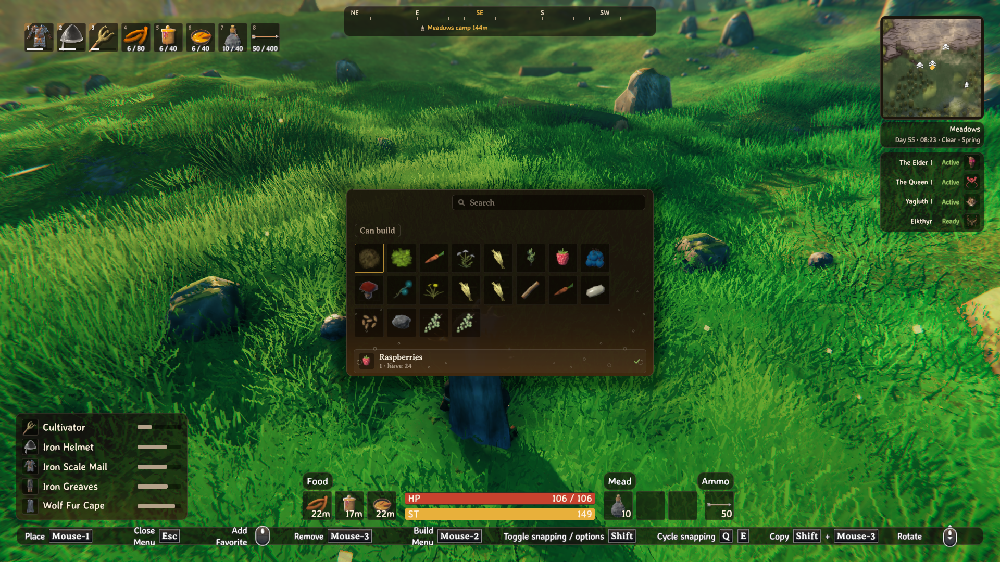
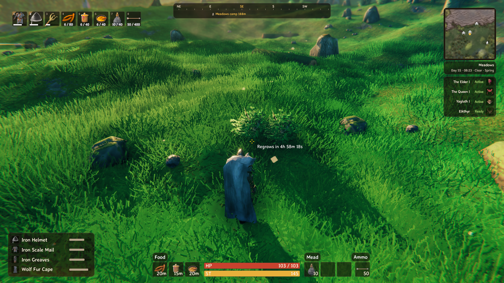
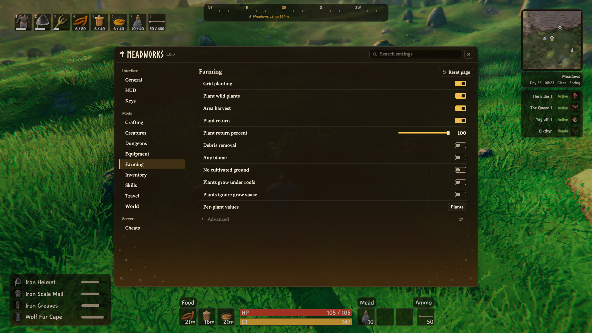
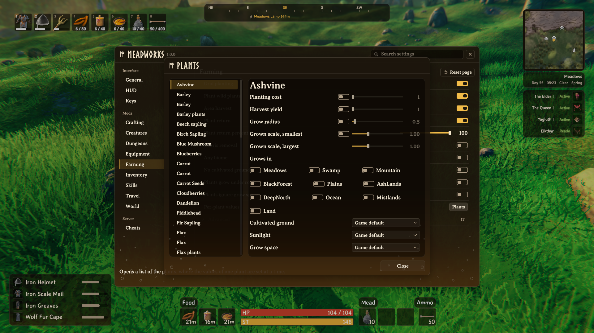
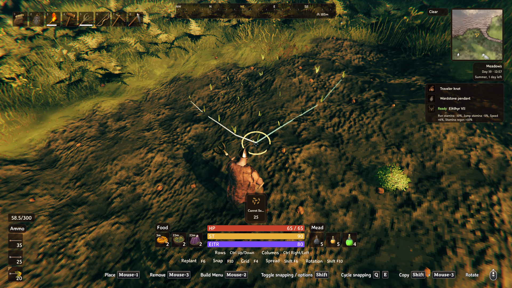
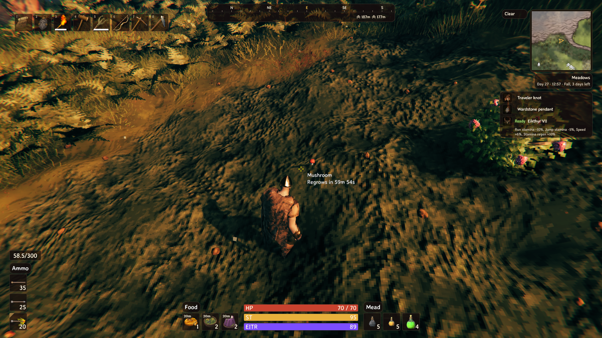

# MeadWorks Farming

Planting, harvesting and plant tuning for the cultivator. Configure the module on the Farming page of the MeadWorks menu (F8). Needs Meadworks: Core at exactly the same version.

## What it does

### Plant a grid
Grid, Rows, and Columns are beside the recipe in the cultivator menu, using Core controls. Dimensions run from 1 to 10 and start at 5 by 5; saved dimensions are preserved, including 1 by 1 for a single plant. The same dimensions remain under Advanced on the Farming page, and the planting shortcuts change those same saved values. While a cultivator crop or sapling is selected, plant a row or a grid in one click. The game's ghost is the anchor and the other ghosts follow the ghost's own rotation as you turn it, spaced by that plant's own grow radius. A gold ring on the ground marks the anchor, a line runs from it along the first row and another along the first column, and a gold line shows which plant the grid snapped to. Grid snapping aligns the anchor with nearby plants of the same kind, or crops of the same spacing, on the nearest free spot, and follows an existing row when one is detected; a row planted at an older spacing still gives its direction. A new grid snapped to the edge of a field turns to the side that keeps it off the plants already standing. Beside a plant that stands alone, hold the game's alternative placement key (Left Shift by default) to place the new plant one step from it at any angle; the grid then runs on in that direction. With World grid on, a plant with nothing nearby to snap to goes onto a fixed grid of the world for its heading and spacing, so fields planted apart line up with each other. Only the plant under the crosshair has to stand within reach, so a grid wider than the reach plants whole. Each cell still has to be legal ground and costs its seed and stamina. Planting stops when the seeds run out, and the ghosts past the seeds you have in reach show red. The cost in the build HUD is the whole grid's: one plant's cost times the cells that fit. A grid larger than five by five is checked a slice of cells at a time and planted over the next frames, and the next click waits until it is in the ground. Seeds are also taken from nearby chests when Crafting is installed and its Use nearby chests setting is on. If another player owns a shared chest needed for seeds, planting asks for access and waits before placing anything that needs those seeds.

Random rotation starts on. Random spread starts off; enabling it adds a small offset inside each cell, a slight lean of up to 2.5 degrees and enough extra spacing to preserve grow space. The preview shows the same offsets and rotations used for placement.

### Hoe terrain brush
Use a square or round brush to repeat the hoe's leveling, raising and path operations over several spots. Stamina, tool wear and any material cost apply per spot. A size of 1 keeps the hoe’s usual footprint. With Hoe clears obstacles on, leveling, raising or smoothing clears eligible trees, stumps and logs. Rocks, ore and built pieces stay in place.

### Replant after harvest
Replant on harvest starts off. When enabled, harvesting a planted crop can plant the same crop in its place. With Replant style set to Selected crop it plants the crop last chosen in the cultivator menu instead, and the harvested crop when none was chosen this session. The hover text identifies the replacement. Its full seed cost must be removed before it is planted, even with No cost enabled. Crafting's nearby chest setting also supplies these seeds. Wards, build restrictions and the crop's growth requirements still apply. Regrowing bushes and mushrooms are left to their own regrowth.

### No wasted seeds
A plant is refused where it would wither under the current growth rules, such as in the wrong biome, on uncultivated ground, outside a shield in extreme temperatures or under a roof. Grow space is ignored by default and can be required under Plant tuning. The ghost turns red for the plant under the crosshair and for each cell of a grid. With Plant whole grid only on, every cell must fit and be paid for before the grid is planted.

### Plant wild plants
The cultivator also plants berry bushes, mushrooms, flowers, wild crops and tree saplings and stones and branches, with crop resources available through an optional switch. Each plant costs one of its item (a crop resource, or any plant placed ripe, costs what its first pick gives), and appears in the menu once you have found that item. A placed plant is the game's own pickable. By default it starts picked and shows as a small plant while it grows, then returns to full size for harvest. After picking, every planted pickable that grows back stays visible as a small plant with its name, hover target and regrowth timer, and is seen from as far away as the full plant; players walk through it while it is small, and the cultivator can still remove it. That covers berry bushes, mushrooms, flowers, wild crops, stones and branches. The cultivator no longer offers vines. Vines planted in earlier versions still regrow and only lose their berries. Wild pickables the world grew show the same small plant while they grow back. Wild plants do not need cultivated ground, and they follow the grid. Wild plant spacing sets how far apart they stand, in a grid and side by side. On Auto each kind has its own: raspberry, blueberry and lingonberry bushes 1.5 m, cloudberry, smoke puff and fiddlehead 1 m, thistle and dandelion 0.75 m, mushrooms 0.5 m, and every other pickable from how wide its model is (0.5 to 2 m). A value in meters, from 0.25 to 3, replaces Auto for every kind. The same slider sits under Rows and Columns in the cultivator menu. Only the cultivator removes a planted wild plant; the hammer leaves it standing. Each kind has a switch on the page.

### Remove and get back
With Plant return on, the cultivator removes a planted crop or sapling and gives back part of what it cost. The game's ward and building rules still apply. The target's hover shows the return for each material while the cultivator is equipped. Counts round down: one seed returns zero at any percentage below 100%. Free-build worlds return zero, and so do planted wild plants unless Wild plant return is on. With it on, a wild plant that was planted small returns its planting cost at the same percent. A plant placed ripe, with Placed plants start picked off, gave its cost back as its first harvest and returns nothing, and so does a wild plant planted before this setting existed. A ripe planted wild plant, a vine included, is picked as it is removed, so its harvest drops; one that is still growing gives nothing. Removing a planted wild plant, crop or sapling plays the plant's pick effect in place of the structure sound, and planting a wild plant plays the cultivator's planting effect. With Debris removal on, cultivating ground also clears picked plants that will not grow back, and removing a plant clears around it.

### Harvest an area
Use alt-interact (Shift+E with the default keyboard bindings) to pick a ready plant, stone, branch, flint or any other pickable and up to 50 more of the same kind within the harvest radius (5 m by default). Plain Use picks only the target. The localized hover prompt shows your bound alt and Use keys, the eligible target count including the target (at most 51), and the radius. Counts describe targets, not confirmed collection. All crops widens a crop harvest to other ripe crops; other pickables still take only the same kind. Alt-interact on a beehive takes honey from the other ready hives in the radius. Containers, item stands and warded targets are excluded. Items from the whole harvest, including the target and honey, go into your inventory through the game's pickup system. Carry weight and inventory space still apply; anything that does not fit stays where it dropped. Other ground items are left alone.

A planted crop has a 5% chance by default to grow giant. The game rolls once when it grows. A giant crop is larger and yields three times as much when picked.

### See what is happening
Growth timers show on a growing crop how long until it is ready, or why it cannot grow, and on a picked plant that grows back how long is left. Elapsed timers show Growth pending until the game processes growth or regrowth. If the native growth clock is unavailable, the crop ETA is omitted. The timer includes the season's growth multiplier; winter slows growth rather than stopping it. Resource health shows the health of a tree, log or rock you point at.

### Change plants one by one
Plant tuning is the master for per-plant numbers and all four global growth switches. Off restores native values and growth checks while keeping saved choices. An explicit per-plant condition wins over its global default while tuning is on. Display names and wild planting remain separate.

Per-plant tuning changes what a plant costs, what it yields, how much room it needs, how large it grows, how long it takes and where it may grow. A crop or sapling's grow time is its shortest; the longest keeps the game's proportion. A wild plant's regrow time applies to planted copies only, never to plants growing wild. The Plants button on the Farming page opens a searchable list by localized or internal name and sets one plant at a time. Controls show captured native baselines when an override is absent. Only supported controls appear: pickable-only wild plants have no crop radius, grown scale, or growth-condition controls, and saplings without a harvest pickable have no yield control. If grown variants have different native yields, their amounts are shown without a single-value override. Invalid overrides appear in their field row; saved unsupported entries remain visible for clearing. Reset plant clears editable overrides for that plant while preserving every other plant and values you cannot edit. Plant keys are case-insensitive. The same values can be entered as lists in the config file. A name and a description in the lists give a plant your own wording in the cultivator's menu. An empty name list leaves the item's own name, and an empty description list leaves the description empty.

## Controls

Planting shortcuts work only with the cultivator equipped, a plant selected, and no window or text field active. Every planting shortcut is configurable under Advanced on the Farming page. The controller shortcuts can be captured by holding LB and pressing a D-pad direction; the configuration writes these as an arrow plus JoystickButton4. With Grid planting on, the cultivator shows Place, Build menu and the planting shortcuts in the bottom hint bar, with row and column keys paired. The hints follow your keyboard bindings and the Key hints setting. The game's tool hints return when you put the cultivator away, switch off Grid planting or use a controller.

| Action | Keyboard | Controller |
| --- | --- | --- |
| Increase / decrease rows | Right Ctrl + Up / Down | LB + D-pad Up / Down |
| Increase / decrease columns | Right Ctrl + Right / Left | LB + D-pad Right / Left |
| Toggle grid planting | F4 | Unbound |
| Toggle grid snapping | F10 | Unbound |
| Toggle replant on harvest | F6 | Unbound |
| Toggle random spread | Left Shift + F6 | Unbound |
| Toggle random rotation | Left Shift + F10 | Unbound |
| Area harvest | Alt-interact (default Shift + E) | Native alt-interact |
| MeadWorks settings | F8 | Native settings control |

F8 always opens MeadWorks settings. F7 remains the creature compendium and F9 remains the game's controller control. The planting toggles can be rebound to controller buttons on the Farming page. Turning replanting on applies to later harvests even after putting the cultivator away.

## Settings

Press F8 and open the Farming page. Every setting row has a hover tip describing its effect. A setting marked Advanced is under the Advanced row of the page. A list is written as `plant=value` pairs with commas between them, using the game's internal plant names.

| Name | Default | Default permission | What it does |
| --- | --- | --- | --- |
| Terrain brush size | 1 | Admins | Sets the brush size (1 to 5, with 1 for a single spot). Advanced. |
| Terrain brush shape | Square | Admins | Uses a square or round brush. Advanced. |
| Hoe clears obstacles | On | Admins | Leveling, raising or smoothing ground with the hoe breaks trees, stumps and logs that the weakest tool breaks, leaving rocks, ore and built pieces alone. |
| Giant crop chance | 5% | Admins | Chance that a planted crop grows giant (0% to 25%). |
| Grid planting | On | Everyone | The cultivator plants several crops at once, in a grid. |
| Rows | 5 | Everyone | How many rows the planting grid has (1 to 10). Advanced. |
| Columns | 5 | Everyone | How many columns the planting grid has (1 to 10). Advanced. |
| Plant whole grid only | Off | Admins | Nothing is planted unless every cell of the grid can be planted. Advanced. |
| Grid snapping | On | Everyone | Aligns the anchor with nearby plants of the same kind, or crops of the same spacing, on the nearest free spot. |
| World grid | Off | Admins | With nothing nearby to snap to, the plant goes onto a fixed grid of the world for its heading and spacing. Advanced. |
| Replant on harvest | Off | Everyone | Pays the seed cost and replants the same harvested crop. |
| Replant style | Harvested crop | Everyone | Harvested crop replants what was picked. Selected crop replants the crop last chosen in the cultivator menu. Advanced. |
| Random spread | Off | Admins | Adds small cell offsets, a slight lean and extra spacing to preserve grow space. |
| Random rotation | On | Admins | Gives each plant a random yaw. |
| Area harvest | On | Everyone | Alt-interact picks nearby ready pickables; plain Use picks one. |
| Harvest radius | 5 | Admins | How far around the pickable or beehive the harvest reaches, in meters (1 to 10). Advanced. |
| Harvest style | Same kind | Admins | Same kind picks matching pickables. All crops widens crop harvests to every ripe crop in reach. Advanced. |
| Plant return | On | Admins | Removes native crops and saplings and returns the configured fraction of each material, rounded down. |
| Plant return percent | 100 | Admins | How much of the planting cost comes back, in percent (0 to 100). |
| Wild plant return | Off | Admins | Removing a planted wild plant also returns its planting cost. A plant that was placed ripe returns nothing. Advanced. |
| Debris removal | On | Admins | Cultivating ground also clears picked plants that will not grow back. |
| Plant wild plants | On | Admins | The cultivator can plant wild plants, such as berry bushes and mushrooms. |
| Placed plants start picked | On | Admins | A wild plant you place starts empty and has to grow before its first harvest. Advanced. |
| Wild plant spacing | Auto | Admins | Meters between planted wild plants, in a grid and side by side (0.25 to 3). Auto gives each kind its own spacing from its size. |
| Planted regrow minutes | 60 | Admins | How long a planted crop, sapling or edible plant takes to grow, in minutes (1 to 240). A per-plant grow time overrides one plant. The planted and picked times stay as the game wrote them: a shorter value can ripen a plant that has already waited longer, at its next check, and a longer value makes it take longer. Stones keep the game's time. Branches and flint keep their 240 minute respawn. Advanced. |
| Plant berry bushes | On | Admins | Lets the cultivator plant the berry bushes. Advanced. |
| Plant mushrooms | On | Admins | Lets the cultivator plant the mushrooms. Advanced. |
| Plant flowers | On | Admins | Lets the cultivator plant the flowers. Advanced. |
| Plant wild crops | On | Admins | Lets the cultivator plant the wild flax and barley. Advanced. |
| Plant crop resources | Off | Admins | Lets the cultivator plant the crop pickables. A planted one gives one pick and is then gone. Advanced. |
| Plant tree saplings | On | Admins | Lets the cultivator plant the tree saplings. Advanced. |
| Plant stones and branches | On | Admins | Lets the cultivator plant stones, flint, wood branches and Frostwood branches. Advanced. |
| Plant tuning | On | Admins | Master for per-plant numbers and global growth switches; Off restores native values and growth checks. Saved choices are kept. |
| Per-plant values (Plants button) | | Edits follow each row’s permission | Opens a list of the plants, where the values of one plant are set at a time. |
| Per-plant costs | empty | Admins | What each plant costs to place, as plant=amount pairs. Advanced. |
| Per-plant yields | empty | Admins | What each plant gives when harvested, as plant=amount pairs. Advanced. |
| Per-plant grow radius | empty | Admins | The room each plant needs around it, as plant=meters pairs. Advanced. |
| Per-plant grown scale | empty | Admins | How large each plant grows, as plant=size pairs. Advanced. |
| Per-plant grow time | empty | Admins | Optional minutes for one crop, sapling or edible plant. Empty uses Planted regrow minutes. It does not change stones, flint, branches or other non-food pickables. Advanced. |
| Per-plant biomes | empty | Admins | Where each plant may grow, as pairs such as plant=Meadows\|Mountain. Advanced. |
| Per-plant cultivated ground | empty | Admins | Which plants skip the cultivated ground check, as name=off pairs. name=on keeps the game's own check. Advanced. |
| Per-plant sunlight | empty | Admins | Which plants skip the open sky check, as name=off pairs. name=on keeps the game's own check. Advanced. |
| Per-plant grow space | empty | Admins | Which plants skip the free room check, as name=off pairs. name=on keeps the game's own check. Advanced. |
| Any biome | Off | Admins | Every plant grows in every biome. |
| No cultivated ground | Off | Admins | Plants grow on ground that was not cultivated. |
| Plants grow under roofs | Off | Admins | Plants grow under a roof. |
| Plants ignore grow space | On | Admins | Plants grow however near they stand to other things. |
| Plant display names | empty | Admins | Your names for plants, as plant=name pairs. Config storage used by Plants; hidden from the settings page. Advanced. |
| Plant display descriptions | empty | Admins | Your descriptions for plants, as plant=description pairs. Config storage used by Plants; hidden from the settings page. Advanced. |
| Increase rows | Right Ctrl + Up | Local binding | Planting shortcut. Advanced. |
| Decrease rows | Right Ctrl + Down | Local binding | Planting shortcut. Advanced. |
| Increase columns | Right Ctrl + Right | Local binding | Planting shortcut. Advanced. |
| Decrease columns | Right Ctrl + Left | Local binding | Planting shortcut. Advanced. |
| Controller increase rows | LB + D-pad Up | Local binding | Planting shortcut. Advanced. |
| Controller decrease rows | LB + D-pad Down | Local binding | Planting shortcut. Advanced. |
| Controller increase columns | LB + D-pad Right | Local binding | Planting shortcut. Advanced. |
| Controller decrease columns | LB + D-pad Left | Local binding | Planting shortcut. Advanced. |
| Toggle grid planting | F4 | Local binding | Planting shortcut. Advanced. |
| Toggle grid snapping | F10 | Local binding | Planting shortcut. Advanced. |
| Toggle replant on harvest | F6 | Local binding | Planting shortcut. Advanced. |
| Toggle random spread | Left Shift + F6 | Local binding | Planting shortcut. Advanced. |
| Toggle random rotation | Left Shift + F10 | Local binding | Planting shortcut. Advanced. |

MeadWorks handles settings sync. The host or an authorized admin can set gameplay and display rows to Admins or Everyone in game. The four global growth switches use a world-wide value even if Everyone can edit them. Other rows use the server value under Admins and each player’s own value under Everyone. Shortcut bindings always belong to each player. Solo players can edit every row.

## Known limits

- Rows and Columns start at 5 and are visible beside the cultivator recipe. Set them to 1 for a single plant.
- Planted wild plants do not return their planting cost when removed unless Wild plant return is on; a ripe one drops its harvest.
- Debris removal only sweeps what your own game owns. Another player's leftovers wait for their cultivator.
- In multiplayer, collecting the harvest requires Farming on the peer that owns the plants or hives.
- Seeds come from chests only when Crafting is installed and its Use nearby chests setting is on. Otherwise the bag alone pays.
- Removal follows the game's ward and building rules, so another player's ward refuses it.
- A planted crop resource gives one pick and is then gone. It does not regrow.
- Stones, flint, branches and other non-food pickables keep the game's respawn time, planted or wild. Branches and flint respawn in the game's 240 minutes. A placed stone, flint or branch is not started picked. A stone an older build saved as picked loads as a stone again: the picked flag is cleared before the game deletes it, and the picked time is left alone.
- Changing Planted regrow minutes does not rewrite a plant's age. A world opened without MeadWorks uses the game's durations with those same times.
- On a server without MeadWorks, a MeadWorks client uses the game's durations.
- With World installed, the season scales crop growth time, and some weather can advance growth or regrowth.
- Replant confirmation uses the crop owner's harvest markers, so Farming must also run on that peer. Timed-out or unconfirmed harvests do not replant.

## Compatibility

Needs Core at exactly the same suite version. MeadWorks clients can join servers without MeadWorks and use other mods. A MeadWorks server refuses only a missing, wrong-version or mismatched MeadWorks install. The server and its players use the same Farming version for shared harvests and replanting.

## Install

Install with a mod manager, or put `meadworks.farming.dll` in `BepInEx/plugins`. Install Core as well. Install on each player who wants it, and on the server for admin settings and locks.

## License

MIT. Copyright (c) 2026 expDARE.
