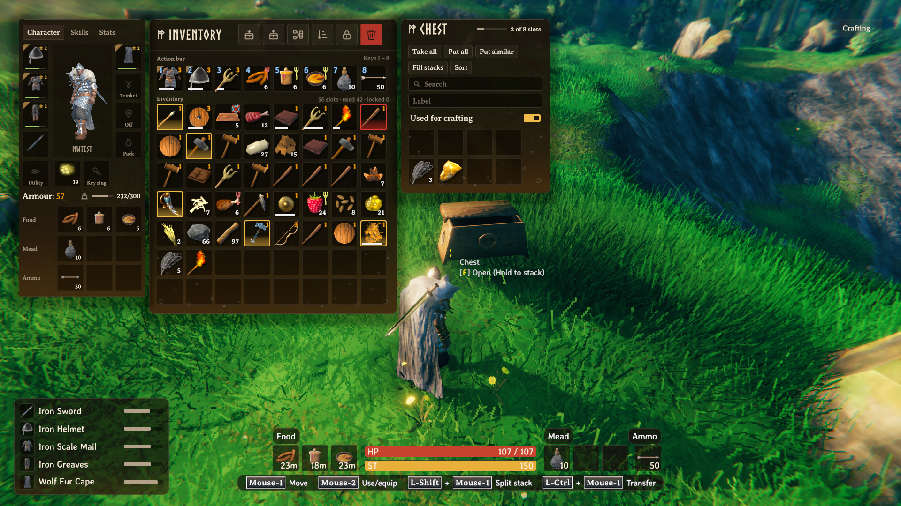
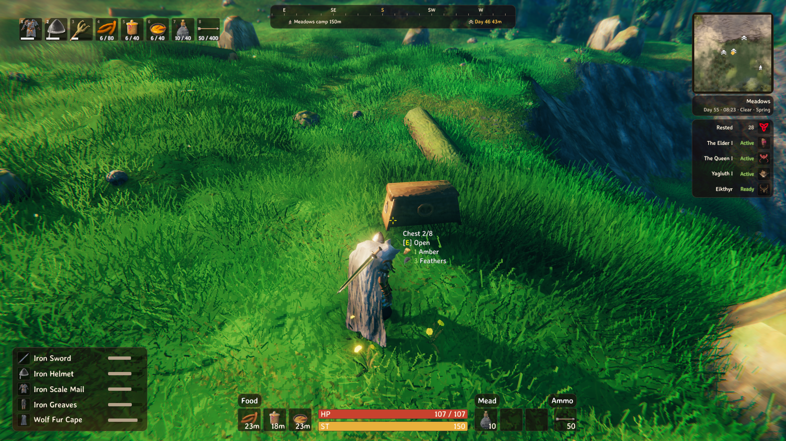
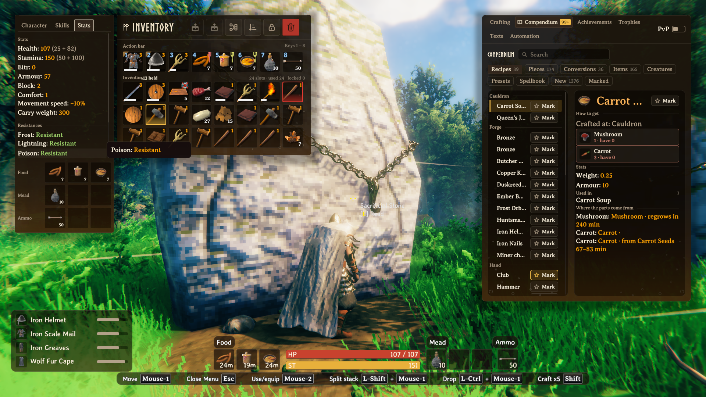
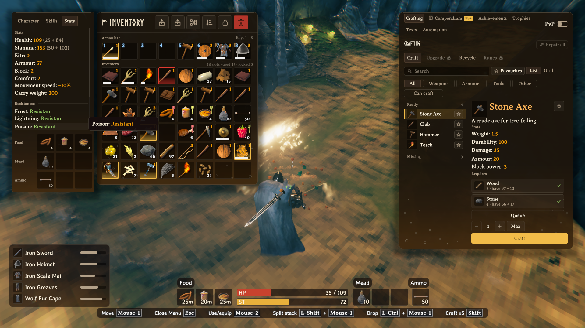
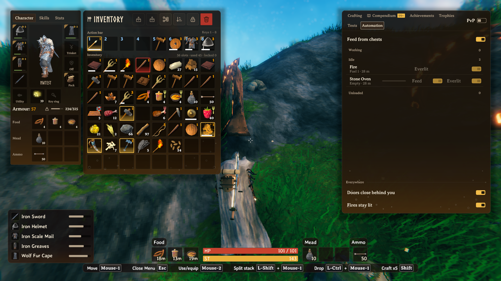
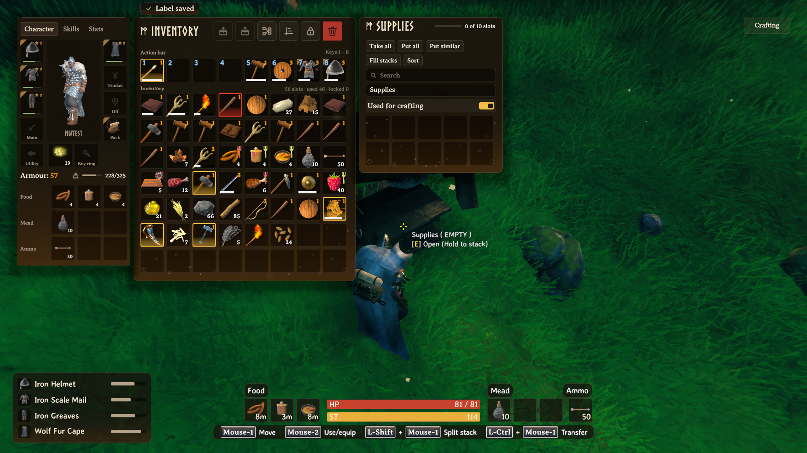

# MeadWorks Inventory

A larger inventory, a new inventory screen, chests that several players can use, and automatic pickup. Switch each part on or off on the Inventory page of the MeadWorks menu (F8). Needs Meadworks: Core at exactly the same version.

## What it does

### Carry more
- **Inventory size.** Choose the height of your inventory: 4 to 8 rows of the game's 8 columns, the action bar included. The default is the game's 8 by 4. A smaller size is refused while an item is in a slot it would remove.
- **Stack multiplier.** Multiplies how many of an item fit in one stack. It is 2 by default. Coins are fixed at 999 outside COINS and ignore this setting.
- **Per-item stacks.** A file you write, `config/MeadWorks/inventory/stacks.json`, gives single items a stack size of their own, 1 to 9999, for example `[ { "item": "Wood", "stack": 200 } ]`. A listed item ignores the multiplier; weight still follows it. Coins, keys and items the game does not stack keep their own limits. The file is read at the next world start, and a server's table applies to everyone connected. To stop using the table, leave `[]` in the file.
- **Base carry weight.** How much you can carry before worn gear and effects add to it, 100 to 1000. 300, the default, is the game's own value.
- **Portals take all items.** Off by default. On, ore, metal and the other items the game keeps out of portals go through them, and the no-portal mark and tooltip line disappear.
- **Keep on death.** Choose Nothing (the world's own death rules), Worn and action bar (worn gear and the top inventory row stay with you), or Everything (all items stay and no tombstone is made). Nothing is the default. Old Off and On settings become Nothing and Everything. Skills and food still follow the world rules.
- **Grave recovery.** Gear worn at death is remembered with its owner. When it returns to your inventory, it is equipped through the game's equip path, pack first. Gear you already wear stays on; conflicting recovered gear stays in the bag. This also covers partial recovery. Older graves without wear marks cannot identify which bag items were worn.

### The inventory screen
The inventory screen is three windows side by side: equipment at the left, the bag beside it and crafting at the right. With a chest open it is four: equipment, bag, chest and crafting, so gear can be worn and moved between the chest, the bag and the equipment cells.

- **Bag.** The title row has a 32-pixel trash slot at its right end, drawn like the other slots with a trash glyph. It stays outside the storage cells so sorting and extra rows never move it. The action bar and bag sit directly below the title row; a four-row bag window is 12 pixels shorter. New items and sorts fill the bag from the top. Trash takes any dragged item from your inventory, the action bar included, except worn, locked and quest items. With Trash anything on in Cheats, a solo player, host or admin can destroy those too; worn gear comes off first. Clicking it or dropping an item on it opens one confirmation before destroying that stack; with Confirm trash off the stack is destroyed at once. The slot uses the kit's radius-6 fill and outline at the native canvas pixel scale.
- **Buttons.** One row of labeled buttons under the title, in the chest window's style: To chests, Restock, Merge, Sort, Lock slot and No pickup. The trash stays in the title row. Sort opens a list of orders (Category, Name, Weight); choosing one merges compatible stacks and sorts by it at once, and the list marks the last order used. To chests, Ctrl+Q, Restock and Merge report moved item counts and destinations. Shared-chest requests show progress until confirmed. Sort, storage and Merge leave locked, favorite, worn, quest and action bar items alone. Restock tops up existing bag stacks, action bar stacks and assigned Food, Mead and Ammo stacks, using the current slot counts; locked stacks stay untouched.
- **Lock slot.** Press Lock slot, then press the slot you want to lock or unlock. The button stays lit until you press a slot or press it again, and a locked item shows a mark. With a gamepad it acts at once on the selected slot. A lock keeps an item out of the bulk actions only. The game's own drag, Take all and Place stacks work as before.
- **Equipment window.** Three tabs over three rows of Food, Mead and Ammo, which stay in view on every tab. Character opens with your model standing between the worn equipment cells, with COINS and KEY RING beneath the model and the Armor row under them. The weight meter sits to the right of Armor, keeping its weight glyph and overweight color. Its track shortens when the numbers need more room. A worn item shows a bronze corner triangle and its durability line. With Equipment installed, rarity frames also show in the dedicated cells. Right-clicking worn gear unequips it, and clicking a slot with a picked-up item equips it. Stats lists health, stamina, eitr, armor, block, comfort, movement speed and carry weight, then resistances and effects, and hovering a stat shows what it is made of. Skills lists your skills with level and progress, sorted by level or name.
- **Character card.** While Restyle game windows is on, the buttons of the game's character card open the Texts, Trophies and Achievements tabs and the Skills tab of the equipment window. The inventory screen hides the card once every button has a tab. With the restyle off, or without a tab, the card and the game's windows are unchanged.
- **Dedicated slots.** On by default. Food, mead and ammo use the labeled cells of the equipment window; with the switch off those rows show what the bag carries of each. Worn gear, PACK, COINS and KEY RING are part of the equipment panel regardless of this switch. Items remain in the player inventory for weight, crafting, traders, doors and death. Explicitly moving coins or keys back to the bag keeps them there. Equipping ammo from the bag merges matching dedicated stacks first, then uses the first free Ammo cell. Full slots leave the remainder in the bag. Hotbar and held stacks stay in place.
- **Food.** With Dedicated slots on, an empty stomach slot is filled from the first eligible Food cell, checked once per second. Active foods are never replaced or duplicated. Eating waits while dead, teleporting, in a cutscene, or holding that item on the drag pointer. Food, mead and ammo cells use the same item hover card as the bag; empty cells have no card. With Equipment installed, manually refreshing an active food keeps its native effect without replaying the eat animation.
- **Eat all and Drink.** With dedicated slots on, the Food row has an Eat all button and the Mead row a Drink button. Eat all eats every food in your food cells that you can eat now: a free place is filled, a food that can be eaten again is topped up, and no food that is still good is replaced. Drink uses the first mead in your mead cells that is ready. Neither binds a key.
- **Food countdowns.** The HUD shows active food buffs even after the last item in a stack is eaten. Food cells in the equipment window show the same countdown for their food. Whole minutes change to minutes:seconds in the last minute, with a red exclamation mark; an ended buff shows 0:00 briefly before clearing or being replenished.
- **HUD mead and ammo follow the slots.** With Dedicated slots on, these boxes show what sits in those slots. The one Ammo box shows the ammo your bow takes, or the first filled Ammo slot.
- **Packs.** Enable Backpacks on the Inventory page (Off by default) to craft and wear packs. A worn pack from Equipment adds one to three rows to the bag. It always uses PACK, beside utility gear. It stays on while the items in its rows have no room in the rest of the bag.
- **Utility slots.** With the server's Utility slots setting at 2, a second utility item is worn beside the first.
- **Equipment panel.** The Character tab shows what you wear.
- With Equipment's Dual wield on, dropping a supported one-handed weapon from the bag onto either hand slot follows equip order: first main, then off, with later weapons replacing the off hand. Shields keep their native left-hand placement. Unequipping the main does not move an off-hand weapon to it.

### Chests
- **Container preview.** Hover a chest, cart or ship storage that a player built to see its name, used and total slots and the item totals, sorted by name, with each item's icon. World loot chests and graves show no preview. Contents rebuild on inventory changes, including the game loading updated chest data, rather than on a timer.
- **Chest panel.** On the inventory screen, a chest, cart, ship or grave opens beside the bag, between it and crafting; the equipment window stays. When the four windows do not fit, the side margins and the bag's and chest's padding narrow first; if that is not enough, all four windows are drawn smaller together, text included, so an 8 by 8 chest keeps full-size slots at 1920 x 1080 and nothing scrolls. A chest scrolls only past the smallest size. Take all, Put all, Put similar, Fill stacks and Sort preserve protected items. Graves use native Take all. Search dims nonmatching cells. Labels persist with the container; Used for crafting excludes disabled chests from crafting, building, feeding, To chests and Restock.
- **Safe item move.** Off by default. With it on, an item is dropped on the ground only while the Drop key is held (Ctrl and a click by default), so a slip drops nothing. A drop without the key returns the item to where it came from. With it on, a delivery that does not fit waits for a free bag slot and says so once.
- **Sort chests on close.** Merges and sorts a chest when you close it. Personal and Off by default. The old server-controlled key is retired; each player opts in again.
- **Store nearby.** Ctrl+Q puts what you carry into nearby chests that already hold the same item. Worn, favorite and hotbar items stay with you.
- **Shared chests.** More than one player can use the same chest at the same time. On by default; it works on host worlds and dedicated servers. Players with access can open and use a newly placed shared chest right away, before the next world save. The host is the sequencer in a hosted world and keeps direct access to its own chests. A put or take is final only once the chest itself shows it, and until then the items are held safe and come back if the request fails.
- Dungeon and camp loot chests are not shared.
- Crafting uses its own chest range, up to 100 meters, including on shared clients. To chests and Restock keep the Inventory chest range.

### Chest size
Two server-controlled numeric settings change player-built stationary storage. The host, solo player or server admin can change them.

Chest width (3 to 8) and Chest height (2 to 8) are slot counts for every player-built chest. Each dimension keeps at least its native size, up to 8, so the defaults 3 and 2 keep every chest native. A change applies at once to every loaded chest, the one you have open included, and to every other chest when it loads. A chest nobody has opened never loses a slot that holds an item. When a player opens a chest that is larger than the setting, or the setting is lowered while the chest is open, it shrinks at once: items outside the new grid move into its free cells, and what still does not fit drops at that player's feet. Old width settings above the default migrate to wood-chest widths 6 and 7; old row settings stay 2 to 6. Owners publish dimensions for viewers and ownership changes.

The inventory keeps the game's 8 columns; a character saved with wider rows by an earlier version keeps every item. Inventory height is 4 to 8 total rows, including the action bar. Saved bag-row settings migrate by adding the action bar once. Solo players, hosts and admins retain control of all three settings.

World loot chests, pots, gifts, carts, Karve, longship and Drakkar storage keep their native sizes. Chest settings are not applied on servers without MeadWorks.

### Pick things up
Auto pickup makes loose items near you glide to you and be picked up when they fit in your inventory and under your carry weight. Shift+V turns it on and off. Pickups per frame is how many are taken in one frame (8 by default), and each plays the pickup effect and shows a message. Pickup radius and a list of items to ignore are settings. Collected items glide at 15 meters per second. To exclude an item, press No pickup for this item in the bag header, then pick the item. A second pick removes the exclusion. With a gamepad, the button acts on the selected grid item. The comma-separated ignore list remains editable in settings, and manual pickup still works.

### Wear things on pickup
Auto equip puts on armor (helmet, chest, legs, cape), a utility item or a pack you pick up when its own slot is empty. A filled slot is left alone. On by default.

### Coins and keys
- **COINS.** The purse holds up to 9,999 coins at 1% of their normal weight. Coins stack to 999 everywhere else, at normal weight. New coins fill the purse first, trader proceeds included, and coins taken from a chest are added to it. The same inventory still counts and spends them. There is no setting for the capacity or the weight.
- **KEY RING.** Every door key you pick up or take goes on the ring, and doors still find them. Keys stack up to 10 of a kind, in the ring, the bag and chests alike, whatever the stack multiplier. The cell shows a held key's icon and how many keys are on the ring; its tooltip lists them. A kind of key found for the first time marks the cell in gold until you open the ring. Click it to open the ring beside the cell: one cell for every kind of key you have found, with a count, and a dimmed cell for a kind you no longer carry. Click or drag a key to take it to the bag; drop a key on KEY RING to put it back. Keys you marked KEY 1 to 3 before carry over without being copied.

PACK, COINS and KEY RING sit on the Character tab of the equipment window. Ammo uses the equipment window's Ammo row.

### Keys
| Key | What it does |
| --- | --- |
| Shift+V | Turns auto pickup on and off. |
| Ctrl+Q | Puts what you carry into nearby chests that already hold the same item. |
| Ctrl and click | With Safe item move on, drops the item you click out of the inventory. |

All three can be changed on the Keys page.

## Settings

Press F8 and open the Inventory page. Every setting row has a hover tip describing its effect. A setting marked Advanced is under the Advanced row of the page. Server controlled values come from the server in multiplayer; admin-lockable values stay personal unless locked. Solo players, hosts and admins can edit gameplay values.

| Name | Default | Policy | What it does |
| --- | --- | --- | --- |
| Inventory height | 4 | Server controlled | Total rows including the action bar, 4 to 8. Occupied rows are kept when shrinking. |
| Food slots | 3 | Personal | 1 to 5 cells. Removed items return to the bag or remain reachable until space is free. Advanced. |
| Mead slots | 3 | Personal | 1 to 5 cells. Removed items return to the bag or remain reachable until space is free. Advanced. |
| Ammo slots | 3 | Personal | 1 to 5 cells. Removed items return to the bag or remain reachable until space is free. Advanced. |
| Stack multiplier | 2 | Server controlled | Multiplies how many of an item fit in one stack (1 to 10). |
| Base carry weight | 300 | Server controlled | How much you can carry before worn gear and effects add to it, from 100 to 1000 (300 is the game's own value). |
| Portals take all items | Off | Server controlled | Ore, metal and the other items the game keeps out of portals go through them. Advanced. |
| Keep on death | Nothing | Server controlled | Nothing, Worn and action bar, or Everything. Hover for what each choice keeps. |
| Dedicated slots | On | Personal | On the inventory screen, food, mead and ammo use the cells of the equipment window. Equipment, PACK, COINS and KEY RING work regardless. |
| Utility slots | 1 | Server controlled | How many utility items you can wear at once, 1 or 2. Each one counts as worn. |
| Equipment panel | On | Personal | Shows what you wear in a panel of its own, one slot per kind of gear. |
| Backpacks | Off | Server controlled | Enables pack recipes and wear; turning Off is refused if the worn pack and its row contents cannot fit in the ordinary bag. |
| Auto equip | On | Personal | Armor, a utility item or a pack you pick up is put on when its own slot is empty. |
| Container preview | On | Personal | Pointing at a chest shows what is inside it without opening it. |
| Chest range | 20 | Server controlled | How far away a chest can be and still count as near you, in meters (5 to 50). |
| Chest width | 3 | Server controlled | Columns of every player-built chest, 3 to 8; a chest never gets fewer than its native columns. Applies to every chest at once; a larger chest shrinks when it is next opened, and what no longer fits drops at the opener's feet. |
| Chest height | 2 | Server controlled | Rows of every player-built chest, 2 to 8; a chest never gets fewer than its native rows. Applies to every chest at once; a larger chest shrinks when it is next opened, and what no longer fits drops at the opener's feet. |
| Shared chests | On | Server controlled | More than one player can use the same chest at the same time. |
| Sort chests on close | Off | Personal | Merges and sorts chests you close. |
| Safe item move | Off | Personal | An item is dropped on the ground only while the drop key is held, so a slip of the mouse drops nothing. |
| Drop key | Ctrl+Mouse0 | Personal | Hold it while you move an item out of the inventory to drop it. Used while Safe item move is on. Advanced. |
| Confirm trash | On | Personal | Asks before the trash destroys an item. Off destroys a dropped item at once. |
| Store nearby | Ctrl+Q | Personal | Puts what you carry into nearby chests that already hold the same item. Worn, favorite and hotbar items stay with you. |
| Auto pickup | On | Personal | Loose items near you glide to you and are picked up when they fit in your inventory. |
| Pickup radius | 4 | Admin-lockable | How near an item must be to be picked up, in meters (1 to 10). |
| Pickups per frame | 8 | Admin-lockable | The most items taken in one frame (1 to 20). Advanced. |
| Pickup ignore list | empty | Personal | Items that are never picked up by themselves, as a list of names with commas between them. Advanced. |
| Junk list | empty | Personal | Items marked as junk from the bag; listed items are not picked up automatically, and Drop junk puts them on the ground. Advanced. |
| Pickup key | Shift+V | Personal | Turns auto pickup on and off. Advanced. |

## Known limits

- Restore Chest width to 3 and Chest height to 2, then open each enlarged chest before removing Inventory: what no longer fits drops at your feet. The native chest loader cannot read items in added columns.

- Shared chests are on by default. They need the server and the players who use the chest to run the same chest protocol, which comes with the same MeadWorks version. This does not change who can join.
- The food, mead and ammo dedicated cells are on by default on the inventory screen. An empty PACK cell is hidden while Backpacks is Off. COINS and KEY RING stay on the equipment panel.
- A worn pack cannot be taken off, replaced, dropped, moved to a chest or destroyed while the items in its rows have no room in the rest of the bag. Free the cells first.
- A second utility item is not drawn on your character.
- With the Lox-hide pack at Inventory height 10 the bag has twelve bag rows below the action bar. On the inventory screen its slots fit the available height, and past that the rows scroll.
- Items in dedicated slots, backpack rows, the coin purse and bag stacks above the game's normal sizes are saved in the character's own item list, below the game's bag rows and split to the game's normal stack size. With MeadWorks they go back to their slots, rows and purse when the character loads. Without MeadWorks they drop at your feet the first time the character loads, and you decide what to keep. An item only MeadWorks adds, such as a backpack, cannot exist in a game without it: it stays in the character file and returns when MeadWorks is installed again. A quest item the game will not drop is saved in a free bag cell instead; with a full bag it stays in the character file until MeadWorks is installed again.
- Chests and graves use the game's own save format. **Before removing MeadWorks, set Chest width and Chest height back to the game's normal size and open your chests:** items outside the normal grid move into its free cells and the rest drops at your feet. Chest and grave stacks above the game's normal size are still cut to that size by a game without MeadWorks, so split those stacks and collect graves first.
- A put to a chest that broke stays held if no result was recorded. It is not refunded without proof.
- After a server crash, shared-chest moves made since the last completed world save are undone when you rejoin, within about a second: what you put comes back and what you took is removed. Taken items you already used, dropped or stored elsewhere are not taken back.
- Used for crafting changes how Crafting uses a chest. Crafting is a separate mod.

## Compatibility

Needs Core at exactly the same suite version. MeadWorks clients can join servers without MeadWorks and use other mods. A MeadWorks server refuses only a missing, wrong-version or mismatched MeadWorks install. Solo players, hosts and admins retain control of gameplay settings; personal settings stay local.

## Install

Install with a mod manager, or put `meadworks.inventory.dll` in `BepInEx/plugins`. Install Core as well. Install on the server and every player.

## License

MIT. Copyright (c) 2026 expDARE.
