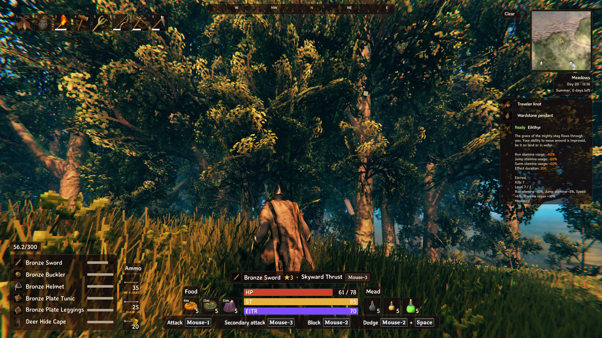
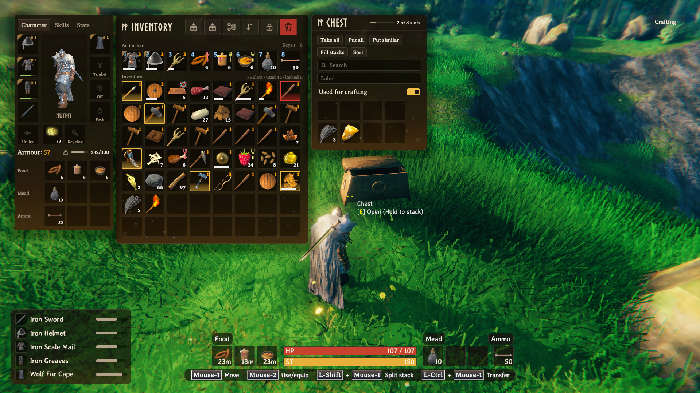
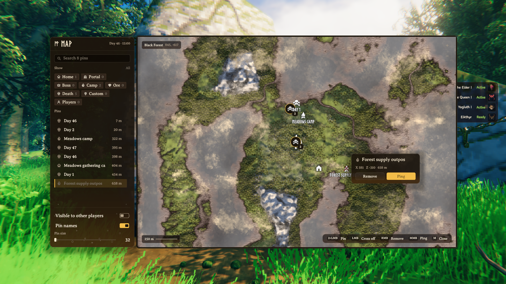
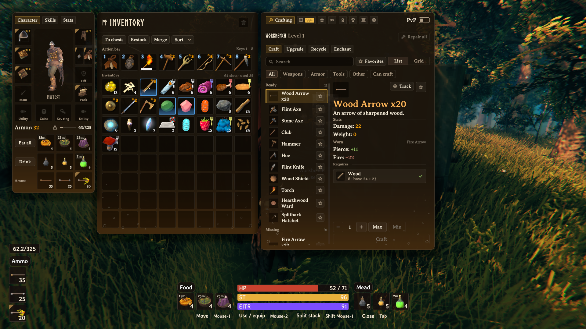
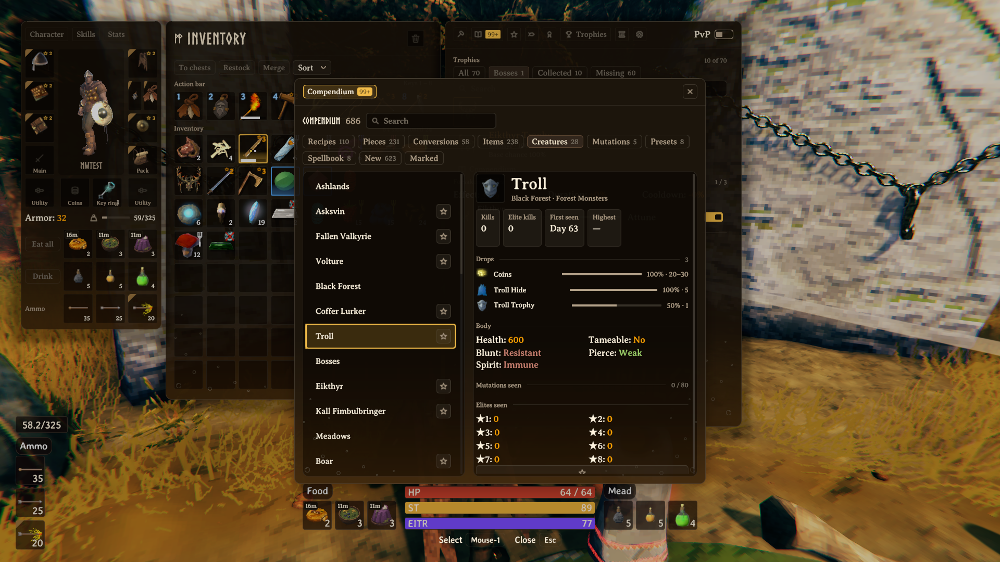
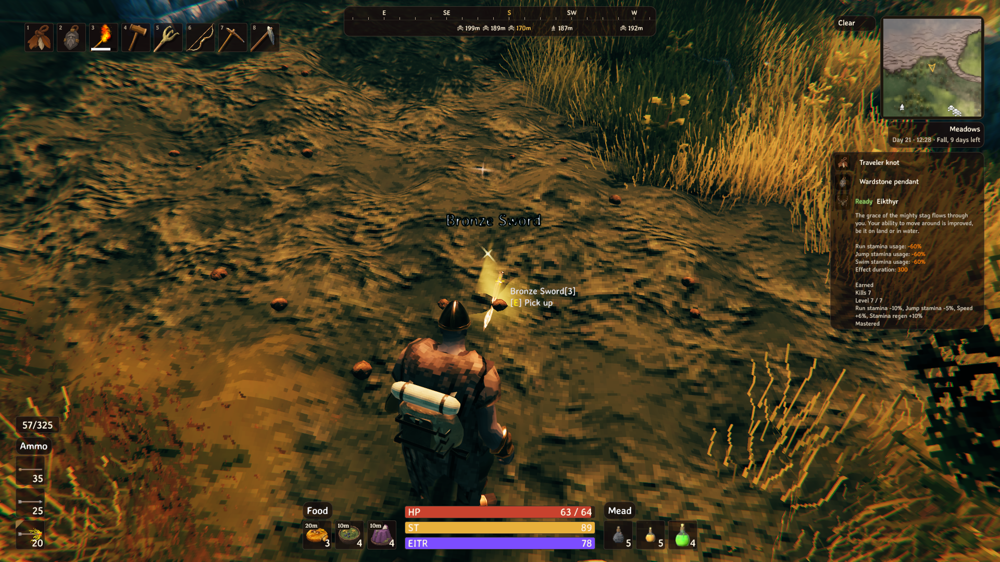
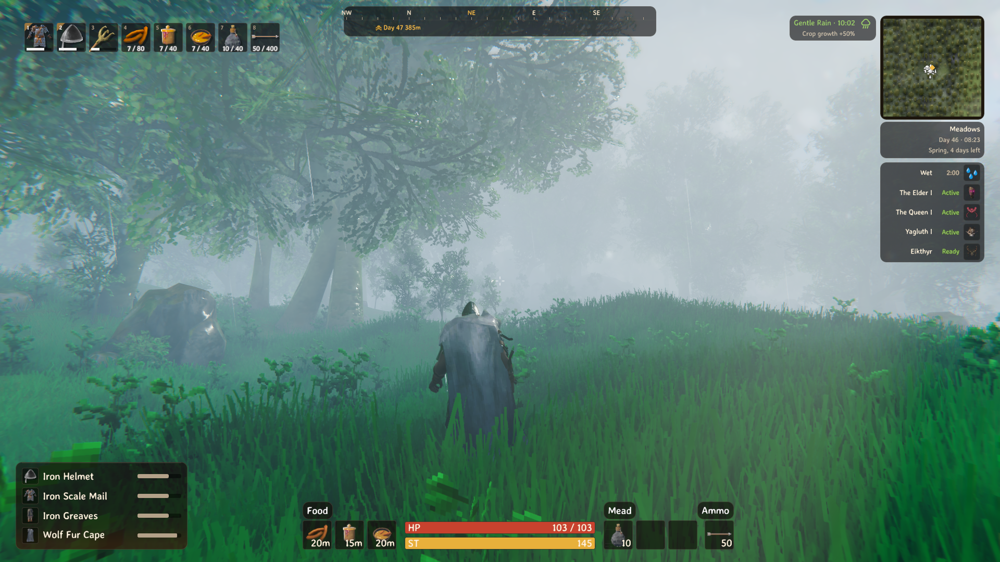

# MeadWorks

A suite of Valheim mods built on one shared Core. Every module has its own page in the MeadWorks menu (F8), and its settings are on that page.

Version 1.0.7. Back up your worlds and characters before adding any mods, and report problems in Issues.

## Modules

| Module | What it adds | Install on |
|---|---|---|
| **Core** (required) | Settings menu (F8) with search and per-setting Admins/Everyone permissions, MeadWorks HUD and compass, restyled windows, campfire character select, world and server picker, loading screens, Compendium, character backups and item recovery | Everyone |
| **Equipment** | 22 weapons, ward shields, wands, spells, robes, trinkets and packs; dual wield and secondary moves; rarity, 122 bonuses, gems and sockets, enchanting; loot glow and biome chest loot | Everyone |
| **Creatures** | Tougher elites with 131 mutations, 13 new creatures, bosses with rotating aspects and shared loot, hordes, nameplates and damage numbers | Everyone |
| **Inventory** | The inventory screen, bigger bags and stacks, food, mead and ammo slots, two trinkets, COINS and KEY RING, shared chests with restock and sort, auto pickup, keep-on-death choices, grave recovery | Everyone |
| **World** | Four seasons, 34 biome weather effects with forecasts, sleep without moving spawn, status timers kept across logout, trophy auras | Everyone |
| **Crafting** | Craft, build and repair from nearby chests, search, favorites and queues, recycling and enchanting, build camera, station automation, shelter and doors | Each player |
| **Farming** | Grid planting up to 10 by 10, wild plants, area harvest, growth timers, giant crops, hoe brush | Each player |
| **Skills** | Passive powers and mastery, achievements, trophies and texts, skill gain feed, food slots and vitals tuning | Each player |
| **Cheats** | Solo, host and admin tools: spawning, heal and repair, god, ghost, fly, free building; safe stamina and loot multiplier; cheats affect only the player who turns them on | Each player |
| **Dungeons** | Burial chambers and sunken crypts reset with larger layouts and an entrance countdown; loot chest refill; camp and dungeon respawn | Server |
| **Travel** | Full map with a side panel, pin search, filters and groups; portal destinations and access; owned beds, parked boats and carts | Each player |

Everyone means the server and every player. Each-player mods also go on the server so the admin's settings and permissions apply. Server means the dedicated server, or the host's game.

### Client and server

- **Core** on a server makes it required on every player who joins. A player without it, or whose suite version or MeadWorks install does not match, is disconnected. A player with MeadWorks can join a server without it; server settings, permissions and server-sent content then stay off, and the player's own settings apply. Other mods do not stop a player with MeadWorks from joining a MeadWorks server. The version check trusts the version a client reports: a mod cannot verify a client's files, so it stops wrong or mismatched installs, not a modified client that reports a matching version.
- **Equipment** adds new items. Install it on the server and on every player, or players without it will see missing items.
- **Creatures, Inventory and World** work best on everyone. Without them on the server, server-controlled settings and server-side parts such as weather don't run. Without them on a player, that player doesn't see the feature.
- **Crafting, Farming, Skills, Cheats** are per player. Put them on the server too so the admin's settings and permissions apply.
- **Dungeons** runs where the world runs: the dedicated server, or the host's game.
- **Travel** draws the map and handles quick portals on each player. Install it on the server too to set portal settings for everyone; map and weather settings stay personal.

Each setting has a permission, Admins or Everyone, chosen in game. On a server, Admins settings use the server's values while you are connected, and your own values come back when you leave. Solo players and hosts are never locked out of a setting.

## Screenshots

| | |
|---|---|
|  |  |
|  |  |
|  |  |

Every module's page below has more.

| Module | Page |
|---|---|
| Core | [Core/README.md](Core/README.md) |
| Inventory | [Inventory/README.md](Inventory/README.md) |
| Crafting | [Crafting/README.md](Crafting/README.md) |
| Equipment | [Equipment/README.md](Equipment/README.md) |
| Farming | [Farming/README.md](Farming/README.md) |
| Skills | [Skills/README.md](Skills/README.md) |
| Creatures | [Creatures/README.md](Creatures/README.md) |
| Dungeons | [Dungeons/README.md](Dungeons/README.md) |
| World | [World/README.md](World/README.md) |
| Travel | [Travel/README.md](Travel/README.md) |
| Cheats | [Cheats/README.md](Cheats/README.md) |

## Install

**With r2modman or Thunderstore Mod Manager.** Install MeadWorks Core and the modules you want; BepInExPack Valheim comes with them.

**By hand.** Install [BepInExPack Valheim](https://thunderstore.io/c/valheim/p/denikson/BepInExPack_Valheim/) first. Then unzip `MeadWorks-Core-<version>.zip` and the modules you want into `BepInEx/plugins/MeadWorks/<Module>/`.

Items in dedicated slots, backpack rows, the coin purse and bag stacks above the game's normal sizes are saved in the character's own item list, split to the game's normal stack size. Without MeadWorks they drop at your feet the first time the character loads, and you decide what to keep. An item only MeadWorks adds, such as a backpack, stays in the character file and returns when MeadWorks is installed again.

Chests and graves are saved in the game's own format: stacks are split to the game's normal size and wide chests use extra rows, so a game without MeadWorks loads them with nothing cut. Items that format cannot hold, such as items only MeadWorks adds, are kept with the world and come back when MeadWorks is installed again. Save the world with MeadWorks before removing it.

## License

MIT. Copyright (c) 2026 expDARE.
