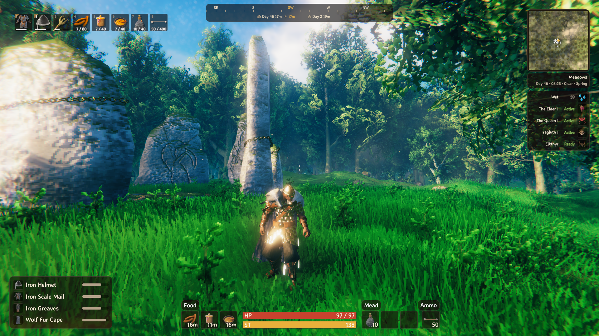
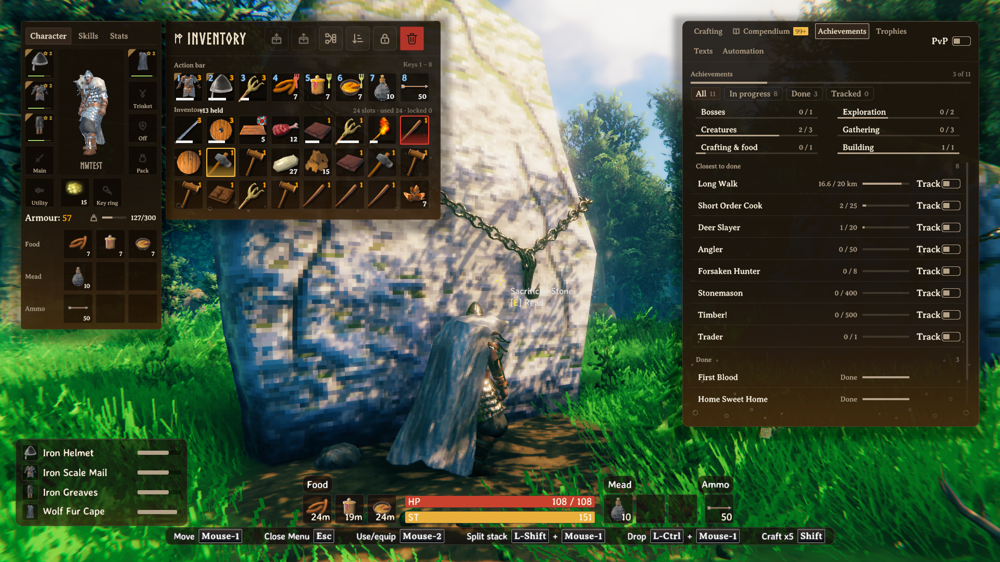
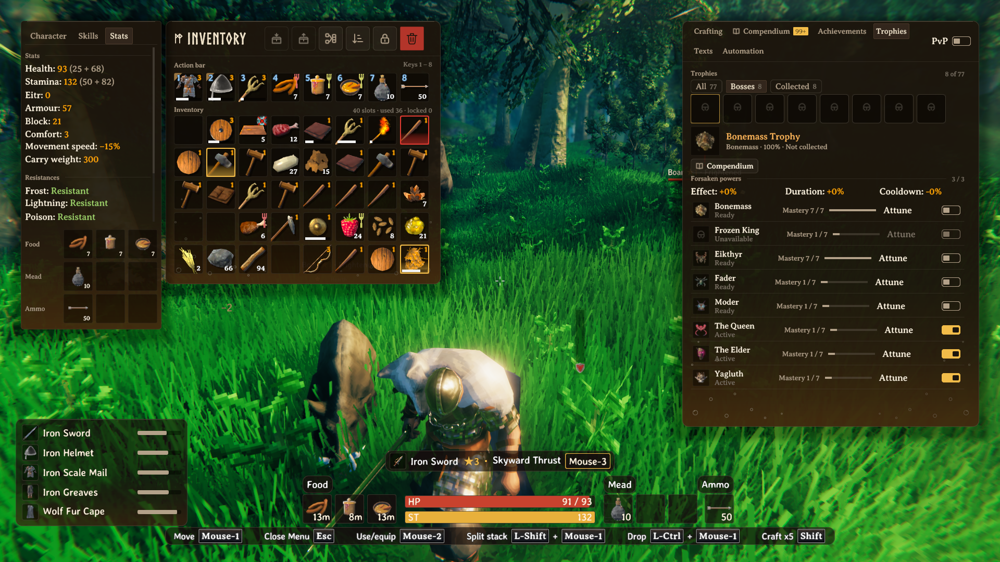
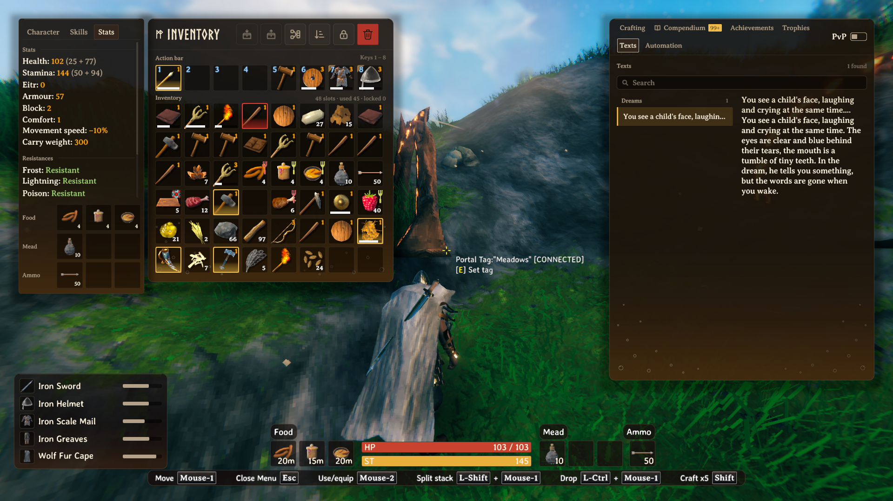

# MeadWorks Skills

The Forsaken powers work all the time and grow with every defeat of their boss. The inventory gains tabs for achievements, trophies and texts. Settings are on the Skills page of the MeadWorks menu (F8). Needs Meadworks: Core at exactly the same version.

## What it does

### Passive Forsaken powers
Every Forsaken power you have earned works all the time, not only while it is the power you picked at the altar. A boss counts for you when you are within the kill credit range as it dies. On a server, the server checks that the boss died where the report says before it counts.

- **Attuning.** Open the Trophies tab of the inventory and switch Attune on or off for each power. You can attune up to the Attuned power limit at once (3 by default). Attuning one more releases the one you attuned first. A limit of 0 removes the limit. A power row says Attuned or Not attuned on its own. The power you picked at the altar also says Ready, or counts down its cooldown.
- **Mastery.** Each power has seven levels. Level 1 is the power itself. Each further defeat of its boss, counted for your character, raises the level by one, up to level 7. Hover a power in the Trophies tab or an attached boss trophy at its stone to see whether you have earned it, your kills, its level, the bonuses you have now and what the next level adds, an active buff's tooltip shows that same level and those bonuses, and its HUD row shows the level after the power's name with those bonuses under it. While a power's buff is active, its Trophies power row also shows the buff's own details. This works while the crafting window covers the HUD effects column. Mastery bonuses come on top of the power:

| Power | Level 2 | Level 3 | Level 4 | Level 5 | Level 6 | Level 7 |
| --- | --- | --- | --- | --- | --- | --- |
| Eikthyr | Run stamina -5% | Jump stamina -5% | Speed +3% | Run stamina -5% | Stamina regen +10% | Speed +3% |
| The Elder | Woodcutting speed +10% | Mining speed +10% | Tool stamina -5% | Woodcutting speed +10% | Mining speed +10% | Tool stamina -5% |
| Bonemass | Health regen +5% | Poison resist 50% | Health regen +10% | Stagger -5% | Poison resist 100% | Health regen +15% |
| Moder | Frost resist 50% | Swim speed +5% | Frost resist 100% | Swim stamina -10% | Cold stamina regen +10% | Swim speed +10% |
| Yagluth | Eitr regen +5% | Magic resist +10% | Eitr regen +10% | Eitr +1/s | Magic resist +15% | Eitr regen +15% |
| The Queen | Health regen +5% | Carry weight +25 | Poison resist 50% | Eitr regen +5% | Carry weight +50 | Health regen +10% |
| Fader | Damage +3% | Health, stamina and eitr regen +5% | Damage +3% | Carry weight +25 | Health, stamina and eitr regen +5% | Damage +3% and all resist +10% |
| Frozen King | Frost resist 50% | Cold stamina regen +5% | Frost resist 100% | Health regen +5% | Speed +3% | Frost resist 100% and health regen +10% |

A tool that both chops and mines gets the larger of its two bonuses, never both.

- **Effects list.** With Passive powers HUD on, your passive powers are rows in your active effects, each with the power's icon and name, in the game's own order. An attuned power reads Active. The power you picked at the altar reads Ready or counts down its cooldown. Each row shows the power's mastery level after its name and, on a smaller line under it, the bonuses it gives you now, such as "Health regen +15%, Poison resist 100%".
- **Strength.** Mastery bonuses are always at full strength. Which earned powers act is the Attune switch on the Trophies tab.

### Saved with the character
- **Attunements.** Your attunements are saved in the character file, so they follow it to any world or server. An earned power is attuned by default. When you go over the limit, the one attuned first is released, and switching a power off and on again makes it the newest.
- **Mastery.** Each power's kill count is saved on the character too, with a receipt for each counted boss death, so one death never counts twice.
- **On a server.** The server checks boss kill credit and controls the attune limit. A stricter server limit releases the oldest excess attunements; earned mastery remains, and you can attune those powers again when the limit allows it. Passive Forsaken powers is a personal switch.

### Existing characters
The first time Skills loads a character, a Forsaken power it already holds from the game counts as earned at level 1. Each defeat after that adds one level. Earlier kills are not counted back from the game's statistics. A power you had switched off under the old passive settings starts unattuned on each character.

### Admin
Grant all, for a solo player, the host or an admin, gives your own character every boss power and leaves mastery you already earned in place. Reset progression clears that character's mastery counts, attunement choices and kill receipts, and it asks first. Both leave the game's own powers and the world's boss progress alone. There is no per-boss give or reset.

### Skill gains
With Show skill gains on, a skill that reaches a new level adds one row to the pickup feed: the skill, the progress that filled the level, and the percent left to the next level. The row keeps adding while that skill levels again before it fades. Experience that stays inside the same level is quiet. The game's own level-up message still appears. The row reads the skill after the game has applied the gain, so a skill raised on the way to something else is included. The rows show while Pickups and skill gains is on.

### Progressive powers
Forsaken powers grow with your progress. For each boss defeated beyond the one that grants the power (any boss that grants a guardian power counts, Hildir's minibosses do not), the power lasts longer, its effects get stronger and its cooldown gets shorter. The percentages per boss are Advanced settings, and the Forsaken powers list on the Trophies tab shows the Effect, Duration and Cooldown bonus you have now. The powers that grant a resistance (Bonemass, Yagluth) or sailing control (Moder) grow only in duration and cooldown, because their effect has fixed steps.

### Inventory tabs
Three tabs sit in the inventory's tab row. The Skills tabs in the inventory switch shows or hides all three.

- **Achievements.** Six categories (Bosses, Exploration, Creatures, Gathering, Crafting & food and Building), each with its progress. Filter by All, In progress, Done or Tracked, and switch Track on for up to three unfinished achievements. The ones you track stay on the character and show under Tracked on the HUD. Finishing one leaves a short completion line, then drops it. Tracking a fourth releases the one you tracked first.
- **Trophies.** Every trophy you can collect, with filters for All, Bosses, Collected and Missing, and a search box. A trophy you have not collected stays unnamed in search, unless it is a boss you have already seen. Choose a collected trophy to see its name, where its creature lives and its base drop chance. With Creatures installed, a button opens the creature's page. The Forsaken powers with their Attune switches are below the trophies.
- **Texts.** The runestones, the raven's messages and the dreams you have found, in groups with a search box. Reading a runestone records where it stands, and Show on map marks it in that world. Texts found earlier without a place stay listed until you read them again.

The Inventory skills key opens the inventory on the Achievements tab. It has no key by default; set one on the Keys page. It does nothing while you are dead, teleporting or in a menu, and if the inventory is already open it only switches the tab.

## Vitals

The Vitals section of the Skills page changes how fast stamina and eitr come back, what actions spend, what food gives, and the health and stamina you have before food. Every slider starts on the game's own number. Leaving it there changes nothing. The server sets these for everyone; a solo player and the host still choose their own.

## Settings

Press F8 and open the Skills page. Every setting row has a hover tip describing its effect. A setting marked Advanced is under the Advanced row of the page. The Vitals rows sit together in the Vitals section.

| Name | Default | Policy | What it does |
| --- | --- | --- | --- |
| Passive Forsaken powers | On | Personal | The Forsaken powers you have attuned work all the time, with the mastery bonuses you have earned. |
| Kill credit range | 50 | Server controlled | How near you must be when a boss dies to be counted in the kill, in meters (10 to 200). Advanced. |
| Attuned power limit | 3 | Server controlled | How many passive powers can be active at once (0 to 9; 0 is no limit). Advanced. |
| Grant all | Grant | Solo / host / admin action | Gives your character every boss power. Mastery you earned stays. Solo players, hosts and admins can use it. |
| Reset progression | Reset | Solo / host / admin action | Clears this character's boss mastery, attunement and kill receipts after you confirm. Solo players, hosts and admins can use it. |
| Passive powers HUD | On | Personal | Lists your passive powers among your effects on the HUD. |
| Show skill gains | On | Personal | Shows a row when a skill reaches a new level. The game's level-up message stays. |
| Catch up | On | Server controlled | A skill below its highest level trains twice as fast until it is back there. Death still takes the game's own share. |
| Progressive powers | On | Server controlled | A Forsaken power grows with every boss defeated beyond the one that grants it. |
| Effect per boss, % | 10 | Server controlled | How much stronger a power's effect gets for each further boss, in percent (0 to 50). Advanced. |
| Duration per boss, % | 10 | Server controlled | How much longer a power lasts for each further boss, in percent (0 to 50). Advanced. |
| Cooldown cut per boss, % | 5 | Server controlled | How much shorter a power's cooldown gets for each further boss, in percent (0 to 20). Advanced. |
| Inventory skills key | None | Personal | Opens the inventory on its Achievements tab. |
| Skills tabs in the inventory | On | Personal | Adds the Achievements, Trophies and Texts tabs to the inventory. |
| Stamina regen | 1 | Server controlled | How fast stamina comes back, times the game's rate (0 to 3). Advanced. |
| Regen delay | 1 | Server controlled | How long stamina and eitr wait before they start coming back, times the game's wait (0 to 3). Advanced. |
| Eitr regen | 1 | Server controlled | How fast eitr comes back, times the game's rate (0 to 3). Advanced. |
| Run stamina | 1 | Server controlled | How much stamina running spends, times the game's cost (0 to 3). Advanced. |
| Jump stamina | 1 | Server controlled | How much stamina jumping spends, times the game's cost (0 to 3). Advanced. |
| Dodge stamina | 1 | Server controlled | How much stamina dodging spends, times the game's cost (0 to 3). Advanced. |
| Swim stamina | 1 | Server controlled | How much stamina swimming spends, times the game's cost (0 to 3). Advanced. |
| Sneak stamina | 1 | Server controlled | How much stamina sneaking spends, times the game's cost (0 to 3). Advanced. |
| Block stamina | 1 | Server controlled | How much stamina blocking spends, times the game's cost (0 to 3). Advanced. |
| Base health | 25 | Server controlled | Health before food, in health points (1 to 200). The slider rests on the game's own base. Advanced. |
| Base stamina | Native player base (50 in the current game) | Server controlled | Stamina before food, in stamina points (1 to 300). The slider rests on the game's own base. Advanced. |
| Attack stamina | 1 | Server controlled | How much stamina a weapon attack spends, times the game's cost (0 to 3). Advanced. |
| Tool stamina | 1 | Server controlled | Multiplies stamina spent on building and attacks marked as home items by the game, such as hammer or hoe work (0 to 3). Advanced. |
| Food health | 1 | Server controlled | Food health multiplier (0.05 to 3). Advanced. |
| Food stamina | 1 | Server controlled | Food stamina multiplier (0 to 3). Advanced. |
| Food eitr | 1 | Server controlled | Food eitr multiplier (0 to 3). Advanced. |
| Food duration | 1 | Server controlled | How long a food lasts, times the game's time (0.05 to 3). Advanced. |
| Eat again | 0.5 | Server controlled | The share of a food's time still left at which it can be eaten again (0 to 1). 0.5 is halfway. Higher means sooner. Advanced. |
| Food slots | 3 | Server controlled | How many foods can be eaten at once (1 to 5). 3 keeps the game's own food row. Advanced. |

Server-controlled settings use the server's values while connected. Solo players, hosts and admins retain edit access. HUD, inventory tabs, keys and the passive-power switch are personal.

## Known limits
- Food scaling applies to the foods in the game, on the ground and in players' inventories. Foods stored in a chest, and foods that another mod adds later, can keep their old values until the next time the values are applied. If another mod also changes food values, the later change can be overwritten.
- Attack and Tool stamina scale the final equipment cost without changing weapon data. Weapon tooltips still show the unscaled attack cost.

- Skill gain rows use the pickup feed. They stay hidden while Pickups and skill gains is off.
- Catch up stores each skill's highest level on the character. Resetting that skill, or a world that clears skills, forgets it. Death still uses the game's own loss.
- Texts found before this version have no place recorded. They stay under Texts until you read them again, and Show on map works for runestones read since.
- A power the game does not have in this world shows as Unavailable and takes no attunement slot.
- A food already eaten picks up a new food multiplier on its next tick, about a second later.
- Food slots above 3 draw a MeadWorks row of food icons. At 1 to 3 the game's own row is left as it is. Lowering the count, or removing the mod, leaves every saved food on the character.

## Compatibility

Needs MeadWorks Core at the same suite version. MeadWorks clients can join servers without MeadWorks and can use other mods on MeadWorks servers. Joining is refused only for a missing, wrong-version or mismatched MeadWorks install on a MeadWorks server. Release builds ship no console commands.

## Install

Install with a mod manager, or put `meadworks.skills.dll` in `BepInEx/plugins`. Install Core as well. Install on each player who wants it, and on the server for admin settings and locks.

## License

MIT. Copyright (c) 2026 expDARE.
