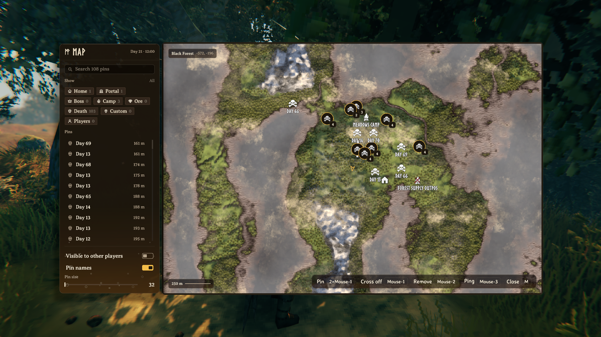
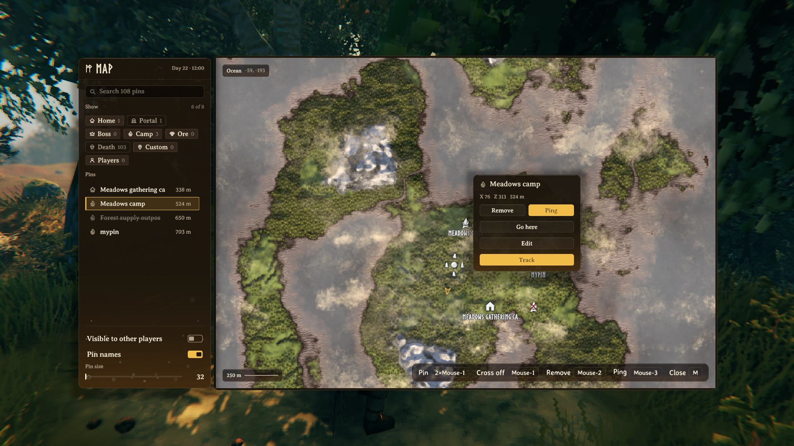
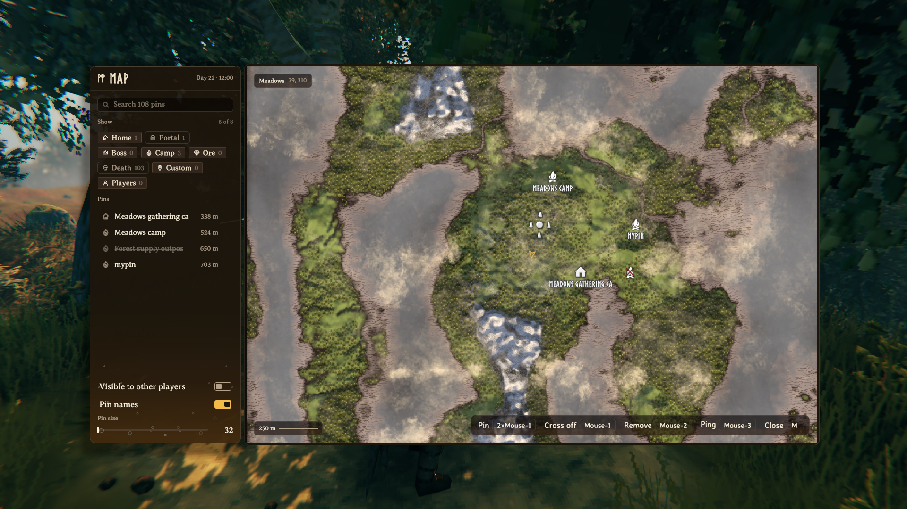
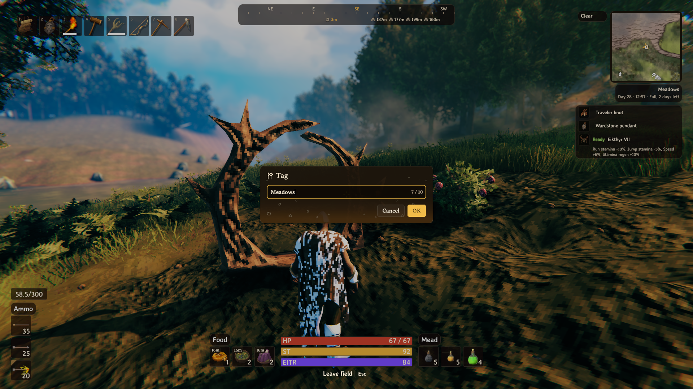
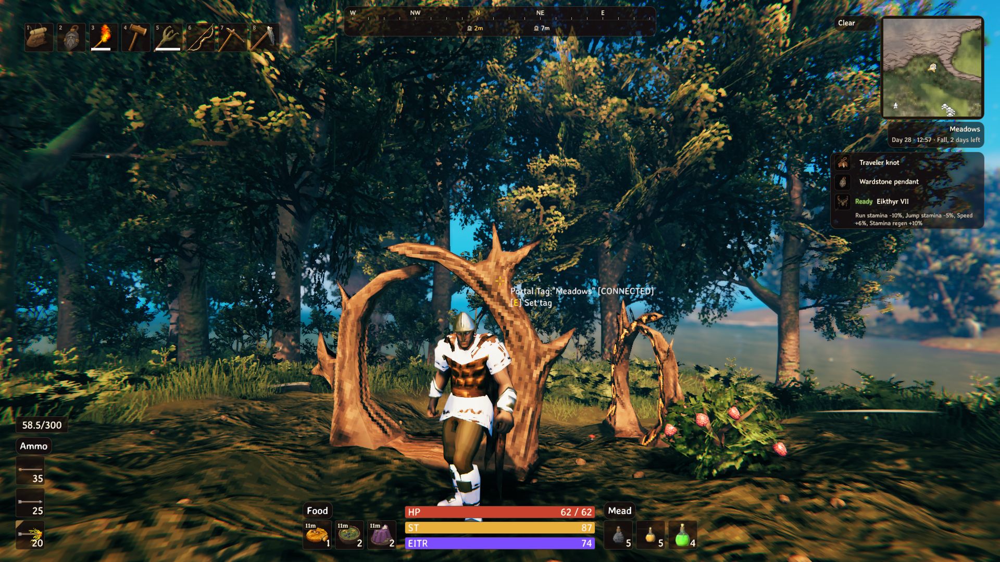

# MeadWorks Travel

A searchable full map, selectable portal destinations, transport markers and a weather line under the minimap. Configure the module on the Travel page of the MeadWorks menu (F8). Needs Meadworks: Core at exactly the same version.

## What it does

### The full map
The full map has a side panel, and the map fills the rest of the screen inside one frame.

- The panel has a search box, a chip for each kind of pin (Home, Portal, Boss, Camp, Ore, Death, Custom and Players) with the number of pins of that kind, the pins listed nearest first, and three options: Visible to other players, Pin names and Pin size.
- A chip shows or hides its kind of pin. A kind that is off still counts its pins.
- A click on a row in the list centers the map on that pin. A crossed-off pin is struck through.
- Double click places a pin and opens a small box for its name and icon. A click on a pin shows its name, position and distance, with Ping and Remove.
- Edit on that card changes the name and icon of a pin you placed. Checked-off pins stay checked off, and a shared pin keeps its owner. Cancel leaves the pin as it was.
- Undo brings back the last pin removed from the card or with right click. Only the latest removal is kept, and it lasts until you leave the world.
- Track marks one pin. It is drawn in gold, slightly larger, on the map and the minimap, and its name stays visible. Track again, or Stop tracking, clears it. The last grave is unchanged. Core also keeps the tracked pin on the compass at any distance, ahead of ordinary nearby pins.
- Map pin travel is off by default. Turn it on to give players **Go here** on visible pin cards. The trip checks the world’s portal rules, including boss fights that block portals, carried items and whether you are on a ship or cart. It uses the game’s teleport loading and floor checks.
- With Map pin travel off and Cheats loaded, an eligible player can use the Cheats **Go here** action and then **Return** in the Cheats window’s Player tab. The return point lasts for the current world session.
- The biome and the position under the pointer show over the map, with zoom buttons, a scale line and a strip that names the map's clicks and keys.
- The game's own clicks and keys work as before.

### Fewer pins when zoomed out
Your ordinary pins hide once the map is zoomed out past a point you set, so a map full of pins stays readable. Pins you have crossed off always stay. The pin you are placing, naming or picking from the list stays in sight.

### Pin clusters
Pins that overlap on screen fold into one badge with their most common icon and a count, and their names hide. Zooming out merges more of them; zooming in splits them, and fully zoomed in every pin shows. Pointing at a badge lists its pins nearest first; pointing at a row brings that pin out with its name, clicking the badge keeps the list open and clicking a row zooms to that pin. Where the names of nearby pins would overlap, one name shows: the selected pin first, then your own pins, then the nearest.

### Weather and clock
A line under the minimap shows the day and time, with the name of the environment actually applied to the local player. Native Rain shows Rain rather than Clear. With World, it also shows the season, using a separate row when it would be wider than the minimap, and the next native or MeadWorks forecast such as `Next: Gentle Rain in 4:10`. The current weather name shows here only when a MeadWorks environment is not applied; World shows that weather and warnings in its panel to the left.

### Portals, boats and carts
A portal you have been near shows its tag on the map and the minimap. A boat or cart you built, sailed or pulled shows where you left it, with the game's icon and its name. A label set on that vehicle is used when it has one. The mark updates when you leave the vehicle or it unloads, and it is removed if the vehicle is destroyed. These marks last for the current world and are not written into the map save. Transport markers, on the Travel page, turns them on or off.

Claimed beds you have seen get their own Owned bed pins. Travel remembers them with your character for that world and clears stale pins once it can confirm the bed was destroyed or changed owners.

### Ships and paved roads
On board, the HUD can show ship speed and hull health. Ship propulsion and Ship steering both start at 1, the game's usual sail, paddle and rudder response. Logging out aboard a ship remembers your spot on its deck. When the ship can be found and loaded on your next login in that world, you return to that spot, even if it moved. Otherwise the game uses its normal login point.

The Paved-road bonus (%) defaults to 10. Jog and run faster and use less running stamina while on paved ground. The bonus does not apply on floors, aboard ships, while swimming or in the air.

### Picking a portal
Step into a portal and the full map opens with a mark on each portal open to you. Click a mark, or a row in the panel, to go there. Tags no longer pair portals: any portal can send you to any other one you are allowed to use, and its tag is simply what it is called on the map and in the list.

- The panel has a search box and lists your favorites, then the remaining portals from nearest to farthest with their distances. The star on a row marks a favorite; favorites are saved with your character, separately for each world, and their marks carry a gold ring.
- The world’s usual restrictions on portal cargo still apply. The black screen and the delay before a portal can be used again are the base game's, and Quick portals sets the wait.
- Close the map and nothing happens. Being moved away from the portal also closes it.
- A portal has one of three access settings. Public, which a freshly built portal has, is open to all players. Private is for its owner alone, plus solo players, the host and admins. Admin is for admins alone.
- A portal's owner is the account that built it, so every character on that account owns it. The server notes the owner when the portal is built.
- A portal that already stood before the server first ran this version of Travel has no owner. It stays Public, and only a solo player, the host or an admin can change its access. Build it again to own it.
- The panel shows the access of the portal you are standing in. Its owner can switch it between Public and Private there, and an admin can choose any of the three for any portal.
- While the map is open the list keeps itself current: a portal that someone closes, opens, builds, renames or removes shows up as it is within a few seconds.
- A portal closed to you is left off the list, stays dark, and shows the game's no-access text when you step into it. Its hover text names the access setting when that is not Public.
- In multiplayer the server or host keeps its own record of every portal's owner and access, and approves each trip and each access change from that record. Travel must be installed on the server for this. Without it there, portals behave as in the base game and you can still join.
- When picking a destination, the departure respects wards around the source. In solo and for the listen host, a ward over the landing spot can also refuse the trip, even if that area is unloaded.
- Portal travel, on the Travel page, chooses between Pick on map and the base game's Tag pairing, and in multiplayer the world uses the server value. When an admin keeps the setting at Admins and chooses Tag pairing, players use the game’s matching-tag portals and portal access modes are off.
- The host or an admin can open Portal management with Manage on the Travel page to search the portal list, change access or assign a new owner by account ID.
- Portal pieces from other mods are included: anything carrying the game's portal component is listed.

### Quick portals
Portal waits rise with distance. A fully loaded destination can skip the black screen and use a wait starting at 0.5 seconds. A trip needing loading keeps the black screen and the game's two-second delay before placement, then holds at the destination for 0.5 seconds nearby, rising to the native six-second hold at 10,000 meters (eight seconds total). Ground and objects must still pass the game's checks; loading can take longer and the native 15-second floor fallback stays unchanged. These timing gates are the same solo and on a dedicated client.

Skipping the fade also requires five seconds of uninterrupted residence in the destination's reference zone and its surrounding active, loaded sectors. Newly entered areas and destinations outside that area keep the black screen for the whole trip.

Portal effects starts at 50% and scales fire, light, hum and swirl. At 0% those effects are off. At 100% they are at the game’s usual strength.

### Keys and clicks
Travel binds no keys of its own.

| Input | What it does |
| --- | --- |
| Double click on the map | Places a pin and opens its name and icon box. |
| Click a pin | Shows its name, position and distance, with Ping, Remove, Edit, Track and Undo. |
| Click a row in the pin list | Centers the map on that pin. |
| Click a chip | Shows or hides that kind of pin. |
| Step into a portal | Opens the map with a mark on each portal open to you. |
| Click a portal mark or a portal row | Starts the trip to that portal. |
| Click the star on a portal row | Adds that portal to your favorites, or takes it out. |

## Settings

Press F8 and open the Travel page. Every setting row has a hover tip describing its effect. A setting marked Advanced is under the Advanced row of the page.

| Name | Default | Default permission | What it does |
| --- | --- | --- | --- |
| Portal travel | Pick on map | Admins | Pick on map: stepping into a portal opens the map and you choose where to go among the portals open to you. Tag pairing: base-game portals, linked two by two through matching tags. |
| Portal management | | Host or admins | Opens Manage to search portals and change access or ownership. |
| Quick portals | On | Everyone | Scales portal waits with distance and keeps the game's loading checks. Skipping the black screen needs a fully loaded destination and five seconds in its reference zone. |
| Shortest portal wait | 0.5 | Everyone | Minimum wait, or minimum hold after placement on loading trips (0.1 to 8 seconds, capped at the native hold). Loading can take longer. |
| Far portal range | 10,000 | Everyone | The distance in meters at which the game's full wait applies (100 to 20,000). |
| Portal effects | 50% | Everyone | Scales portal fire, light, hum and swirl from 0% (off) to 100% (the game's normal effects), in steps of 5%. |
| Ship propulsion | 1 | Admins | Multiplies each ship's sail and paddle force, from 0.5 to 2 (1 keeps its original force). |
| Ship steering | 1 | Admins | Multiplies each ship's rudder response and steering force, from 0.5 to 2 (1 keeps its original steering). |
| Paved-road bonus (%) | 10 | Admins | Increases jog and run speed and reduces running stamina use on paved terrain by this percent (0 to 20; 0 disables it). |
| Restyle full map | On | Everyone | Draws the full map with the MeadWorks side panel: search, filters and the list of pins. Off gives the game's own map back. |
| Show Home pins | On | Everyone | Shows Home pins on the map. Advanced. |
| Show Portal pins | On | Everyone | Shows Portal pins on the map. Advanced. |
| Show Boss pins | On | Everyone | Shows Boss pins on the map. Advanced. |
| Show Camp pins | On | Everyone | Shows Camp pins on the map. Advanced. |
| Show Ore pins | On | Everyone | Shows Ore pins on the map. Advanced. |
| Show Death pins | On | Everyone | Shows Death pins on the map. Advanced. |
| Show Custom pins | On | Everyone | Shows Custom pins on the map. Advanced. |
| Show Players pins | On | Everyone | Shows other players on the map. Advanced. |
| Map pin names | On | Everyone | Writes the names of pins on the map. |
| Map pin size | 48 | Everyone | How large pins are drawn on the map, in pixels (32 to 64). |
| Map pin travel | Off | Admins | Adds Go here to visible pin cards on the restyled map. The world's portal restrictions apply. |
| Hide pins beyond zoom | 0.15 | Everyone | Hides your ordinary pins once the map is zoomed out past this point. Lower hides them sooner; 1 never hides them. Pins you have crossed off always stay. |
| Cluster map pins | On | Everyone | Pins that overlap on screen are drawn as one badge with a count. |
| 24-hour clock | On | Everyone | Shows the time as 14:30 rather than 2:30 PM. |
| Transport markers | On | Everyone | Shows a discovered portal's tag, and the last place you left a boat or cart you built or used. |

The chips in the side panel set the same switches as Show Home pins and the rest. MeadWorks syncs settings. The host or an authorized admin can set each settings row to Admins or Everyone in game. Portal travel, Map pin travel, Ship propulsion, Ship steering and Paved-road bonus (%) use a world-wide value under either permission. Other rows use each player’s own value under Everyone and the server value under Admins. Solo players can edit every row.

## Known limits

- Hide pins beyond zoom affects only the five ordinary pin icons. Boss, portal, death, player and other special pins keep their own rules.
- The weather line is one of the minimap text lines. It shows only while the MeadWorks HUD and its Minimap text switch are on, both on the HUD page.
- Players, pings, shouts, event areas and area pins are never grouped.
- Tracking keeps one destination on the map, minimap and compass. It leaves the last-grave marker unchanged.
- Picking a portal needs the map. In a world played without one, portals pair by tag as in the base game, and a pair that includes a portal closed to you stays shut.
- The portal picker is used with the mouse.
- Ownership follows the account as the server sees it. An account that plays the same world once over Steam and once over crossplay, or hosts it and later joins it on a dedicated server through crossplay, may be seen as two owners.
- Transport markers are remembered for the current world only. A boat or cart you have not built, sailed or pulled is not marked.

## Compatibility

Needs MeadWorks Core at the same suite version. MeadWorks clients can join servers without MeadWorks and can use other mods on MeadWorks servers. Joining is refused only for a missing, wrong-version or mismatched MeadWorks install on a MeadWorks server. Release builds ship no console commands.

## Install

Install with a mod manager, or put `meadworks.travel.dll` in `BepInEx/plugins`. Install Core as well. Install on each player who wants it, and on the server for shared settings and portal access.

## License

MIT. Copyright (c) 2026 expDARE.
