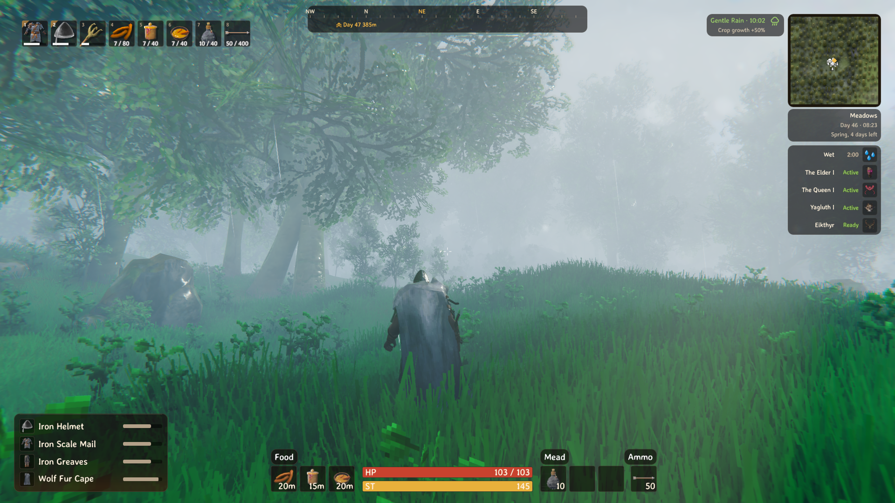
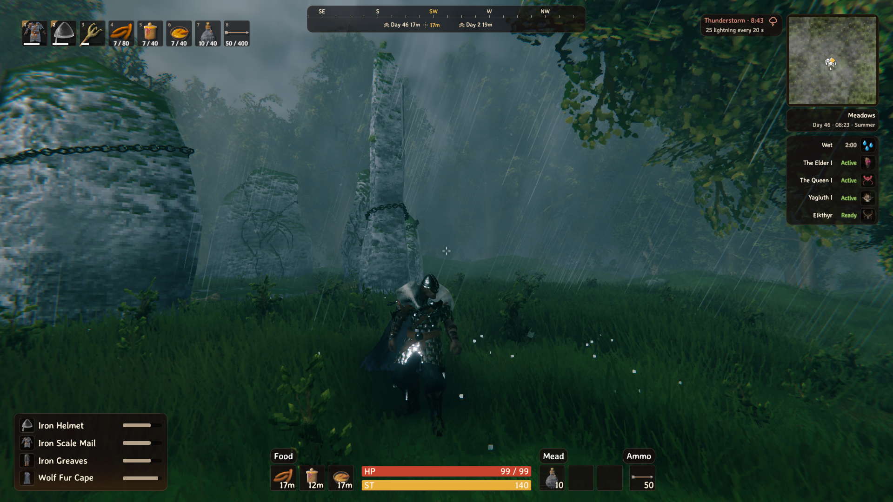
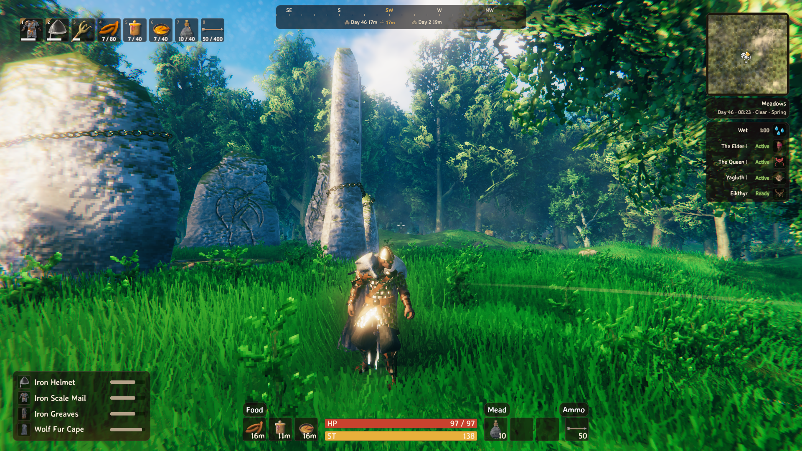
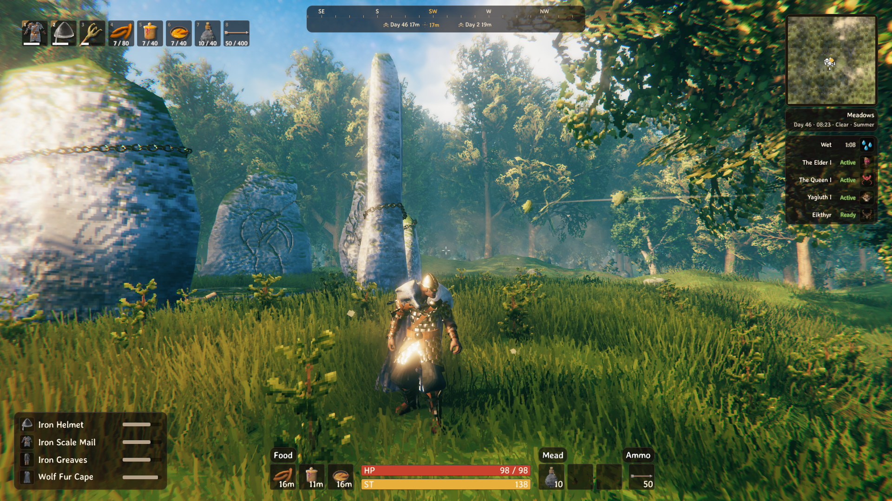
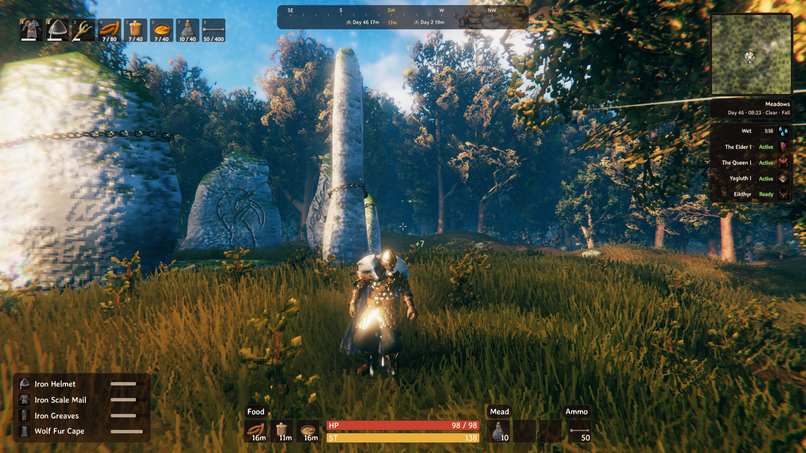
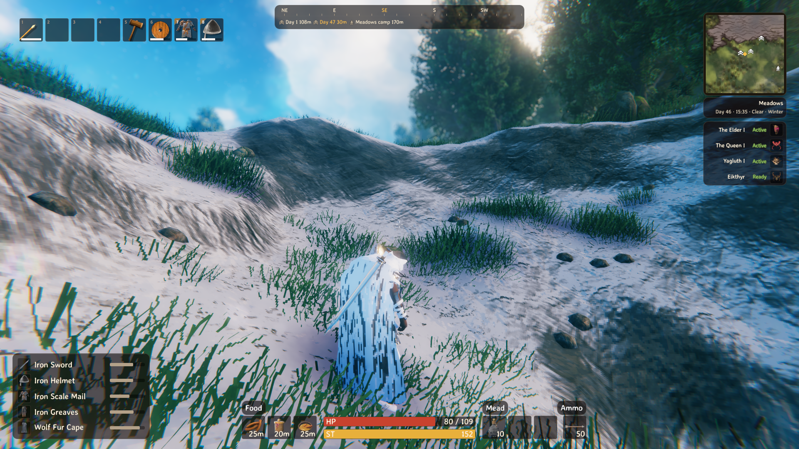

# MeadWorks World

Seasons and weather, new looks for each season, beds and altars, and smoother play on servers. Configure the module on the World page of the MeadWorks menu (F8). Needs Meadworks: Core at exactly the same version.








## What it does

### Seasons
The world moves through Spring, Summer, Fall and Winter. The season comes from the world day, so every player sees the same one. Days per season is 10 by default, and Start season sets the season of the first day. With Season changes on sleep on, a new season begins only once the night has been slept through. Season override holds the world in one season. The line under the minimap's biome ends with the season and, by your choice, the days left, the day of the season, days and hours, a countdown or nothing, such as "Day 36 · 15:45 · Winter, 4 days left". When that would make the line wider than the minimap, the season gets its own line.

- **Winter cold.** In winter you are Cold outdoors, and Freezing at night. Fires, shelter and resistances work as in the game, and a lit torch from Equipment still keeps the cold off. It does not apply indoors, in dungeons or in the Ashlands.
- **New season notice.** The first morning of a new season shows one center message, such as "Summer begins". Joining an existing season or holding a Season override does not announce it again.
- **Crop growth.** Crops take 1.0 times as long to grow in spring, 0.8 in summer, 1.0 in fall and 2.0 in winter. Winter slows growth without stopping it. The four multipliers are Advanced settings.

### What a season changes
With Seasonal modifiers on, each season can change production, harvests, fuel use, native weather weights, raids, trader stock and daylight. Empty lists use the built-in profile below. Explicit entries replace the built-in value for that season; for example, `Winter=1` restores the native rate in that category. MeadWorks weather has separate built-in seasonal weights. A list is written as `Season=value` pairs with commas between them, such as `Winter=0.5, Summer=1.2`.

- **Production speed.** Smelters, furnaces, kilns, spinning wheels, windmills, fermenters, beehives and cooking stations work faster or slower. A fermenter batch keeps the length it started with.
- **Harvest yield.** Berries, mushrooms, herbs and other pickables give more or less. Tree and rock drops are not changed.
- **Fuel burn rate.** Fires, cooking stations and the smelter family burn fuel faster or slower.
- **Weather weights.** Makes kinds of weather more or less likely, as pairs such as `Winter=Snow:3`.
- **Raid chance and raid events.** Each raid lasts a random 3-10 minutes, chosen by the server and shared with everyone. How likely raids are, and which raids can come in each season. `-name` removes a raid. A list can only narrow the raids the game would roll.
- **Trader stock.** What Haldor and Hildir sell in each season, as `Season=item:price` entries. `-item` removes an item.
- **Night length and light.** How long nights are in each season, how bright each season is, and the color of its light as `RRGGBB`. Nights last at least half their usual length.

### Season looks
Ground, terrain and foliage take the season's colors, and the minimap follows them. Spring shows fresher, denser grass. Summer shows a warm haze on clear days that thins as the game's own fog thickens. Winter covers the ground and plants in snow, thins the grass, and frosts the gear you wear, up to the late-Fall level. Winter water looks icy, with ice floes for show; you cannot walk on it. Seasonal tint turns all of that on together, and the ground takes the season's full color.

The built-in season values:

| | Spring | Summer | Fall | Winter |
| --- | --- | --- | --- | --- |
| Days | 10 | 10 | 10 | 10 |
| Crop growth time | 1 | 0.8 | 1 | 2 |
| Ground tint | #C4FF9C | #FFEC9A | #FF9650 | #FFFFFF |
| Ground lift | #061200 | #120A00 | #000000 | #000000 |
| Foliage tint | #DDFFC8 | #FFDA90 | #FFB070 | #A0B4D0 |
| Grass tint | #B4FF9C | #FFD080 | #FFA860 | #D0DCEE |
| Harvest yield | 1 | 1 | 1 | 1 |

### Built-in season profile

| Rate or duration | Spring | Summer | Fall | Winter |
| --- | --- | --- | --- | --- |
| Crop growth and station production rate | 1 | 1.25 | 1 | 0.5 |
| Honey production rate | 1.25 | 1.5 | 0.75 | 0.25 |
| Fuel burn rate | 1 | 0.9 | 1.1 | 1.5 |
| Night length | 1 | 0.75 | 1.1 | 1.4 |
| Raid chance | 0.5 | 0.5 | 0.625 | 0.375 |
| Raid interval | 1.5 | 1.5 | 1.5 | 1.5 |

Rates multiply progress: summer production takes 0.8 times the native duration. Honey uses its own rate, without multiplying the station rate a second time. `Season production speed` entries override stations, honey, and crop growth for the named season. Crop growth time sliders remain duration overrides when no production entry or file preset applies. Existing configured values are retained. Crops and bees continue working in winter. Built-in raids halve the previous seasonal chance and wait 69 minutes between rolls (native 46 minutes); explicit raid-list entries retain their existing chance and interval scaling.

Night length defaults multiply native night seconds within the same world day. Dawn and the native sleep target stay fixed; the world clock, day counter, planting timestamps, and fermenter timestamps are unchanged. `Season night ratio` remains the existing night-to-daylight ratio override. Harvest yield, trader stock, raid event selection, and lighting stay native until configured. Seasonal modifiers off restores native station, honey, fuel, raid, and night behavior; crop growth has its own toggle.

### Season presets
**Quick start.** Copy `default.json` in `BepInEx/config/MeadWorks/seasons`, give the copy a new name, change the values you want, then type that name, without `.json`, into Season preset. To read the file again after an edit, pick `Built-in` and then the preset again.

A JSON file per preset, in `BepInEx/config/MeadWorks/seasons/*.json`, holds each season's ground, foliage and grass tints, production speed, harvest yield, fuel burn, weather weights and length in days. The Advanced Season preset setting picks one by its file name without `.json` (case does not matter). `Built-in` keeps the built-in values and the list settings. A `default.json` with the built-in values is written once as a template. A file that is missing, over 64 KiB, not valid, or too large to sync (about 4000 characters once packed) logs one warning and the Built-in preset applies.

On a server, the chosen preset's content is synced to every client and replaces the client's own choice. A client uses only content it received from the server in the current session, holds the Built-in values from the moment it connects until it arrives, and never reads a file named by the server. A synced preset that does not parse falls back to the Built-in preset on every peer alike. A client whose World build speaks a different preset format is refused when it joins, instead of silently running other values than the server. A player or server without World is not refused. Solo players and the host choose freely.

The current season display is a text line; custom season-icon PNGs are not displayed on the HUD. Presets customize colors and rates, without replacing terrain or foliage textures.

### Weather
Weather effects adds the MeadWorks weather on top of the game's own, with a warning before severe weather. Weather frequency defaults to 0.5, leaving about 20 minutes of normal weather between events. Configs still at the old 1.0 default move to 0.5 once; edited values stay. Events use a 10-minute base length, with each weather's existing proportion preserved (8 to 16 minutes); Fimbulwinter remains permanent background weather. Each weather has its own look using the game's particles, fog, lighting, wind or aurora, blended in and out with the game's environment transitions and restricted to its biomes. Hailstorm, Monsoon, Thunderstorm, Bog Surge and Rogue Swell make you Wet outdoors; the other weathers leave the biome's own wetness, and windy weathers raise the wind.

The host or dedicated server rolls a separate schedule for each biome occupied by connected players, including players whose position is private on the map. Players in the same biome share its weather; players in different biomes can have different weather. Reconnecting keeps the biome's current weather and forecast. Empty biomes do not roll new weather. The game's own per-biome environments and regional overrides still apply.

With Seasons on, built-in weights favor Heatwave, Dust Storm, Prairie Fire and Clear Skies in summer, rain and thunderstorms in spring and fall, fog and gales in fall, and snow, hail and frost in winter. Heatwave has zero winter weight. Severe storm weights are multiplied by 0.35 and beneficial weights by 1.5; storms are capped at 0.75 so they never outweigh a beneficial event. The unseasoned catalog mix is roughly one storm in eight events; biome, time and season change the actual mix. These defaults need no list or new setting; the Season weather weights list and presets continue to adjust the game's own environment weights separately.

The panel beside the minimap shows `Next: Gentle Rain in 4:10` for the next environment selection, native or MeadWorks, including benign weather. A MeadWorks look returning to native weather forecasts the native biome selection at that time, rather than assuming Clear. Native forecasts use the game's period seed, biome entries and seasonal weights; the forecast is hidden if that selection reads the same as the current weather, including Clear Skies returning to native Clear and either Thunderstorm variant. Countdowns use shared world time, without timer messages over the network. Severe warnings remain limited to the last three minutes. A MeadWorks forecast is recalculated if its time, season or boss-fight requirements no longer allow it when it is due; unpredictable forced or regional overrides hide the forecast.

Severe weather approaching or beginning in your biome gives one center-screen message and the game's warning sound for each stage, remembered per character across relogs.

Current weather names come from the environment actually applied by EnvMan, including transitions and overrides. Native Rain displays Rain and native ThunderStorm displays Thunderstorm, even when no MeadWorks weather is active. MeadWorks environment clones use their catalog names. Missing environment data does not become Clear. The weather panel also shows native weather without advertising MeadWorks effect bonuses over it.

While a MeadWorks weather is on where you stand, a panel left of the minimap shows its icon, its name and the time left, red for severe weather and green for good weather, with one line for each thing it changes, such as "Move speed -10%" or "3 blunt every 5 s". Weather only shows in the biomes it belongs to. Before severe weather the same panel counts down, such as "Blizzard in 0:45", with what it will change. The current weather name appears once, in the side block; the caption leaves out that name while the block is visible. A warning is not repeated as a forecast, and unchanged weather is not forecast as a new arrival. Rows wrap to their measured height. Sleeping advances the day and season while preserving the current weather and its remaining time.

- **Fishing Wind** halves a wandering fish's wait before it approaches a fishing float in its biomes. It does not shorten an approach already underway.
- **Rich Fog** gives one more of the item for each pickable picked where it is on, crops included.
- **Fair Sailing** gives ships under sail 25% more sail force.
- **Dead Calm** halves the sail force of ships under sail; rowing is unchanged.
- **Gale** slows you by 10% and gives ships under sail 25% more sail force.

Weather effects are limited to the listed biomes. Damage ticks apply outdoors without shelter; armor and resistances still apply. Severe weather gives three minutes of warning and does not start during a nearby boss fight. Fimbulwinter is the Deep North's background weather when no other local MeadWorks weather is active.

| Weather | Biomes | Effects |
| --- | --- | --- |
| Heatwave | Meadows, Plains | Hot in the open: stamina regeneration -20%, no Cold or Freezing. Shade, shelter or Wet clears Hot; Wet dries twice as fast outdoors. Bleached sunlight, warm haze and heat shimmer. |
| Dust Storm | Plains, Mountain | Move speed -10%, running stamina cost +10%, dense fog. |
| Hailstorm | Meadows, Black Forest, Mountain | 3 blunt damage every 5 s. |
| Fog Bank | Swamp, Black Forest | Dense gray fog, movement noise -40%. |
| Blizzard | Mountain, Deep North | Cold outdoors, dense fog. |
| Monsoon | Swamp, Meadows | Stamina regeneration -10%. |
| Aurora Night | Mountain, Deep North, Meadows | Suppresses Cold, Rested duration +25%. |
| Ember Storm | Ashlands | 4 fire damage every second. |
| Spore Drift | Swamp, Mistlands | 1 poison damage every 2 s, plant growth time halved. |
| Gale | Meadows, Plains, Ocean | Move speed -10%, sail force +25%. |
| Deep Snow | Deep North | Move speed -18%, running stamina cost +15%. |
| Helbreath | Deep North | Freezing outdoors, 2 frost damage every second. |
| Fimbulwinter | Deep North | Freezing outdoors, stamina regeneration -25%, 3 frost damage every 5 s. |
| Hoarfrost Fog | Deep North, Mountain | Cold outdoors, dense fog. |
| Glimmerfrost | Deep North, Mountain | Stamina regeneration +10%, movement noise +15%. |
| Morning Dew | Meadows | Plant growth speed +10%, movement noise -10%. |
| Thunderstorm | Meadows, Black Forest, Swamp | 25 lightning damage every 20 s; Wet raises lightning damage by 50%. |
| Gloomfall | Black Forest | Dark forest fog. |
| Bog Surge | Swamp | Move speed -15%. |
| Rimesleet | Mountain | Cold outdoors and Freezing at night. |
| Prairie Fire | Plains | 3 fire damage every 3 s. |
| Arcmist | Mistlands | 8 lightning damage every 20 s; Wet raises lightning damage by 50%. |
| Ashfall | Ashlands | Stamina regeneration -10%, dense fog, movement noise -20%. |
| Brimstone Rain | Ashlands | 5 fire damage every 3 s. |
| Dead Calm | Ocean | Sail force halved; rowing is unchanged. |
| Rogue Swell | Ocean | Running stamina cost doubled. |
| Gentle Rain | Meadows, Black Forest | Plant growth speed +50%. |
| Fishing Wind | Ocean, Meadows | Halves the wandering wait before fish approach a nearby float. |
| Brisk Air | Plains, Mountain | Stamina regeneration +25%, move speed +10%. |
| Clear Skies | Meadows, Plains | Rested duration +50%. |
| Rich Fog | Swamp, Black Forest | One extra item per pickable harvest, including crops. |
| Northerly Calm | Deep North | Suppresses Cold, stamina regeneration +20%. |
| Fair Sailing | Ocean | Sail force +25%. |
| Eitr Mist | Mistlands | Eitr regeneration +40%. |

### Beds, altars and trophies

- **Dry Wet near torches.** Lit player-built standing torches, wall sconces and braziers dry Wet at the campfire rate within the native campfire heat radius. Multiple fires do not stack the drying rate.
- **Sleep without setting spawn.** Use an unclaimed bed, another player's bed, or your own old bed to sleep without changing ownership or your spawn point. Hold the game's alternate-use binding while using an unclaimed or your own bed to claim it or set spawn normally, including on gamepad. Hover text distinguishes Sleep (spawn unchanged), Claim, and Set spawn. Daytime use never silently claims a bed. Native time, enemies, shelter, fire, and Wet checks still apply.
- **Players in bed to skip night (%).** The server chooses 1 to 100%, default 100% (native behavior). The count rounds up: 50% of three connected players needs two in bed. A center line shows `2 of 3 in bed`. Below 100%, players outside beds stay awake; if players leave bed or join and the threshold is no longer met during a skip, the skip stops at its current time. A canceled skip does not settle Season changes on sleep.
- **Status effects across logout.** Rested, Wet, and poison keep their remaining duration in character data, including across worlds. Poison also keeps its remaining damage and tick timer. Offline time does not run these timers. Existing effects are not stacked or refreshed. Death clears the saved effects.
- **Sleep near torches.** A sheltered bed can use a nearby lit, player-built standing torch, wall torch or brazier as its fire, including colored and iron variants. The range matches the campfire's heat radius. This is always on; torches gain no warmth or comfort, and all other sleep requirements still apply.
- **Altar offerings from inventory.** A boss altar takes its offering straight from your inventory when you use it.
- **Trophy auras.** A supported trophy on an ordinary item stand gives a bonus to players near it. Trophy aura radius sets how near. The strongest aura per kind applies, with three auras at most; each status tooltip states its effect. Attachment and stand lifecycle events track trophies; moving into or out of range updates the selected bonuses. Sacrificial guardian-power stands do not grant auras. Elder has no aura: its former entry advertised a wood bonus that was never implemented.
- **Raid banner.** A raid shows its name and the time left under the compass.

| Trophy | Aura |
| --- | --- |
| Eikthyr | Run speed +5% |
| Bonemass | Poison resistance |
| Moder | Frost resistance |
| Yagluth | Fire damage +5% |
| Queen | Stamina regeneration +10% |
| Fader | Fire resistance |
| Deer | Move speed +5% |
| Boar | Health regeneration +5% |
| Neck | Stamina regeneration +3% |
| Greydwarf | Stamina regeneration +5% |
| Troll | Carry weight +15 |
| Draugr | Health regeneration +7% |
| Wolf | Run speed +3% |
| Lox | Carry weight +21 |
| Seeker | Stamina regeneration +7% |

### Smoother play on servers
On a server you have joined, far-away things unload 25 at a time so the game does not stutter. It does nothing for a solo player or the host, and there is no setting for it.

These are off unless noted, and they are Advanced.

- **Release objects of disconnected players** (on): when a player leaves, the creatures, boats, carts and open chests their game was running are freed at once, so nothing stays frozen or stuck.
- **Prioritize ZDO updates per player**: the server sends each player the changes that matter most to them first.
- **Filter dungeon layer updates**: the server sends players outside a dungeon less about what is inside it, and players inside less about what is outside.
- **Raise Steam send rate and queue headroom**: lets the game send more data each second, for smoother play with many players or large bases.
- **Negotiated Steam compression**: compresses what is sent between players whose games both have it on.
- **Coalesce tiny movement updates**: leaves out very small movements until they add up.

### Raids

Raids last a server-chosen 3-10 minutes. Built-in seasonal pacing reduces raid frequency and chance. Troll raid creatures require Bonemass defeated in the world and, for player-based raids, by the spawning player. With Creatures installed, raid elites require the spawn biome boss defeated and are limited to one per raid across waves, peers and save/reload.

## Preset format

One JSON object per preset file. Every field is optional: a missing field keeps the built-in value, a number outside its safe range is clamped, a season whose value is not an object is ignored, and a file that is not valid JSON, is nested deeper than 8 levels or is over 64 KiB logs one warning and the Built-in preset applies.

```json
{
  "name": "default",
  "seasons": {
    "Spring": {
      "days": 10,
      "ground": "#C4FF9C",
      "ground_lift": "#061200",
      "foliage": "#DDFFC8",
      "grass": "#B4FF9C",
      "production": 1.0,
      "yield": 1.0,
      "fuel": 1.0,
      "weather": { "Clear": 1.0 }
    }
  }
}
```

- `seasons` holds one object per season, named Spring, Summer, Fall or Winter. The exact spelling wins, and a differently cased key is used only when the exact one is absent; a repeated key takes its last value.
- `days` is that season's length in world days, clamped to 1-60.
- `ground`, `ground_lift`, `foliage`, `grass` are RGB hex tints (`#RRGGBB`), the same values the seasonal tint uses; `ground` is the terrain multiply and `ground_lift` its additive lift.
- `production`, `yield`, `fuel` are the season multipliers for station work speed, harvest drops and fuel burn, clamped to 0.1-5 like the list settings.
- `weather` maps a term to a weight multiplier; every environment whose name contains the term is bent by it, clamped to 0.1-5.

While a preset file is active its values replace the built-in palettes, the Season production speed, Season harvest yield, Season fuel burn rate and Season weather weights lists and the Days per season setting. Choose `Built-in` to go back to those settings. A missing or invalid file means `Built-in`, so those settings keep applying. The host runs the same packed values as its clients, so a production of `0.1234` is `0.123` for everyone.

Switching preset in a running world changes the season lengths at once. The season is worked out from the world day and the lengths, so the current season and day can jump, and winter cold can start or stop on the spot. A preset file is read when the choice changes: pick `Built-in` and then the preset again to re-read an edited file.

Raid creatures cannot gain elite levels or mutations until the boss of their spawn biome is defeated (native world keys). After that, at most one creature per raid can become an elite, shared across spawn waves and peers and retained across a save/reload. Unknown biomes remain plain.

Troll raid creatures, including troll variants, require Bonemass to be defeated in the world. With player-based raids, the spawning player must also have defeated Bonemass. Other creatures in mixed raids keep their existing requirements. Severe-weather warning and start alerts use the native distant thunder clip Thunder10 locally at 40% volume for 2 seconds, fading out over the last 0.3 seconds. The game's SFX volume applies. If the clip is unavailable, the original short cue plays instead.

## Settings

Press F8 and open the World page. Every setting row has a hover tip describing its effect. A setting marked Advanced is under the Advanced row of the page. Server controlled settings use server values for clients; solo players, the host and admins can change them. Personal settings affect your own game. No rows on this page use an optional server lock.

| Name | Default | Policy | What it does |
| --- | --- | --- | --- |
| Seasons | On | Server controlled | The world moves through spring, summer, fall and winter. |
| Days per season | 10 | Server controlled | How long a season lasts, in in-game days (1 to 60). |
| Start season | Spring | Server controlled | The season the world's first day falls in. Advanced. |
| Season changes on sleep | Off | Server controlled | A new season begins only once the night has been slept through. |
| Season override | Off | Server controlled | Holds the world in one season. Off lets the seasons run. Advanced. |
| Season time left | Day of season | Personal | How the time left in the season is written: days left, day of the season, days and hours, a countdown, or not at all. Advanced. |
| Winter cold | On | Server controlled | In winter you are cold outdoors unless a fire, shelter or warm gear keeps you warm. |
| Season crop growth | On | Server controlled | Crops grow faster or slower with the season, taking twice as long in winter by default. |
| Spring growth time | 1 | Server controlled | Multiplies how long crops take to grow in spring. 1 is the game's own time (0.25 to 3). Advanced. |
| Summer growth time | 0.8 | Server controlled | The same for summer. Advanced. |
| Fall growth time | 1 | Server controlled | The same for fall. Advanced. |
| Winter growth | 2 | Server controlled | The same for winter: crops take twice as long by default (0.25 to 3). Advanced. |
| Seasonal modifiers | On | Server controlled | The season changes production, harvests, fuel use, weather, raids, trader stock and daylight. |
| Season production speed | empty | Server controlled | Overrides crop, station, and honey rates by season; empty uses the built-in profile. Advanced. |
| Season harvest yield | empty | Server controlled | How much pickables give, as Season=multiplier pairs. Advanced. |
| Season fuel burn rate | empty | Server controlled | Overrides built-in fuel burn rates by season. Advanced. |
| Season weather weights | empty | Server controlled | Makes kinds of weather more or less likely in a season, as pairs such as Winter=Snow:3. Advanced. |
| Season raid chance | empty | Server controlled | Overrides built-in raid chance by season. Advanced. |
| Season raid events | empty | Server controlled | Which raids can come in each season, as Season=name\|name entries. -name removes a raid. Advanced. |
| Season trader stock | empty | Server controlled | What traders sell in each season, as Season=item:price entries. -item removes an item. Advanced. |
| Season night ratio | empty | Server controlled | How long nights are in each season, as Season=number pairs. Above 1 is longer, below 1 shorter, 0.5 at the least. Advanced. |
| Season light brightness | empty | Server controlled | How bright each season is, as Season=number pairs. 1 is normal. Advanced. |
| Season light tint | empty | Server controlled | The color of the light in each season, as Season=RRGGBB pairs. Advanced. |
| Season preset | Built-in | Server controlled | The name of the season preset file in use. Built-in keeps the values on this page. Advanced. |
| Season preset data (synced) | empty | Server controlled | The season preset the server sends to its players. The server fills it in; leave it as it is. Advanced. |
| Seasonal tint | On | Personal | Tints the world in the colors of the season. Spring shows fresh grass, summer a haze, and winter snow and icy water. Advanced. |
| Weather effects | On | Server controlled | Adds seasonal weather per occupied biome and a forecast in the weather panel and minimap line. |
| Weather frequency | 0.5 | Server controlled | Multiplies how often that weather comes (0.25 to 3). Advanced. |
| Raid banner | On | Personal | Shows a raid's name and the time left under the compass. |
| Sleep without setting spawn | On | Server controlled | Sleep in any bed without changing spawn; alternate use claims or sets spawn. |
| Players in bed to skip night (%) | 100 | Server controlled | Percent of connected players needed, rounded up (1 to 100). |
| Claim beds without a roof | On | Server controlled | Claiming a bed sets your spawn point without shelter, while sleeping still needs shelter. Advanced. |
| Trophy auras | On | Server controlled | A trophy on an item stand gives a small bonus to players near it. |
| Trophy aura radius | 10 | Server controlled | How near a trophy you must be for its bonus, in meters (1 to 30). Advanced. |
| Player limit | 10 | Server controlled | Maximum players after the next world start, from 1 to 64 (crossplay keeps its native limit of 10). |
| Reduce distant player cloth | On | Personal | Reduces cloth simulation and offscreen animation for idle players more than 60 meters away while keeping full animation nearby and during attacks. |
| Release objects of disconnected players | On | Server controlled | When a player leaves, the creatures, boats, carts and open chests their game was running are freed at once. Advanced. |
| Keep recent terrain loaded | Off | Personal | Keeps terrain from up to four long visits or recent deaths loaded briefly while pieces and creatures still unload at their usual range. Advanced. |
| Arrival object budget (ms) | Native (0) | Personal | Targets this many milliseconds of object creation per scene update during loading screens and teleports (0 to 8; 0 keeps the native schedule). Advanced. |
| Prioritize ZDO updates per player | Off | Server controlled | The server sends each player the changes that matter most to them first. Advanced. |
| ZDO maximum priority wait (seconds) | 5 | Server controlled | After this many seconds unsent, a change moves up the queue (1 to 30). Advanced. |
| ZDO priority distance boost (meters) | 100 | Server controlled | How much closer things count as when they are in a fight, just changed or matter to a player, so they are sent sooner (0 to 500). Advanced. |
| Filter dungeon layer updates | Off | Server controlled | The server sends players outside a dungeon less about what is inside it, and players inside less about what is outside. Advanced. |
| Always sync prefabs | `Player,Player_tombstone,Raft,Karve,VikingShip,VikingShip_Ashlands,Cart,portal,portal_wood,portal_stone,LocationProxy,dungeon_forestcrypt_door,dungeon_sunkencrypt_irongate,dungeon_queen_door,sunken_crypt_gate` | Server controlled | Things that are always sent to every player, as a list of names with commas between them. Advanced. |
| Layer height margin (meters) | 100 | Server controlled | How far past the line between the world and its dungeons something must be before it is held back (0 to 500). Advanced. |
| Layer transition grace (seconds) | 10 | Server controlled | How long everything is still sent after a player goes in or out of a dungeon (2 to 30). Advanced. |
| Other layer maximum deferral (seconds) | 5 | Server controlled | The longest an update from the other level is held back (1 to 30). Advanced. |
| Raise Steam send rate and queue headroom | Off | Personal | Lets the game send more data to other players each second, for smoother play with many players or large bases. Advanced. |
| Steam send rate min (bytes/s) | 153600 | Personal | The lowest rate the game sends at (10240 to 16777216). Advanced. |
| Steam send rate max (bytes/s) | 153600 | Personal | The highest rate the game sends at (10240 to 16777216). Advanced. |
| Steam send buffer size (bytes) | 524288 | Personal | How much data may wait to be sent (2048 to 4194304). Advanced. |
| ZDO queue headroom per peer (bytes) | 10240 | Server controlled | How much data may wait for one player before more is held back (2048 to 1048576). Advanced. |
| Negotiated Steam compression | Off | Personal | Compresses what is sent between players whose games both have it on. Advanced. |
| Compression threshold (bytes) | 256 | Personal | Only messages larger than this are compressed (64 to 65536). Advanced. |
| Coalesce tiny movement updates | Off | Server controlled | Leaves out very small movements until they add up, to save data. Advanced. |

## Known limits

- Frozen water is a look only. You cannot walk on it, and the ice floes are for show.
- The season lists start empty. Production, honey, fuel, raids, and night length use the built-in profile; explicit season entries override it. Yield, native weather weights, traders, and lighting remain neutral until configured. MeadWorks weather uses the built-in seasonal weights above.
- A preset replaces the lists for production, yield, fuel and weather weights and the Days per season setting, but not the raid, trader, night and light lists.
- A preset file is read when you choose it. Choose Built-in and then the preset again to read an edited file.

## Compatibility

MeadWorks clients can join servers without MeadWorks and can use other mods. On a MeadWorks server, only a missing, wrong-version or mismatched MeadWorks installation is refused. Keep Core and the installed MeadWorks modules at the same suite version on the server and its players.

## Install

Install with a mod manager, or put `meadworks.world.dll` in `BepInEx/plugins`. Install Core as well. Install on the server and every player.

## License

MIT. Copyright (c) 2026 expDARE.
